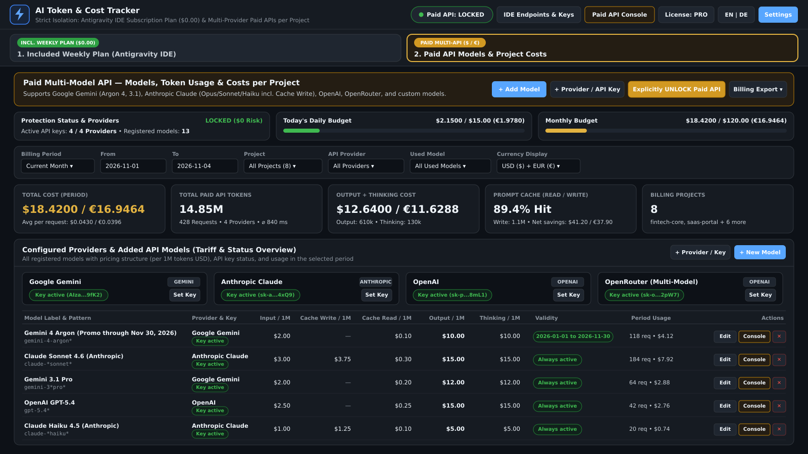
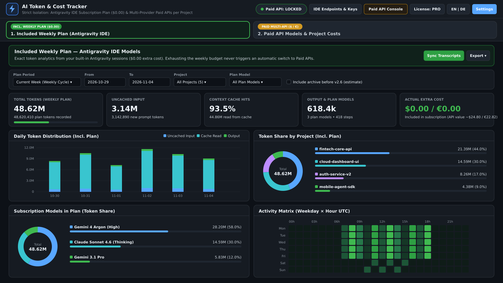
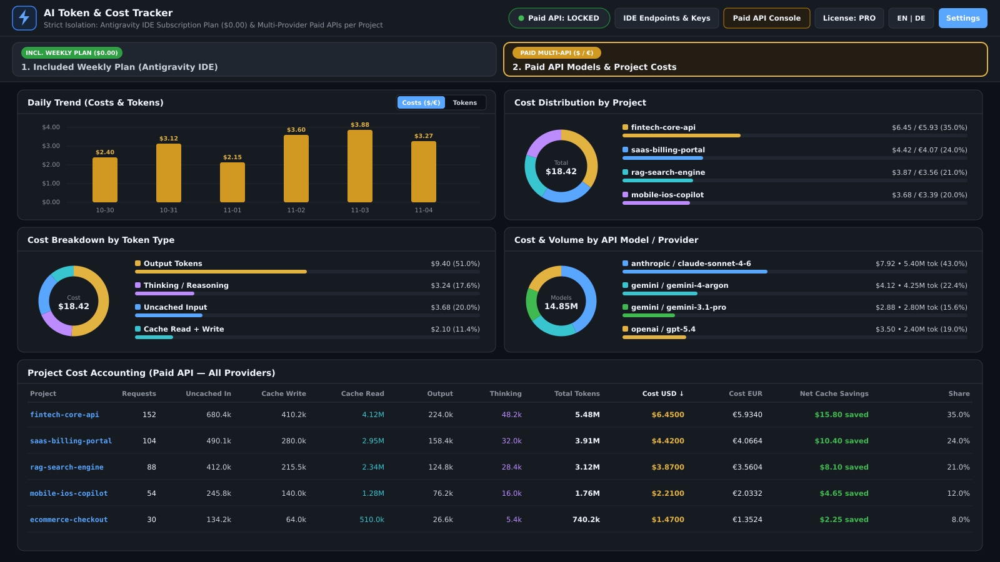
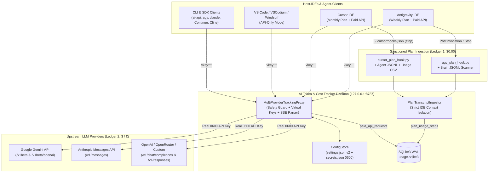

🌐 **Language:** [English](./README.md) | **Deutsch**

# ⚡ AI Token & Cost Tracker v1.1.2

**Multi-Provider LLM API Gateway, projektgenaue Kostenabrechnung & IDE-isolierte Abo-Plan-Analytik**

[](#)
[-3776AB.svg>)](#voraussetzungen--installation)
[](#multi-ide-extension--command-palette)
[-success.svg>)](#projektstruktur-qualitaetssicherung--marketplace-build)
[-critical.svg>)](#sicherheitsarchitektur--zero-trust-garantien)
[](#modern-web-dashboard--accessibility)
[-f59e0b.svg>)](https://buy.polar.sh/polar_cl_2EcUogc92f06pCVToDHs8lhxPJDNi1EBn7P6K1rB7V3)

> **Kurzüberblick:** **AI Token & Cost Tracker** ist ein lokal laufendes Zero-Dependency LLM-Telemetrie-Gateway und Multi-IDE-Add-on für **Antigravity IDE, Cursor, VS Code, VSCodium, Windsurf sowie JetBrains-/CLI-Workflows**. Die Architektur erzwingt eine strikte **Dual-Ledger-Trennung** zwischen **inkludierten IDE-Abonnements (`$0.00` Zusatzkosten)** und **kostenpflichtigen Multi-Provider API-Aufrufen (`USD $` / `EUR €`)** über **Google Gemini (inkl. Gemini 4 Argon), Anthropic Claude, OpenAI, OpenRouter sowie eigene OpenAI-/Anthropic-kompatible Endpunkte** (DeepSeek, Mistral, xAI, Ollama) — inklusive projektgenauer Zuordnung, hartem Budget-Schutzschalter und `chmod 0600` Schlüssel-Isolation.

### Dashboard-Ansichten (`16:9`)







---

## Inhaltsverzeichnis

1. [Überblick & Wertversprechen](#ueberblick--wertversprechen)
2. [Systemarchitektur & Datenfluss](#systemarchitektur--datenfluss)
3. [Strikte IDE-Kontext-Isolation (4 Betriebsmodi)](#strikte-ide-kontext-isolation-4-betriebsmodi)
4. [Sicherheitsarchitektur & Zero-Trust-Garantien](#sicherheitsarchitektur--zero-trust-garantien)
5. [Multi-Provider LLM Gateway & Tarif-Engine](#multi-provider-llm-gateway--tarif-engine)
6. [Voraussetzungen & Installation (Windows, macOS, Linux)](#voraussetzungen--installation)
7. [Multi-IDE Extension & Command Palette](#multi-ide-extension--command-palette)
8. [CLI-Referenz (`tracker-cli` & `ai-api`)](#cli-referenz-tracker-cli--ai-api)
9. [Lokale Proxy-Endpunkte & SDK-/Plugin-Integration](#lokale-proxy-endpunkte--sdk-plugin-integration)
10. [Modern Web Dashboard & Accessibility](#modern-web-dashboard--accessibility)
11. [REST-API & SQLite-Datenbankschema](#rest-api--sqlite-datenbankschema)
12. [Projektstruktur, Qualitätssicherung & Marketplace-Build](#projektstruktur-qualitaetssicherung--marketplace-build)
13. [Lizenzmodell (Free Community Edition vs. Pro / Team Edition)](#lizenzmodell-free-vs-pro--team-edition)
14. [Deinstallation](#deinstallation)

---

<a id="ueberblick--wertversprechen"></a>

## 1. Überblick & Wertversprechen

Moderne KI-gestützte Softwareentwicklung nutzt parallel **inkludierte IDE-Abonnements** (z. B. Antigravity Weekly Plan, Cursor Pro Monthly Plan) und **direkte, nutzungsbasierte API-Schlüssel** (Google Gemini, Anthropic Claude, OpenAI, OpenRouter, DeepSeek). Ohne zentrale Erfassung entstehen drei kritische Probleme:

1. **Intransparente Projektkosten:** API-Rechnungen am Monatsende lassen sich keinem Kundenprojekt oder Repository mehr zuordnen.
2. **Kostenfallen durch stillen Fallback:** Das unbeabsichtigte Umschalten von einem erschöpften Inklusiv-Abo auf einen hinterlegten API-Key verursacht unkontrollierte Kosten.
3. **Kontaminierte Metriken:** Inkludierte Abo-Tokens (`$0.00` Zusatzkosten) und kostenpflichtige API-Requests (`$` / `€`) werden in herkömmlichen Tools vermischt.

**AI Token & Cost Tracker v1.1.2** löst diese Anforderungen durch eine lokal auf `127.0.0.1:8787` laufende **Dual-Ledger-Architektur**:

| Merkmal               | Ledger 1: Inkludierter IDE-Plan (`panel-plan`)                                           | Ledger 2: Paid Multi-Model API (`panel-paid`)                                                                    |
| :-------------------- | :--------------------------------------------------------------------------------------- | :--------------------------------------------------------------------------------------------------------------- |
| **Zusatzkosten**      | **Immer `$0.00` / `€0.00`** (im IDE-Abo enthalten)                                       | **Exakte Abrechnung in `USD ($)` & `EUR (€)`**                                                                   |
| **Datenquellen**      | Lokale IDE-Transkripte (`.jsonl`), offizielle Lifecycle-Hooks & Cursor Usage-CSV-Import  | Lokaler Multi-Provider Tracking Reverse Proxy (`/p/<projekt>/...`)                                               |
| **IDE-Sichtbarkeit**  | Nur in Plan-IDEs (**Antigravity**, **Cursor**) oder als getrennter Umschalter im Browser | In **allen** IDEs (Antigravity, Cursor, VS Code, VSCodium, Windsurf, Browser)                                    |
| **Token-Metriken**    | `Uncached Input`, `Cache Read`, `Output`, `Cache-Hit-Quote (%)`, `Theor. API-Gegenwert`  | `Uncached Input`, `Cache Write (1.25×)`, `Cache Read`, `Output`, `Thinking / Reasoning`, `Netto Cache-Ersparnis` |
| **Schutzmechanismus** | Kein automatischer Wechsel auf Paid API bei Budgeterschöpfung                            | Standardmäßig **`GESPERRT (LOCKED)`** + harte Tages-/Monats-Limits in USD                                        |

---

<a id="systemarchitektur--datenfluss"></a>

## 2. Systemarchitektur & Datenfluss

Das System folgt einer strikten **Ports-and-Adapters-Architektur (Hexagonal Architecture)** ohne externe Laufzeitabhängigkeiten:



---

<a id="strikte-ide-kontext-isolation-4-betriebsmodi"></a>

## 3. Strikte IDE-Kontext-Isolation (4 Betriebsmodi)

Sowohl die IDE-Statusleiste als auch das Dashboard und der Endpunkt `/api/stats/plan` erzwingen eine vollständige Mandantentrennung zwischen den Host-IDEs (`PlanTranscriptIngestor.resolve_ide_context`):

### Modus 1: Antigravity IDE (`ide=antigravity`)

- **Tab 1 — Inkludierter Wochen-Plan (`$0.00`)**: Wertet ausschließlich lokale Antigravity-Konversationen (`~/.gemini/antigravity/brain/*/.system_generated/logs/transcript.jsonl` und `~/.gemini/antigravity-ide/brain/...`) aus. Erfasst exakte `input_tokens`, `cache_read_tokens` und `output_tokens` pro Projekt und Modell sowie den theoretischen API-Gegenwert.
- **Tab 2 — Kostenpflichtige Multi-Provider-API (`$` / `€`)**: Projektgenaue Kostenabrechnung expliziter API-Aufrufe.

### Modus 2: Cursor IDE (`ide=cursor`)

- **Tab 1 — Inkludierter Monats-Plan (`$0.00`)**: Auf den monatlichen Cursor-Abrechnungszyklus (`month_cycle`, Reset-Tag konfigurierbar über `cursor_monthly_reset_day`) und die im Cursor-Plan genutzten Modelle (`claude-*`, `gpt-*`, `gemini-*`) abgestimmt.
- **Drei sanktionierte Datenquellen (100 % Clean Code ohne `state.vscdb`-Scraping):**
  1. Offizieller Cursor Lifecycle-Hook (`~/.cursor/hooks.json` → `stop` → `bin/cursor_plan_hook.py`).
  2. Lokale Cursor Agent-Transkripte (`~/.cursor/projects/*/agent-transcripts/*.jsonl`) mit automatischer Projekt-Slug-Auflösung (`resolve_project_from_cursor_slug`).
  3. Idempotenter **Cursor Dashboard Usage CSV-Import** (UI-Dialog oder `tracker-cli import-cursor-csv`), der per SHA-256-Signatur dedupliziert und nutzungsbasierte Zusatzzeilen (`Usage-Based`, `On-Demand`, `Paid`, `Overage`) automatisch herausfiltert.
- **Garantie:** Cursor zeigt niemals fremde Antigravity-Daten an.

### Modus 3: VS Code, VSCodium, Windsurf & Multi-Extension-IDEs (`vscode`, `vscodium`, `windsurf`, `jetbrains`)

- **Automatische Erkennung installierter KI-Chat-Extensions (`vscode.extensions.all` + lokale Session-Adapter):**
  - Erkennt automatisch installierte KI-Chat-Extensions und lokale Sitzungsprotokolle für **Google Antigravity** (`google.google-antigravity`), **GitHub Copilot Chat** (`github.copilot-chat` / `workspaceStorage/*/chatSessions`), **Anthropic Claude Code** (`anthropic.claude-code` / `~/.claude/projects`), **OpenAI Codex / ChatGPT** (`openai.chatgpt` / `~/.codex/sessions`), **Cline / Roo Code / Kilo Code** (`saoudrizwan.claude-dev`, `rooveterinaryinc.roo-cline`, `kilocode.kilo-code`) und **Continue.dev** (`continue.continue` / `~/.continue/sessions`).
  - Sobald mindestens eine KI-Chat-Extension installiert ist, wird **Tab 1 (`panel-plan`) automatisch freigeschaltet** — inklusive exakter Token-Zähler (`is_estimated = 0`) sowie deterministischer Token-Schätzung (`chars // 4`, `is_estimated = 1`, standardmäßig aktiv) und einem Umschalter zwischen **Alle aktiven KI-Pläne & Extensions (`all`)** und jeder einzelnen Extension.
- **Reiner API-Modus:** Wenn keinerlei KI-Chat-Extension oder lokales Sitzungsprotokoll vorhanden ist, bleibt Tab 1 ausgeblendet (`has_plan: false`) und das Dashboard öffnet direkt **Tab 2 (Kostenpflichtige Multi-Provider-API)**.

### Modus 4: Standalone Web-Browser (`http://127.0.0.1:8787`, `ide=browser`)

- Bietet auf Tab 1 einen expliziten Umschalter **IDE-Abo Quelle** über alle erkannten Plan-IDEs und KI-Chat-Extensions auf dem System (inklusive kombinierter Ansicht `Alle aktiven KI-Pläne & Extensions`). Ist keine Quelle vorhanden, schaltet die Browser-Ansicht automatisch in den reinen Paid-API-Modus.

---

<a id="sicherheitsarchitektur--zero-trust-garantien"></a>

## 4. Sicherheitsarchitektur & Zero-Trust-Garantien

> [!IMPORTANT]
> **Kein automatischer Wechsel auf kostenpflichtige APIs:** Wenn das Wochen- oder Monats-Budget einer IDE erschöpft ist, findet **niemals** ein automatischer Fallback auf kostenpflichtige API-Keys statt.

1. **Hardware-artiger Schutzschalter (`paid_api_armed: false` als Standard):**
   - Im Standardzustand **`PAID API: GESPERRT`** blockiert der lokale Proxy jeden kostenpflichtigen Request sofort mit `HTTP 403 PERMISSION_DENIED` (`$0.00` Kostenrisiko).
   - Kostenpflichtige Aufrufe sind nur möglich, wenn der Schutzschalter explizit über die Statusleiste, das Dashboard oder `tracker-cli arm` auf **`FREIGEGEBEN (ARMED)`** geschaltet wird.
2. **Harte Tages- und Monats-Budgetgrenzen (`block_on_budget_exceeded: true`):**
   - Vor jedem Proxy-Request prüft `MultiProviderTrackingProxy.check_safety_guards()` die aufgelaufenen Tages- und Monatskosten (`daily_budget_limit_usd`, Standard `$15.00`; `monthly_budget_limit_usd`, Standard `$120.00`).
   - Bei Erreichen eines Limits wird der Request vor der Weiterleitung mit `HTTP 429 RESOURCE_EXHAUSTED` abgelehnt.
3. **Schutz der echten API-Schlüssel (`chmod 0600` & Virtuelle Projekt-Keys):**
   - Alle Provider-Schlüssel liegen ausschließlich lokal in `config/secrets.json` mit erzwungenen Dateirechten `0600` (nur Eigentümer-Lese-/Schreibzugriff, atomare Schreiboperationen über `_atomic_write_json`, per `.gitignore` vom Git-Tracking ausgeschlossen).
   - Clients, IDE-Plugins und Subshells erhalten ausschließlich einen projektgebundenen **Virtuellen Projekt-Key** im Format `vkey::<projektname>::<local_proxy_token>`.
   - Die Validierung des Proxy-Tokens erfolgt zeitkonstant mittels `hmac.compare_digest`. Erst im lokalen Proxy wird der echte Provider-Key für den ausgehenden HTTPS-Request injiziert.
4. **Härtung gegen Web- & Pfad-Angriffe:**
   - Strikte `Content-Security-Policy` (Nonce-basiert in VS Code Webviews, `default-src 'self'` im Browser), `X-Content-Type-Options: nosniff`, `Referrer-Policy: no-referrer`.
   - Strikte Eingabevalidierung über reguläre Ausdrücke (`PROJECT_NAME_RE`, `PROVIDER_ID_RE`, `MODEL_PATTERN_RE`) sowie Schutz gegen Path-Traversal (`404` bei `..`-Segmenten).

---

<a id="multi-provider-llm-gateway--tarif-engine"></a>

## 5. Multi-Provider LLM Gateway & Tarif-Engine

Der lokale Reverse Proxy (`tracker/proxy_handler.py`) unterstützt sowohl synchrone JSON-Antworten als auch **Echtzeit-SSE-Streaming (`text/event-stream`)** über alle großen LLM-Protokolle hinweg:

### Unterstützte Protokolle & Besonderheiten

- **Google Gemini Native (`/v1beta/models/...`) & OpenAI-Compat (`/v1/chat/completions`):**
  - Automatische Pfad-Normalisierung von `/p/<projekt>/gemini/v1/chat/completions` auf `/v1beta/openai/chat/completions`.
  - Volle Erfassung von `promptTokenCount`, `cachedContentTokenCount`, `candidatesTokenCount` sowie **`thoughtsTokenCount`** (Thinking-/Reasoning-Tokens).
  - **Datumsabhängige Tarifpläne (`effective_from` / `effective_until`):** Unterstützt automatische Tarifwechsel wie bei `gemini-4-argon` (Promo-Tarif bis `2026-11-30` vs. Standard-Tarif ab `2026-12-01`).
- **Anthropic Messages API (`/v1/messages`):**
  - Zustandsbehafteter **Split-Event-SSE-Parser (`SseUsageAccumulator`)**: Kombiniert `input_tokens`, `cache_creation_input_tokens` (**Cache Write**) und `cache_read_input_tokens` (**Cache Read**) aus dem `message_start`-Event mit den kumulativen `output_tokens` aus dem `message_delta`-Event.
  - Exakte Abrechnung von Prompt Caching inkl. Cache-Write-Aufschlag (`1.25×` bei 5m TTL) und Cache-Read-Rabatt (`0.10×`) sowie Ausweis des **Netto-Cache-Vorteils** (`read_discount - write_surcharge`).
- **OpenAI & OpenRouter (`/v1/chat/completions` & `/v1/responses`):**
  - Automatische Injektion von `"stream_options": {"include_usage": true}` bei Streaming-Requests (`stream: true`), damit OpenAI-kompatible Server im letzten SSE-Chunk exakte Token-Zähler liefern.
  - Differenzierte Auswertung von `prompt_tokens_details.cached_tokens`, `prompt_tokens_details.cache_write_tokens` und `completion_tokens_details.reasoning_tokens` (bzw. `input_tokens_details` / `output_tokens_details` in der Responses API).
- **Eigene Provider (`Custom Providers`):**
  - Beliebige OpenAI-, Anthropic- oder Gemini-kompatible Endpunkte (z. B. **DeepSeek**, **Mistral**, **xAI / Grok**, **Groq**, **Ollama**, **vLLM**, **LM Studio**) lassen sich zur Laufzeit per Dashboard, CLI oder REST-API registrieren.

### Vorkonfigurierter Modell-Katalog (`config/settings.default.json`)

| Provider    | Modell-Pattern         | Bezeichnung               | Input / 1M | Cache Write / 1M | Cache Read / 1M | Output / 1M | Thinking / 1M | Gültigkeit                  |
| :---------- | :--------------------- | :------------------------ | ---------: | ---------------: | --------------: | ----------: | ------------: | :-------------------------- |
| `gemini`    | `gemini-4-argon*`      | Gemini 4 Argon (Promo)    |    `$2.00` |          `$0.00` |         `$0.10` |    `$10.00` |      `$10.00` | `2026-01-01` – `2026-11-30` |
| `gemini`    | `gemini-4-argon*`      | Gemini 4 Argon (Standard) |    `$4.00` |          `$0.00` |         `$0.20` |    `$20.00` |      `$20.00` | ab `2026-12-01`             |
| `gemini`    | `gemini-3*pro*`        | Gemini 3.1 Pro            |    `$2.00` |          `$0.00` |         `$0.20` |    `$12.00` |      `$12.00` | Immer                       |
| `gemini`    | `gemini-3*flash*`      | Gemini 3.1 Flash          |    `$0.30` |          `$0.00` |         `$0.03` |     `$2.50` |       `$2.50` | Immer                       |
| `gemini`    | `gemini-3*flash-lite*` | Gemini 3.1 Flash-Lite     |    `$0.25` |          `$0.00` |        `$0.025` |     `$1.50` |       `$1.50` | Immer                       |
| `anthropic` | `claude-*opus*`        | Claude Opus 4.6           |    `$5.00` |          `$6.25` |         `$0.50` |    `$25.00` |      `$25.00` | Immer                       |
| `anthropic` | `claude-*sonnet*`      | Claude Sonnet 4.6         |    `$3.00` |          `$3.75` |         `$0.30` |    `$15.00` |      `$15.00` | Immer                       |
| `anthropic` | `claude-*haiku*`       | Claude Haiku 4.5          |    `$1.00` |          `$1.25` |         `$0.10` |     `$5.00` |       `$5.00` | Immer                       |
| `openai`    | `gpt-5.4*`             | OpenAI GPT-5.4            |    `$2.50` |          `$0.00` |         `$0.25` |    `$15.00` |      `$15.00` | Immer                       |
| `openai`    | `gpt-5*mini*`          | OpenAI GPT-5.4 Mini       |    `$0.75` |          `$0.00` |        `$0.075` |     `$4.50` |       `$4.50` | Immer                       |
| `openai`    | `gpt-5*nano*`          | OpenAI GPT-5.4 Nano       |    `$0.20` |          `$0.00` |         `$0.02` |     `$1.25` |       `$1.25` | Immer                       |
| `openai`    | `gpt-5.2*`             | OpenAI GPT-5.2            |    `$1.75` |          `$0.00` |        `$0.175` |    `$14.00` |      `$14.00` | Immer                       |
| `openai`    | `gpt-5*`               | OpenAI GPT-5              |    `$1.25` |          `$0.00` |        `$0.125` |    `$10.00` |      `$10.00` | Immer                       |
| `*`         | `*`                    | Fallback Standard-Tarif   |    `$2.00` |          `$0.00` |         `$0.20` |    `$10.00` |      `$10.00` | Fallback                    |

---

<a id="voraussetzungen--installation"></a>

## 6. Voraussetzungen & Installation (Windows, macOS, Linux)

### Systemvoraussetzungen

- **Python:** `python3 >= 3.10` (ausschließlich Python Standard Library — **keine** `pip`-Pakete oder virtuellen Environments erforderlich).
- **Betriebssystem:** Linux (`systemd --user`), Windows Subsystem for Linux (WSL2), oder macOS (`launchd`).
- **Unabhängigkeit:** Komplett eigenständiger Host-/User-Service (keine Abhängigkeit von DDEV, Docker oder projektspezifischen Runtimes).

### Installationsoptionen

#### Option A: Autonome IDE-Extension installieren (Marketplace / Open VSX / VSIX-Release)

1. **Über die IDE-Extensions-Ansicht:** Suchen Sie nach **`AI Token & Cost Tracker`** (`VladyslavVitko.ai-token-cost-tracker`) im VS Code Marketplace oder in der Open VSX Registry (Cursor, Antigravity IDE, Windsurf, VSCodium).
2. **Oder per direktem VSIX-Download:** Laden Sie [`ai-token-tracker-1.1.2.vsix`](https://github.com/Vladyslav-Vitko/ai-token-tracker/releases/latest) herunter und wählen Sie `Ctrl+Shift+P` → **`Extensions: Install from VSIX...`**. Die Extension enthält das eingebettete Python-Backend und startet den lokalen Daemon (`127.0.0.1:8787`) automatisch beim IDE-Start.

#### Option B: Standalone- / Entwickler-Service-Installation (`./install.sh`)

```bash
./install.sh
```

#### Was `./install.sh` deterministisch und idempotent ausführt:

1. **Pfad-Registrierung:** Speichert den Installationspfad in `~/.config/ai-token-tracker/install_path` zur automatischen Erkennung durch alle IDE-Extensions.
2. **Konfigurations- & Datenbank-Initialisierung:** Erstellt bzw. migriert `config/settings.json` (Schema v2), `config/secrets.json` (`chmod 0600`) und die SQLite-WAL-Datenbank `data/usage.sqlite3`.
3. **CLI-Symlinks:** Verlinkt `ai-api`, `agy-api`, `tracker-cli` und `ai-tracker-server` nach `~/.local/bin/`.
4. **Bedingte IDE-Hook-Registrierung:** Registriert Lifecycle-Hooks **ausschließlich** für tatsächlich auf dem System vorhandene Plan-IDEs:
   - Antigravity IDE: `~/.gemini/config/hooks.json` (`PostInvocation` & `Stop`) sowie `useG1Credits: false` in `~/.gemini/antigravity-cli/settings.json`.
   - Cursor IDE: `~/.cursor/hooks.json` (`stop`-Hook auf `bin/cursor_plan_hook.py`).
5. **Hintergrund-Daemon:** Richtet unter Linux/WSL2 den User-Service `~/.config/systemd/user/ai-token-tracker.service` (`systemctl --user enable --now`) bzw. unter macOS den LaunchAgent `~/Library/LaunchAgents/local.ai-token-tracker.plist` auf `http://127.0.0.1:8787` ein.
6. **Multi-IDE VSIX-Build & Rollout:** Paketiert `vscode-extension/ai-token-tracker-1.1.2.vsix` ohne externe Build-Tools (`build_vsix.py`), entfernt etwaige Altinstallationen und installiert die Extension automatisch in alle erkannten lokalen sowie Remote-/WSL-IDEs (`antigravity-ide`, `cursor`, `code`, `code-insiders`, `codium`, `windsurf`, `~/.antigravity-ide-server`, `~/.cursor-server`, `~/.vscode-server`, `~/.windsurf-server`).

Führen Sie anschließend in Ihrer IDE einmalig `Ctrl+Shift+P` (bzw. `Cmd+Shift+P`) → **`Developer: Reload Window`** aus.

---

<a id="multi-ide-extension--command-palette"></a>

## 7. Multi-IDE Extension & Command Palette

Nach der Installation erscheint in der rechten unteren Statusleiste Ihrer IDE das interaktive Tracker-Widget:

- **Im gesperrten Standardzustand (`LOCKED`):**
  - Plan-IDEs (Antigravity / Cursor): `🛡️ Plan: 17.5k | Paid API: GESPERRT ($0.00)`
  - Reine API-IDEs (VS Code / Windsurf / VSCodium): `🛡️ Paid API: GESPERRT ($0.00 / €0.00)`
- **Im freigegebenen Zustand (`ARMED`):**
  - Hervorgehoben mit Warnfarbe (`statusBarItem.warningBackground`): `🔥 Plan: 17.5k | Paid API [AKTIV]: $3.05 / €2.81`

### Verfügbare Befehle in der Command Palette (`Ctrl+Shift+P` / `Cmd+Shift+P`)

| Command ID                         | Titel in der Command Palette                                                  | Funktion                                                                                                                                        |
| :--------------------------------- | :---------------------------------------------------------------------------- | :---------------------------------------------------------------------------------------------------------------------------------------------- |
| `aiTokenTracker.quickMenu`         | **AI Token Tracker: Hauptmenü & Schnellsteuerung öffnen**                     | Öffnet das kontextsensitive Schnellmenü (Dashboards, Modell-Starter, Schutzschalter, API-Keys, Sprachumschalter, Browser-Ansicht).              |
| `aiTokenTracker.openPlanDashboard` | **AI Token Tracker: Inkludierten IDE-Plan öffnen ($0.00)**                    | Öffnet Tab 1 direkt im IDE-Webview (_nur sichtbar in Antigravity & Cursor via `when: aiTokenTracker.hasPlan`_).                                 |
| `aiTokenTracker.openPaidDashboard` | **AI Token Tracker: Paid API & Kosten-Dashboard öffnen ($ / €)**              | Öffnet Tab 2 (Multi-Provider Kostenabrechnung & Modell-Katalog) im IDE-Webview.                                                                 |
| `aiTokenTracker.startPaidAgent`    | **AI Token Tracker [PAID]: Modellsitzung für Projekt starten**                | Interaktiver QuickPick-Starter: Modell wählen → Tracked Terminal (`ai-api`) starten, Projekt-URL/Virtual-Key kopieren oder Paid-Konsole öffnen. |
| `aiTokenTracker.togglePaidLock`    | **AI Token Tracker [PAID]: Ausgabenschutz umschalten (Sperren / Freigeben)**  | Schaltet den globalen Paid-API-Ausgabenschutz (`paid_api_armed`) sofort um.                                                                     |
| `aiTokenTracker.setApiKey`         | **AI Token Tracker [PAID]: Provider-API-Key sicher hinterlegen (chmod 0600)** | Hinterlegt oder löscht API-Keys für beliebige Provider über ein maskiertes Passwort-Eingabefeld (`chmod 0600`).                                 |
| `aiTokenTracker.manageLicense`     | **AI Token Tracker: Lizenz & Pro-Edition verwalten**                          | Verwaltet die kostenlose Community Edition sowie die Aktivierung von Pro-/Team-Lizenzschlüsseln (Polar.sh, Lemon Squeezy, Offline `AITT1-*`).   |
| `aiTokenTracker.selectPython`      | **AI Token Tracker: Python 3 Interpreter auswählen**                          | Dateiauswahl-Dialog zum manuellen Festlegen einer Python 3.10+ Binary (aktualisiert `aiTokenTracker.pythonPath`).                               |
| `aiTokenTracker.showLogs`          | **AI Token Tracker: Erweiterungs- & Daemon-Logs anzeigen**                    | Öffnet das dedizierte VS Code Output-Fenster (`View` → `Output` → `AI Token Tracker`) zur Live-Diagnose.                                        |

### Extension-Einstellungen (`settings.json` der IDE)

| Einstellung                  | Typ      | Standardwert  | Beschreibung                                                                                                                                                                                 |
| :--------------------------- | :------- | :------------ | :------------------------------------------------------------------------------------------------------------------------------------------------------------------------------------------- |
| `aiTokenTracker.pythonPath`  | `string` | `""`          | Optionaler expliziter Pfad zum Python 3 (>= 3.10) Interpreter (z. B. `C:\Python312\python.exe` oder `/usr/bin/python3`). Bleibt standardmäßig leer für automatische Erkennung.               |
| `aiTokenTracker.servicePath` | `string` | `""`          | Optionaler expliziter Pfad zur lokalen `ai-token-tracker`-Installation (Standard: automatische Erkennung über `~/.config/ai-token-tracker/install_path` oder das eingebettete VSIX-Backend). |
| `aiTokenTracker.apiHost`     | `string` | `"127.0.0.1"` | Host-Adresse des lokalen AI Token Tracker Daemons.                                                                                                                                           |
| `aiTokenTracker.apiPort`     | `number` | `8787`        | Port des lokalen AI Token Tracker Daemons.                                                                                                                                                   |
| `aiTokenTracker.language`    | `string` | `"en"`        | Oberflächensprache der Extension und des Dashboards (`"en"` = Englisch als Standard, `"de"` = Deutsch).                                                                                      |

---

### Fehlerbehebung & Diagnose

#### Statusleiste zeigt `AI Tracker: Offline`

1. Klicken Sie auf das Statusleisten-Widget oder führen Sie `Ctrl+Shift+P` → **`AI Token Tracker: Hauptmenü & Paid-API-Steuerung öffnen`** aus, um den Start manuell anzustoßen.
2. Führen Sie `Ctrl+Shift+P` → **`AI Token Tracker: Erweiterungs- & Daemon-Logs anzeigen`** aus (oder `View` → `Output` → **AI Token Tracker**), um die exakten Startprotokolle des Daemons einzusehen.

#### Benachrichtigung: „Python 3.10+ is required“

- Stellen Sie sicher, dass Python 3.10 oder neuer installiert ist ([python.org/downloads](https://www.python.org/downloads/)).
- Unter Windows muss bei der Installation die Option **„Add Python to PATH“** aktiviert sein.
- Wenn Sie Anaconda oder ein spezielles Virtualenv nutzen: `Ctrl+Shift+P` → **`AI Token Tracker: Python 3 Interpreter auswählen`** aufrufen und die Python-Datei auswählen.

#### Port-Konflikt (Port 8787 bereits belegt)

- Falls Port 8787 belegt ist, tragen Sie in den VS Code Einstellungen einfach einen anderen Port ein, z. B. `"aiTokenTracker.apiPort": 8788`. Die Extension und der Daemon binden sich automatisch an den konfigurierten Port.

---

<a id="cli-referenz-tracker-cli--ai-api"></a>

## 8. CLI-Referenz (`tracker-cli` & `ai-api`)

### 8.1 `tracker-cli` — Verwaltung, Modell-Katalog & Terminal-Reports

```bash
# Gesamtstatus (Schutzschalter, hinterlegte Provider-Keys, Tages-/Monatsausgaben, erkannte Plan-IDEs)
tracker-cli status

# Paid-API Schutzschalter explizit freigeben (ARM) oder sperren (LOCK)
tracker-cli arm
tracker-cli lock

# API-Schlüssel sicher in config/secrets.json (chmod 0600) hinterlegen
tracker-cli set-key --provider gemini
tracker-cli set-key --provider anthropic
tracker-cli set-key --provider openai
tracker-cli set-key --provider openrouter

# Eigenen OpenAI-/Anthropic-/Gemini-kompatiblen Provider registrieren (z. B. DeepSeek, Mistral, Ollama)
tracker-cli add-provider \
  --id deepseek \
  --label "DeepSeek API" \
  --protocol openai \
  --base-url https://api.deepseek.com \
  --key sk-deepseek-...

# Alle registrierten Modelle & Tarife auflisten (optional nach Provider gefiltert)
tracker-cli list-models
tracker-cli list-models --provider anthropic

# Neues Modell oder Tarifregel in den Katalog aufnehmen / aktualisieren (Preise pro 1M Tokens in USD)
tracker-cli add-model \
  --provider deepseek \
  --pattern "deepseek-reasoner*" \
  --label "DeepSeek R1 Reasoner" \
  --input 0.55 \
  --cache-write 0.00 \
  --cached-input 0.14 \
  --output 2.19 \
  --thinking 2.19

# Lokale IDE-Abo-Transkripte manuell synchronisieren
tracker-cli sync --ide all
tracker-cli sync --ide antigravity
tracker-cli sync --ide cursor

# Offiziellen Cursor Dashboard Usage-CSV-Export idempotent in den Cursor Monats-Plan importieren
tracker-cli import-cursor-csv ~/Downloads/cursor-usage.csv --project cms

# Strikt getrennte Terminal-Reports ausgeben
tracker-cli report --ledger plan --ide antigravity --period week
tracker-cli report --ledger plan --ide cursor --period month_cycle
tracker-cli report --ledger paid --period month --provider all

# Lizenzstatus prüfen sowie Pro-/Team-Lizenzschlüssel aktivieren oder deaktivieren
tracker-cli license
tracker-cli activate AITT1-PRO-PERPETUAL-...
tracker-cli deactivate
```

### 8.2 `ai-api` (bzw. Alias `agy-api`) — Projektgebundener Paid-API-Starter

`ai-api` erkennt automatisch das aktuelle Arbeitsverzeichnis als Projektname (oder akzeptiert `--project <name>`), generiert den virtuellen Projekt-Key `vkey::<projekt>::<token>` und routet alle Aufrufe durch den lokalen Tracking-Proxy:

```bash
# 1. Google Gemini Paid-API-Sitzung (startet 'agy' CLI oder Tracked Shell mit Gemini-Umgebungsvariablen)
ai-api --model gemini-4-argon --effort high

# 2. Anthropic Claude Paid-API-Sitzung (startet 'claude' CLI oder Tracked Shell mit ANTHROPIC_BASE_URL)
ai-api --provider anthropic --model claude-sonnet-4-20250514

# 3. Beliebiges Skript oder CLI-Tool direkt im getrackten Projektkontext ausführen
ai-api --project shop2022 --provider openai --model gpt-5 -- python3 scripts/migrate.py

# 4. Umgebungsvariablen (export ...) für das aktuelle Projekt ausgeben
eval "$(ai-api --project cms --provider anthropic --model claude-sonnet-4-20250514 --print-env)"
```

---

<a id="lokale-proxy-endpunkte--sdk-plugin-integration"></a>

## 9. Lokale Proxy-Endpunkte & SDK-/Plugin-Integration

Alle externen Tools, IDE-Erweiterungen (Continue, Cline, Roo Code, JetBrains AI, Zed, Aider) und eigenen Applikationen können über die lokalen Projekt-Endpunkte angebunden werden. Den passenden **Virtuellen Projekt-Key** (`vkey::<projektname>::<token>`) erhalten Sie im Dashboard unter **Endpunkte & Keys**, über `ai-api --print-env` oder per `GET /api/ide-connection?project=<projektname>`.

### Übersicht der lokalen Routing-URLs

| Protokoll / Einsatzbereich                                                     | Lokale Base-URL (pro Projekt)                                              | Authentifizierungs-Header                            |
| :----------------------------------------------------------------------------- | :------------------------------------------------------------------------- | :--------------------------------------------------- |
| **Unified OpenAI-Compatible** _(Auto-Routing nach Modellname)_                 | `http://127.0.0.1:8787/p/<projektname>/v1`                                 | `Authorization: Bearer vkey::<projektname>::<token>` |
| **Provider-spezifisch OpenAI-Compat** _(OpenAI, OpenRouter, DeepSeek, Custom)_ | `http://127.0.0.1:8787/p/<projektname>/<provider>/v1`                      | `Authorization: Bearer vkey::<projektname>::<token>` |
| **Anthropic Messages API** (`/v1/messages`)                                    | `http://127.0.0.1:8787/p/<projektname>/anthropic`                          | `x-api-key: vkey::<projektname>::<token>`            |
| **Google Gemini Native API** (`/v1beta/models/...`)                            | `http://127.0.0.1:8787/p/<projektname>/gemini` _(oder `/p/<projektname>`)_ | `X-Goog-Api-Key: vkey::<projektname>::<token>`       |

> **Alternative Header-Steuerung:** Falls ein Client feste Basis-URLs (`http://127.0.0.1:8787/v1/...`) verwendet, können Projekt und Provider auch per HTTP-Header `X-Project-Name: <projektname>` und `X-Provider: <provider_id>` übergeben werden.

### Beispiel 1: Continue / Cline / Roo Code (`config.json`)

```json
{
  "models": [
    {
      "title": "Claude Sonnet 4 (Tracked via AI Token Tracker)",
      "provider": "openai",
      "model": "claude-sonnet-4-20250514",
      "apiBase": "http://127.0.0.1:8787/p/my-project/v1",
      "apiKey": "vkey::my-project::<IHR-LOKALER-PROXY-TOKEN>"
    }
  ]
}
```

### Beispiel 2: Python OpenAI SDK (Auto-Routing für beliebige Provider)

```python
from openai import OpenAI

client = OpenAI(
    base_url="http://127.0.0.1:8787/p/erp-portal/v1",
    api_key="vkey::erp-portal::<IHR-LOKALER-PROXY-TOKEN>",
)

response = client.chat.completions.create(
    model="gemini-4-argon",
    messages=[{"role": "user", "content": "Erstelle ein Datenbank-Audit."}],
    stream=True,
)
for chunk in response:
    if chunk.choices and chunk.choices[0].delta.content:
        print(chunk.choices[0].delta.content, end="")
```

---

<a id="modern-web-dashboard--accessibility"></a>

## 10. Modern Web Dashboard & Accessibility

Das unter `http://127.0.0.1:8787` sowie als natives VS-Code-Webview verfügbare Dashboard (`web/index.html`, `web/styles.css`, `web/app.js`) verzichtet vollständig auf schwere Frontend-Frameworks und setzt konsequent auf moderne Browser-Standards:

- **Native Browser-APIs:**
  - **HTML `<dialog>` Element:** 7 native modale Dialoge (Modell-Tarifregel-Editor, Provider- & Key-Verwaltung, Einstellungen & Sicherheitslimits, API-Testkonsole, API-Einzelabrechnung, Cursor Usage-CSV-Import, Lizenz- & Editionsverwaltung).
  - **Native Popover API (`popover="auto"`, `popovertarget`):** Deklarative Popover-Menüs für lokale Proxy-Endpunkte und CSV-/JSON-Datenexporte ohne JavaScript-Focus-Trap-Overhead.
  - **CSS Container Queries (`container-type: inline-size`):** Adaptive Layouts (`@container kpi-area`, `@container charts-area`, `@container providers-area`), die sich nahtlos an schmale IDE-Split-Views und breite Browser-Monitore anpassen.
- **Strikte Barrierefreiheit (WCAG 2.2 AA & WAI-ARIA):**
  - Vollständige Tastaturnavigation inkl. `.skip-link` (_„Zum Hauptinhalt springen"_), sichtbaren `:focus-visible`-Ringen und Pfeiltasten-Steuerung in der WAI-ARIA `role="tablist"`.
  - Live-Statusansagen über `aria-live="polite"` (`#live-announcer`) bei Filterwechseln, Synchronisationen und Schutzschalter-Aktionen.
  - Sortierbare Datentabellen mit korrekter `aria-sort`-Auszeichnung (`ascending` / `descending` / `none`) und Screenreader-Captions (`.sr-only`).

---

<a id="rest-api--sqlite-datenbankschema"></a>

## 11. REST-API & SQLite-Datenbankschema

### 11.1 REST-API-Endpunkte (`tracker/server.py`)

| Methode | Pfad                                                              | Beschreibung                                                                                                                   |
| :------ | :---------------------------------------------------------------- | :----------------------------------------------------------------------------------------------------------------------------- |
| `GET`   | `/api/health?ide=<hostIde>`                                       | Liefert Daemon-Status, `paid_api_armed`, maskierten Key-Status, Tages-/Monatsausgaben und den aufgelösten `ide_context`.       |
| `GET`   | `/api/bootstrap?ide=<hostIde>&plan_surface=<surf>`                | Initialisierungsdaten für Dashboard & QuickPicks (Einstellungen, bekannte Projekte, Ausgaben, `ide_context`).                  |
| `GET`   | `/api/stats/plan?ide=<hostIde>&surface=<surf>&period=<p>`         | Strikt IDE-isolierte Abo-Plan-Analytik (KPIs, Projekte, Modelle, Zeitverlauf, Heatmap, letzte Sitzungen).                      |
| `GET`   | `/api/stats/paid?period=<p>&project=<pr>&provider=<pv>&model=<m>` | Paid-API-Kostenanalytik inkl. angereichertem Modell-Katalog (`configured_models`), Provider-Split und Einzel-Requests.         |
| `GET`   | `/api/ide-connection?project=<projektname>`                       | Generiert alle projektspezifischen Proxy-URLs und den `virtual_key` (`vkey::<projekt>::<token>`).                              |
| `GET`   | `/api/export/plan.csv` / `/api/export/paid.csv`                   | UTF-8-BOM CSV-Export der Projekt-Tabellen für Tabellenkalkulationen und Abrechnungen (erfordert Pro/Team).                      |
| `GET`   | `/api/export/plan.json` / `/api/export/paid.json`                 | Vollständiger JSON-Analytik-Export für Plan- und Paid-Telemetrie (erfordert Pro/Team).                                          |
| `POST`  | `/api/safety/toggle`                                              | Schaltet `paid_api_armed` (`true` / `false`) um.                                                                               |
| `POST`  | `/api/settings`                                                   | Aktualisiert Währungs-, Sicherheits-, Budget-, IDE-Standard- und Abo-Zyklus-Einstellungen.                                     |
| `POST`  | `/api/providers/upsert` / `/api/providers/delete`                 | Erstellt, aktualisiert oder löscht Provider-Konfigurationen (optional inkl. `api_key`-Speicherung).                            |
| `POST`  | `/api/models/upsert` / `/api/models/delete`                       | Erstellt, aktualisiert oder löscht Modell-Tarifregeln vor dem Wildcard-Fallback (`*`).                                         |
| `POST`  | `/api/secrets/apikey`                                             | Speichert oder löscht API-Keys einzelner oder mehrerer Provider (`chmod 0600`).                                                |
| `POST`  | `/api/plan/sync`                                                  | Stößt eine sofortige Synchronisation der lokalen IDE-Abo-Transkripte an.                                                       |
| `POST`  | `/api/plan/cursor/import-csv`                                     | Importiert und dedupliziert offizielle Cursor Usage-CSV-Exporte für den Cursor Monats-Plan.                                    |
| `POST`  | `/api/playground/chat`                                            | Führt einen expliziten Test-Prompt über den lokalen Tracking-Proxy aus (inkl. Token- & Kosten-Beleg).                          |
| `GET`   | `/api/license/status`                                             | Liefert die aktuelle Lizenzstufe (`free`, `pro`, `team`), Freischaltungen (`entitlements`) und den maskierten Schlüsselstatus. |
| `POST`  | `/api/license/activate` / `/api/license/deactivate`               | Aktiviert oder deaktiviert einen kommerziellen Pro-/Team-Lizenzschlüssel (Polar.sh, Lemon Squeezy oder Offline `AITT1-*`).     |

### 11.2 SQLite-Tabellen (`data/usage.sqlite3` im WAL-Modus)

1. **`plan_usage_steps`**: Speichert alle Schritte inkludierter IDE-Abonnements (`conversation_id`, `step_index`, `created_at`, `project_name`, `model_name`, `surface` [`antigravity` | `cursor`], `billing_cycle` [`weekly` | `monthly`], `uncached_input_tokens`, `cached_input_tokens`, `output_tokens`, `total_tokens`, `is_estimated`) mit `UNIQUE(conversation_id, step_index)`.
2. **`plan_sync_state`**: Inkrementeller Datei-Index (`transcript_path`, `mtime_ns`, `file_size`, `project_name`, `model_name`, `updated_at`) zur Vermeidung redundanter Datei-Scans.
3. **`paid_api_requests`**: Revisionssicheres Einzelbeleg-Journal aller kostenpflichtigen API-Aufrufe (`request_uid`, `created_at`, `project_name`, `provider`, `model_name`, `endpoint`, `is_stream`, `http_status`, `latency_ms`, alle 6 Token-Kategorien, `pricing_rule_id`, Einzelkosten in USD, `cache_savings_usd`, `total_cost_usd`, `total_cost_eur`, `client_agent`, `error_message`).

---

<a id="projektstruktur-qualitaetssicherung--marketplace-build"></a>

## 12. Projektstruktur, Qualitätssicherung & Marketplace-Build

### Verzeichnisstruktur

```text
ai-token-tracker/
├── bin/
│   ├── ai-api                  # Universeller Multi-Provider Paid-API CLI-Launcher & Tracked Shell
│   ├── agy-api                 # Abwärtskompatibler Wrapper auf bin/ai-api
│   ├── tracker-cli             # Management-, Modell-Katalog-, CSV-Import- & Reporting-CLI
│   ├── ai-tracker-server       # HTTP- & Proxy-Daemon Entrypoint (127.0.0.1:8787)
│   ├── agy_plan_hook.py        # Antigravity IDE Lifecycle-Hook (PostInvocation / Stop)
│   └── cursor_plan_hook.py     # Cursor IDE Lifecycle-Hook (~/.cursor/hooks.json -> stop)
├── config/
│   ├── settings.default.json   # Standard-Konfiguration & Multi-Provider Tarifkatalog (Schema v2)
│   ├── settings.json           # Aktive Laufzeitkonfiguration (automatisch generiert/migriert)
│   └── secrets.json            # Isolierter API-Key- & Token-Speicher (chmod 0600, git-ignored)
├── data/
│   └── usage.sqlite3           # Lokale SQLite-Datenbank im WAL-Modus (git-ignored)
├── tracker/
│   ├── __init__.py
│   ├── config_store.py         # Thread-sichere Konfiguration, 0600-Secrets & Preisberechnungs-Engine
│   ├── database.py             # SQLite-Layer für isolierte Plan- & Paid-API-Analytik
│   ├── plan_ingestor.py        # Ports & Adapters für Antigravity (Weekly) & Cursor (Monthly)
│   ├── proxy_handler.py        # Multi-Provider Tracking Reverse Proxy & Split-Event SSE-Parser
│   └── server.py               # ThreadingHTTPServer, REST-API, CSV/JSON-Export & Security-Header
├── web/
│   ├── index.html              # Adaptives Dual-Tab Dashboard (<dialog>, Popover API, WAI-ARIA)
│   ├── styles.css              # Modern CSS mit Container Queries (@container) & Dark/Light-Support
│   └── app.js                  # Vanilla-JS Frontend-Controller mit SVG-Charts & XSS-Escaping
├── vscode-extension/
│   ├── package.json            # Extension-Manifest (Commands, Settings, Context-Keys)
│   ├── extension.js            # StatusBar-Controller, Webview-Bridge & QuickPick-Workflows
│   ├── build_vsix.py           # Zero-Dependency Open Packaging Conventions (.vsix) Builder
│   └── ai-token-tracker-1.1.2.vsix
├── tests/
│   ├── test_backend_e2e.py     # End-to-End Backend-, Proxy-, Tarif-, Sicherheits- & Isolationstests
│   └── test_frontend_ui.mjs    # Statisches & Laufzeit-Audit (Modern Web APIs, WCAG/ARIA, JS-Syntax)
├── LICENSE.md                  # Dual-Tier Freemium & Commercial Pro Software-Lizenz
├── README.md                   # Primäre englische Marketplace- & Repository-Dokumentation
├── README.de.md                # Vollständige deutsche Dokumentation
├── install.sh                  # Universeller Installer (Linux, WSL2, macOS & Multi-IDE Rollout)
└── uninstall.sh                # Sauberer Uninstaller (mit optionalem --purge-data)
```

### Automatisierte Tests ausführen

```bash
# 1. Backend End-to-End Test-Suite (0600-Secrets, Argon-Tarifwechsel, Anthropic Split-SSE, Budget-Cap, IDE-Isolation)
python3 tests/test_backend_e2e.py

# 2. Frontend-, Modern-Web-, Extension-Sync- & WCAG-2.2-AA/ARIA-Audit
node tests/test_frontend_ui.mjs
```

### VSIX-Paket für Marketplace / Open VSX / Manuelle Verteilung bauen

```bash
python3 vscode-extension/build_vsix.py
# Erzeugt: vscode-extension/ai-token-tracker-1.1.2.vsix (inkl. eingebettetem Backend, Icon, LICENSE.md & README.md)
```

---

<a id="lizenzmodell-free-vs-pro--team-edition"></a>

## 13. Lizenzmodell (Free Community Edition vs. Pro / Team Edition)

AI Token & Cost Tracker wird unter einer **Dual-Tier Freemium- & Kommerziellen Nutzungslizenz** bereitgestellt (siehe [LICENSE.md](./LICENSE.md) und [PRIVACY.md](./PRIVACY.md)):

| Funktion / Leistungsumfang                                         | Free Community Edition (`FREE`)      | Commercial Pro / Team Edition (`PRO` / `TEAM`)                                                                                                                         |
| :----------------------------------------------------------------- | :----------------------------------- | :--------------------------------------------------------------------------------------------------------------------------------------------------------------------- |
| **Inkludierte IDE-Abo-Plan-Analytik (`$0.00`)**                    | Unbegrenzt (Antigravity & Cursor)    | Unbegrenzt (Antigravity & Cursor)                                                                                                                                      |
| **Paid-API-Schutzschalter (`LOCKED` / `ARMED`) & Budget-Limits**   | Enthalten                            | Enthalten                                                                                                                                                              |
| **Integrierte Kern-Provider (Gemini, Claude, OpenAI, OpenRouter)** | Alle 4 enthalten                     | Alle 4 enthalten                                                                                                                                                       |
| **Getrackte Paid-API-Kunden- & Repository-Projekte**               | Bis zu **5 Projekte**                | **Unbegrenzte Projekte**                                                                                                                                               |
| **Custom-Provider (DeepSeek, Mistral, Ollama, vLLM etc.)**         | Bis zu **2 Custom-Provider**         | **Unbegrenzte Custom-Provider**                                                                                                                                        |
| **Eigene & datumsabhängige Modell-Tarifregeln**                    | Bis zu **3 Custom-Modelle**          | **Unbegrenzte Custom-Modelle**                                                                                                                                         |
| **Cursor Dashboard Usage-CSV-Import**                              | Bis zu **500 Zeilen** pro Import     | **Unbegrenzter CSV-Massenimport**                                                                                                                                      |
| **Buchhaltungs- & Berichts-Datenexporte (`CSV` & `JSON`)**         | Deaktiviert (`HTTP 402` auf alle Exporte) | **Vollständiger UTF-8-BOM CSV- & JSON-Export (`/api/export/*`)**                                                                       |
| **Kommerzielle Tarife & Lizenzaktivierung**                         | Dauerhaft kostenfrei ($0.00)         | **Monatlich (4,99 $/Monat)**, **Jährlich (24,99 $/Jahr — 58 % sparen)** oder **Lifetime (49,99 $)** über **[Polar.sh Checkout](https://buy.polar.sh/polar_cl_2EcUogc92f06pCVToDHs8lhxPJDNi1EBn7P6K1rB7V3)** & 100 % Offline (`AITT1-PRO-...`) |

---

<a id="deinstallation"></a>

## 14. Deinstallation

```bash
# Hintergrunddienst stoppen sowie Symlinks und IDE-Hooks sauber entfernen (SQLite-Historie bleibt erhalten)
./uninstall.sh

# Vollständige Entfernung inklusive lokaler SQLite-Datenbank, Einstellungen und 0600-Secrets
./uninstall.sh --purge-data
```
