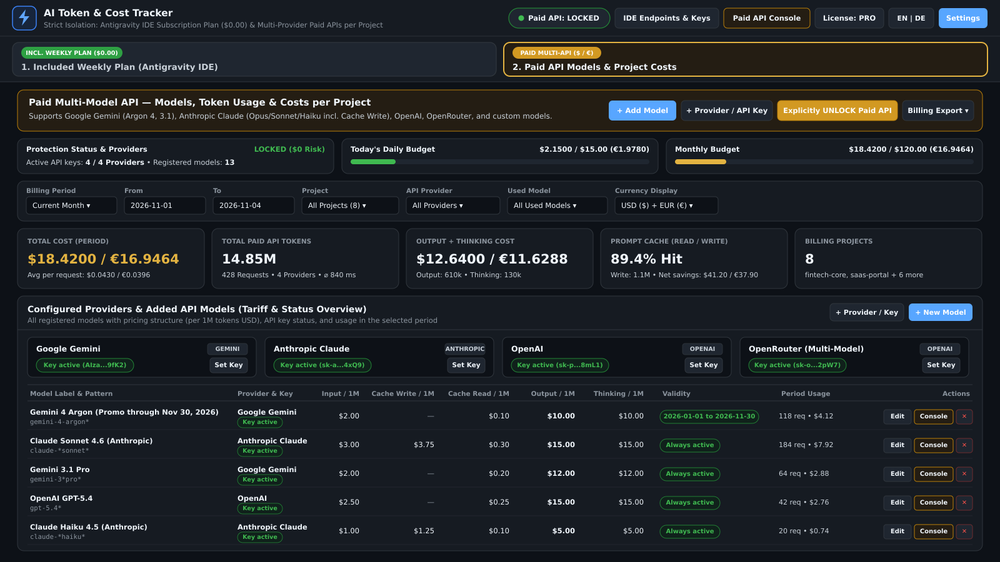
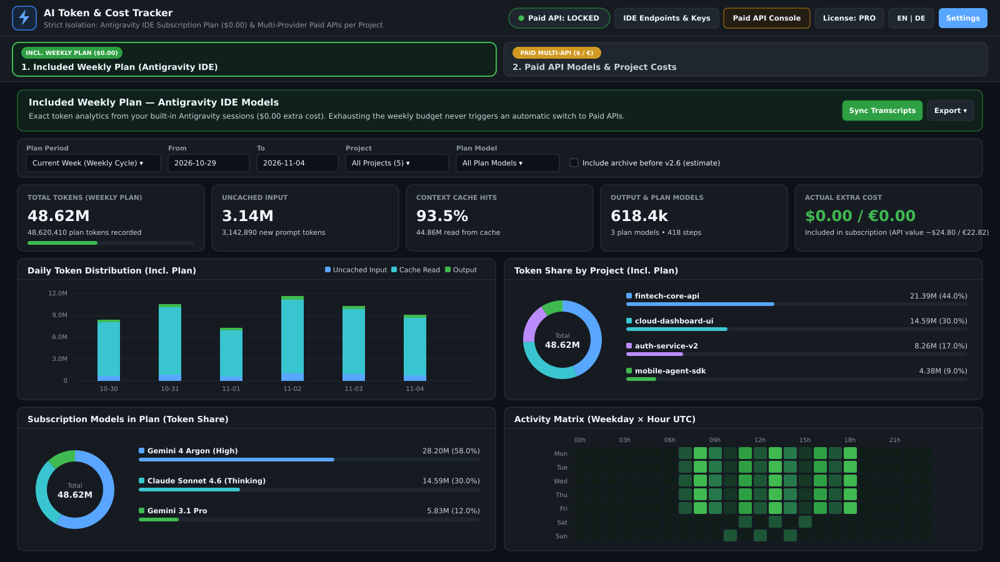
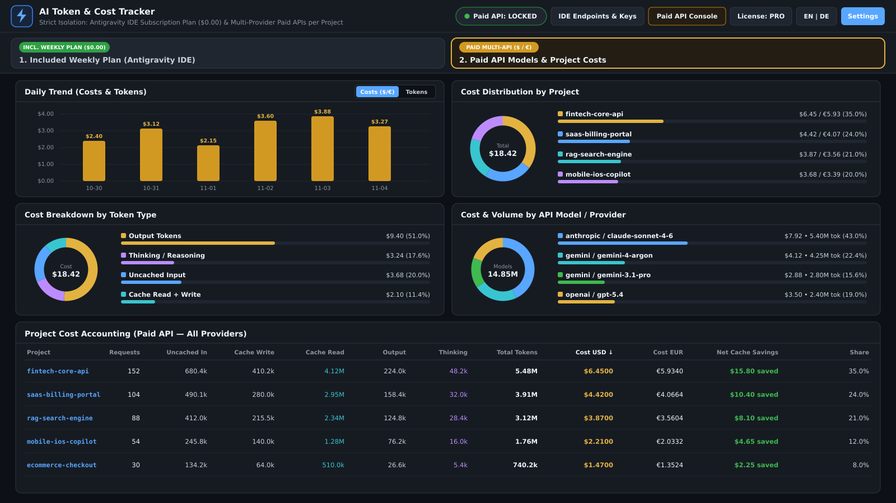
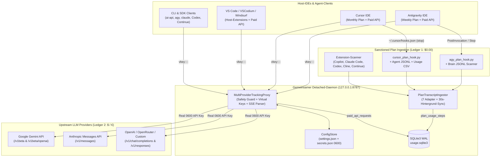

🌐 **Language:** [English](./README.md) | **Deutsch**

# ⚡ AI Token & Cost Tracker v1.1.8

**Lokales Multi-Provider LLM-Gateway, projektgenaue Kostenabrechnung & IDE-isolierte Abo-Plan-Analytik**

[](https://github.com/Vladyslav-Vitko/ai-token-tracker/releases/latest)
[](https://marketplace.visualstudio.com/items?itemName=VladyslavVitko.ai-token-cost-tracker)
[](https://open-vsx.org/extension/VladyslavVitko/ai-token-cost-tracker)
[-3776AB.svg>)](#2-60-sekunden-schnellstart--installation)
[-success.svg>)](#9-systemarchitektur-rest-api--sqlite-schema)
[-critical.svg>)](#5-zero-trust-kostenschutz--key-sicherheit)
[-f59e0b.svg>)](#8-lizenzmodell-free-vs-pro--team-edition)

[**Aus VS Code Marketplace installieren**](https://marketplace.visualstudio.com/items?itemName=VladyslavVitko.ai-token-cost-tracker) · [**Aus Open VSX installieren**](https://open-vsx.org/extension/VladyslavVitko/ai-token-cost-tracker) · [**`.vsix`-Release herunterladen**](https://github.com/Vladyslav-Vitko/ai-token-tracker/releases/latest) · [**60-Sekunden-Schnellstart**](#2-60-sekunden-schnellstart--installation) · [**Pro / Team Edition**](#8-lizenzmodell-free-vs-pro--team-edition) · [**Changelog**](./CHANGELOG.md)

> **Ein lokaler Leitstand für alle KI-Entwicklungskosten:** **AI Token & Cost Tracker v1.1.8** ist ein zu 100 % lokal laufendes (`127.0.0.1:8787`), abhängigkeitsfreies LLM-Telemetrie-Gateway und Multi-IDE-Add-on für **Antigravity IDE, Cursor, VS Code, VSCodium, Windsurf sowie CLI-/SDK-Workflows**. Die Architektur erzwingt eine strikte **Dual-Ledger-Trennung** zwischen **inkludierten IDE-Abonnements (`$0.00` Zusatzkosten)** und **kostenpflichtigen Multi-Provider API-Aufrufen (`USD $` / `EUR €`)** über **Google Gemini (inkl. Gemini 4 Argon & Carbon), Anthropic Claude, OpenAI, OpenRouter sowie eigene Endpunkte** (DeepSeek, Mistral, xAI, Ollama) — inklusive projektgenauer Zuordnung, hartem Budget-Schutzschalter und `chmod 0600` Schlüssel-Isolation.

---

### Visueller Produkt-Überblick (`16:9`)

**1. Paid Multi-Provider API Cost Center — Projektgenaue Zuordnung, Schutzschalter & Budget-Limits (`USD $` / `EUR €`):**


**2. Inkludierte IDE-Abo-Plan-Analytik — Strikte IDE-Isolation, Cache-Hit-Quote & theoretischer API-Gegenwert (`$0.00`):**


**3. Multi-Provider Modell-Katalog, 2×2 Kostenverteilungs-Diagramme & Pro-Lizenzverwaltung:**


---

## Inhaltsverzeichnis

1. [Warum AI Token & Cost Tracker? (Dual-Ledger-Architektur)](#1-warum-ai-token--cost-tracker-dual-ledger-architektur)
2. [60-Sekunden-Schnellstart & Installation (Windows, macOS, Linux, WSL2)](#2-60-sekunden-schnellstart--installation)
3. [Multi-IDE-Bedienung, Statusleiste & Schnellmenü](#3-multi-ide-bedienung-statusleiste--schnellmenue)
4. [Kontextsensitive IDE-Isolation (4 Betriebsmodi)](#4-kontextsensitive-ide-isolation-4-betriebsmodi)
5. [Zero-Trust-Kostenschutz & Key-Sicherheit (`chmod 0600`)](#5-zero-trust-kostenschutz--key-sicherheit)
6. [Multi-Provider LLM-Gateway & Modell-Tarifkatalog](#6-multi-provider-llm-gateway--modell-tarifkatalog)
7. [SDKs, KI-Plugins & CLI anbinden (`ai-api` & `tracker-cli`)](#7-sdks-ki-plugins--cli-anbinden-ai-api--tracker-cli)
8. [Lizenzmodell (Free Community vs. Pro / Team Edition)](#8-lizenzmodell-free-vs-pro--team-edition)
9. [Systemarchitektur, REST-API & SQLite-Schema](#9-systemarchitektur-rest-api--sqlite-schema)
10. [Fehlerbehebung, Entwickler-QA & Deinstallation](#10-fehlerbehebung-entwickler-qa--deinstallation)

---

<a id="1-warum-ai-token--cost-tracker-dual-ledger-architektur"></a>
<a id="ueberblick--wertversprechen"></a>

## 1. Warum AI Token & Cost Tracker? (Dual-Ledger-Architektur)

Moderne KI-gestützte Softwareentwicklung kombiniert **pauschale IDE-Abonnements** (Antigravity Weekly Plan, Cursor Pro Monthly Plan, GitHub Copilot, Claude Code) mit **nutzungsbasierten API-Schlüsseln** (Google Gemini, Anthropic Claude, OpenAI, OpenRouter, DeepSeek). Ohne eine dedizierte lokale Kontrollschicht entstehen für Entwickler, Freelancer und Teams drei kritische Probleme:

1. **Nicht zuordenbare Kunden- & Projektkosten:** Monatsrechnungen der KI-Anbieter fassen alle Aufrufe zusammen und lassen sich keinem Kundenprojekt, Repository oder Workflow mehr zuordnen.
2. **Kostenfallen durch stillen Fallback:** Ist das inkludierte IDE-Kontingent erschöpft, schalten manche Tools unbemerkt auf hinterlegte API-Keys um und verursachen unerwartete Kosten.
3. **Verfälschte Metriken:** Das Vermischen von kostenfreien Abo-Tokens (`$0.00`) mit kostenpflichtigen API-Tokens verzerrt sowohl die Finanzbuchhaltung als auch die Prompt-Caching-Effizienz.

**AI Token & Cost Tracker v1.1.8** löst diese Probleme an der Wurzel durch einen gemeinsamen lokalen Daemon (`http://127.0.0.1:8787`) mit zwei strikt voneinander getrennten SQLite-WAL-Ledgern:

| Merkmal | Ledger 1: Inkludierter IDE-Abo-Plan (`panel-plan`) | Ledger 2: Paid Multi-Model API (`panel-paid`) |
| :--- | :--- | :--- |
| **Zusatzkosten** | **Immer `$0.00` / `€0.00`** (im IDE-Abonnement enthalten) | **Exakte Einzelabrechnung in `USD ($)` & `EUR (€)`** |
| **Datenquellen** | Lokale IDE- & KI-Extension-Transkripte über **7 Quellen** (`antigravity`, `cursor`, `copilot`, `claude-code`, `codex`, `cline`, `continue`), Live-Quota-Telemetrie & Hooks (`agy_plan_hook.py`, `cursor_plan_hook.py`, `claude_plan_hook.py`), 30s-Hintergrund-Sync & Cursor Usage-CSV-Import | Lokaler Multi-Provider Tracking Reverse Proxy (`/p/<projekt>/...` und `/p/<projekt>/v1/...`) |
| **IDE-Sichtbarkeit** | Native Plan-IDEs (**Antigravity**, **Cursor**) isolieren strikt auf den eigenen Plan & kreisförmige Live-Quota-Ringe (`Woche` / `5-Stunden` / `Monat` `%` frei + Reset-Countdown); **VS Code / VSCodium / Windsurf** zeigen aktive Host-Extensions; **Browser-Hub** zeigt **Alle aktiven KI-Pläne & Extensions (`all`)** | In **allen** IDEs (Antigravity, Cursor, VS Code, VSCodium, Windsurf) sowie im Standalone-Browser verfügbar |
| **Token-Metriken** | Live-IDE-Quota-Ringe (`%` verbleibend + Reset-Timer), `Uncached Input`, `Cache Read`, `Output`, `Cache-Hit-Quote (%)`, `Theoretischer API-Gegenwert ($)` | `Uncached Input`, `Cache Write (1.25×)`, `Cache Read`, `Output`, `Thinking / Reasoning`, `Netto-Cache-Ersparnis ($)` |
| **Kostenschutz** | Dynamische IDE-/Extension-Limits (automatisch aktuell auch nach IDE-Updates); löst bei erschöpftem Abo-Kontingent niemals kostenpflichtige API-Aufrufe aus | Standardmäßig **`GESPERRT ($0.00 Risiko)`** + gold umrahmte UTC-Tages-/Monatslimits für **USD & Tokens** (`HTTP 429`) |

---

<a id="2-60-sekunden-schnellstart--installation"></a>
<a id="voraussetzungen--installation"></a>

## 2. 60-Sekunden-Schnellstart & Installation

### Systemvoraussetzungen

- **Betriebssysteme:** **Windows 10/11** (nativ & WSL2), **macOS** (`launchd`) und **Linux** (`systemd --user`, Desktop sowie Remote-SSH).
- **Python-Laufzeitumgebung:** `python3 >= 3.10` mit **100 % Python Standard Library** (`0 pip`- und `0 npm`-Laufzeitpakete; keinerlei Abhängigkeit von virtuellen Environments, Docker oder DDEV).
- **Unterstützte IDEs:** VS Code (`^1.85.0`), Antigravity IDE, Cursor, Windsurf, VSCodium sowie CLI-/JetBrains-Anbindung über den lokalen Proxy und Browser-Hub.

### Option A: Zero-Config Extension-Installation (Empfohlen — 1 Klick)

Das Extension-Paket ist **zu 100 % autonom (self-contained)**: Es enthält sowohl das Webview-UI als auch das komplette Python-Backend (`extension/backend/`) und startet den gemeinsamen Hintergrund-Daemon (`127.0.0.1:8787`) automatisch beim IDE-Start.

1. **Aus der Registry installieren:**
   - **VS Code:** Direkt aus dem [**Visual Studio Marketplace (`VladyslavVitko.ai-token-cost-tracker`)**](https://marketplace.visualstudio.com/items?itemName=VladyslavVitko.ai-token-cost-tracker) installieren.
   - **Antigravity IDE, Cursor, Windsurf, VSCodium:** Direkt aus der [**Open VSX Registry (`VladyslavVitko/ai-token-cost-tracker`)**](https://open-vsx.org/extension/VladyslavVitko/ai-token-cost-tracker) installieren.
   - **Oder direkte `.vsix`-Offline-Installation:** Laden Sie [`ai-token-tracker-1.1.8.vsix`](https://github.com/Vladyslav-Vitko/ai-token-tracker/releases/latest) herunter und wählen Sie `Ctrl+Shift+P` (`Cmd+Shift+P` unter macOS) → **`Extensions: Install from VSIX...`**.
2. **Sofort loslegen:**
   - In der rechten unteren Statusleiste Ihrer IDE erscheint: `🛡️ Plan: ... | Paid API: GESPERRT ($0.00)`.
   - Klicken Sie auf das Statusleisten-Widget, um das **Schnellmenü** zu öffnen, das **Inkludierte Plan-Dashboard (`$0.00`)** oder **Paid-API-Dashboard (`$ / €`)** anzuzeigen, Provider-API-Keys (`chmod 0600`) zu hinterlegen oder den **Multi-IDE-Hub im Browser** (`http://127.0.0.1:8787`) zu starten.

### Option B: CLI- & Service-Installation aus lokalem Checkout (`./install.sh` — Linux, WSL2, macOS)

Wenn Sie einen lokalen Quellcode-Checkout nutzen und zusätzlich die CLI-Befehle (`ai-api`, `tracker-cli`) in `~/.local/bin` sowie einen Betriebssystem-Hintergrunddienst (`systemd --user` bzw. `launchd`) einrichten möchten:

```bash
# Baut & installiert das autonome .vsix in alle erkannten IDEs + richtet OS-Daemon & CLI-Symlinks ein
./install.sh

# Oder direkt aus der Marketplace/Open-VSX-Galerie installieren, um automatische Hintergrund-Updates aktiv zu halten
./install.sh --marketplace
```

Was `./install.sh` deterministisch und idempotent ausführt:
1. Speichert den Installationspfad in `~/.config/ai-token-tracker/install_path` und initialisiert `config/settings.json`, `config/secrets.json` (`chmod 0600`) sowie die SQLite-WAL-Datenbank `data/usage.sqlite3`.
2. Verlinkt `ai-api`, `agy-api`, `tracker-cli` und `ai-tracker-server` nach `~/.local/bin/`.
3. Registriert Fail-Open Lifecycle- & Quota-Hooks (`bin/agy_plan_hook.py`, `bin/cursor_plan_hook.py` und `bin/claude_plan_hook.py`) ausschließlich für tatsächlich auf dem System vorhandene Plan-IDEs/CLIs.
4. Aktiviert den Hintergrunddienst (`~/.config/systemd/user/ai-token-tracker.service` unter Linux/WSL2 bzw. `~/Library/LaunchAgents/local.ai-token-tracker.plist` unter macOS).
5. Paketiert `vscode-extension/ai-token-tracker-1.1.8.vsix` und installiert die Erweiterung in alle erkannten lokalen sowie Remote-/WSL-IDEs (`antigravity-ide`, `cursor`, `code`, `code-insiders`, `codium`, `windsurf`).

---

<a id="3-multi-ide-bedienung-statusleiste--schnellmenue"></a>
<a id="multi-ide-extension--command-palette"></a>

## 3. Multi-IDE-Bedienung, Statusleiste & Schnellmenü

Nach der Aktivierung zeigt die Erweiterung in der rechten unteren Statusleiste Ihrer IDE ein kontextsensitives Live-Widget:

- **Gesperrter Standardzustand (`LOCKED` — `$0.00` Kostenrisiko):**
  - Plan-IDEs (Antigravity / Cursor / KI-Extensions): `🛡️ Plan: 17.5k | Paid API: GESPERRT ($0.00)`
  - Reine API-IDEs (ohne KI-Chat-Extensions): `🛡️ Paid API: GESPERRT ($0.00 / €0.00)`
- **Freigegebener Zustand (`ARMED` — mit Warnhintergrund hervorgehoben):**
  - `🔥 Plan: 17.5k | Paid API [AKTIV]: $3.05 / €2.81`

### Zweistufiges Schnellmenü & Command Palette (`Ctrl+Shift+P` / `Cmd+Shift+P`)

Ein Klick auf das Statusleisten-Widget öffnet ein kategorisiertes **zweistufiges QuickPick-Steuerzentrum**:
- **Kopfzeilen-Schnellbuttons:** Ein-Klick-Aktionen für **Sync/Refresh**, **Sprachwechsel EN | DE** und **Extension-Einstellungen**.
- **Kontextabhängige Sofort-Aktionen:** Blendet automatisch **Jetzt neu laden, um neue Version zu aktivieren** ganz oben ein, sobald ein Galerie-Update im Hintergrund geladen wurde, oder zeigt **Wiederherstellungs-Aktionen**, falls der Daemon offline ist.
- **Ebene 2 — System, Diagnose & Service:** Wartungsmenü mit `Back`-Navigation, Transkript-Rescan, Log-Ansicht, Python-Interpreter-Auswahl sowie Neustart/Stopp des gemeinsamen Daemons.

| Command ID | Titel in der Command Palette | Funktion & Geltungsbereich |
| :--- | :--- | :--- |
| `aiTokenTracker.quickMenu` | **AI Token Tracker: Hauptmenü & Schnellsteuerung öffnen** | Öffnet das zweistufige Schnellmenü (Dashboards, Modell-Starter, Schutzschalter, API-Keys, Lizenz, Browser-Hub, Diagnose). |
| `aiTokenTracker.openPlanDashboard` | **AI Token Tracker: Inkludierten IDE-Plan öffnen ($0.00)** | Öffnet Tab 1 (`panel-plan`) im IDE-Webview *(sichtbar bei aktivem Plan oder erkannter KI-Extension via `aiTokenTracker.hasPlan`)*. |
| `aiTokenTracker.openPaidDashboard` | **AI Token Tracker: Paid API & Kosten-Dashboard öffnen ($ / €)** | Öffnet Tab 2 (`panel-paid` — Multi-Provider Kostenabrechnung & Modell-Katalog) im IDE-Webview. |
| `aiTokenTracker.openBrowserHub` | **AI Token Tracker: Multi-IDE-Hub im Browser öffnen** | Öffnet das zentrale Multi-IDE Web-Dashboard (`http://127.0.0.1:8787`) im Standardbrowser. |
| `aiTokenTracker.startPaidAgent` | **AI Token Tracker: Paid API — Modellsitzung für Projekt starten** | Interaktiver Modell-Starter: Tracked Terminal (`ai-api`) starten, Projekt-URL/Virtual-Key (`vkey`) kopieren oder Testkonsole öffnen. |
| `aiTokenTracker.togglePaidLock` | **AI Token Tracker: Paid API — Ausgabenschutz umschalten (Sperren / Freigeben)** | Schaltet den globalen Paid-API-Ausgabenschutz (`paid_api_armed`: `GESPERRT` ↔ `FREIGEGEBEN`) sofort um. |
| `aiTokenTracker.setApiKey` | **AI Token Tracker: Paid API — Provider-API-Key hinterlegen (chmod 0600)** | Speichert oder löscht Provider-API-Keys über ein maskiertes Passwort-Eingabefeld (`chmod 0600`). |
| `aiTokenTracker.manageLicense` | **AI Token Tracker: Lizenz & Pro-Edition verwalten** | Verwaltet Free-Kontingente sowie die Aktivierung von Pro-/Team-Lizenzschlüsseln (Polar.sh, Lemon Squeezy, Offline `AITT1-*`). |
| `aiTokenTracker.syncPlanTranscripts` | **AI Token Tracker: Lokale Transkripte neu einlesen** | Stößt einen sofortigen inkrementellen SQLite-Sync aller aktiven IDE- & KI-Extension-Logs an (`when: aiTokenTracker.hasPlan`). |
| `aiTokenTracker.selectPython` | **AI Token Tracker: Python 3 Interpreter auswählen** | Dateiauswahl-Dialog zum expliziten Festlegen einer Python `>= 3.10` ausführbaren Datei (aktualisiert `aiTokenTracker.pythonPath`). |
| `aiTokenTracker.showLogs` | **AI Token Tracker: Erweiterungs- & Daemon-Logs anzeigen** | Öffnet das dedizierte VS Code Output-Fenster (`View` → `Output` → `AI Token Tracker`) zur Live-Diagnose. |
| `aiTokenTracker.checkForUpdates` | **AI Token Tracker: Nach Updates suchen & neue Version laden** | Prüft die Extension-Galerie auf Updates, erkennt bereitstehende Pakete und bietet einen sofortigen Reload an. |
| `aiTokenTracker.restartService` | **AI Token Tracker: Hintergrund-Service neu starten (Gemeinsamer Daemon)** | Startet den gemeinsamen Detached-Daemon (`127.0.0.1:8787`) sauber neu (`systemd --user` oder Hintergrundprozess). |
| `aiTokenTracker.stopService` | **AI Token Tracker: Hintergrund-Service beenden (Gemeinsamer Daemon)** | Beendet den gemeinsamen Daemon geordnet über alle offenen IDEs hinweg (mit Bestätigungsdialog bei aktiven Client-Leases). |

> **Gemeinsamer Multi-IDE Daemon & SemVer-Upgrade-Handshake:** Mehrere gleichzeitig geöffnete IDEs teilen sich einen einzigen Detached-Daemon (`127.0.0.1:8787`, Client-Leases unter `data/clients/`, rotierte Logs in `data/daemon.log`). Das Schließen eines IDE-Fensters trennt niemals andere laufende IDEs. Nach einem Extension-Update führt die Erweiterung automatisch einen SemVer-Upgrade-Handshake mit dem laufenden Daemon durch und lädt geöffnete Webviews/Browser-Tabs unter vollständigem Erhalt Ihrer SQLite-Historie neu.

### Extension-Einstellungen (`settings.json` der IDE)

| Einstellung | Typ | Standardwert | Beschreibung |
| :--- | :--- | :--- | :--- |
| `aiTokenTracker.pythonPath` | `string` | `""` | Optionaler expliziter Pfad zum Python 3 (`>= 3.10`) Interpreter (z. B. `C:\Python312\python.exe` oder `/usr/bin/python3`). Automatische Erkennung wenn leer. |
| `aiTokenTracker.servicePath` | `string` | `""` | Optionaler expliziter Pfad zu einer lokalen `ai-token-tracker`-Installation (nutzt automatisch das eingebettete VSIX-Backend oder `~/.config/ai-token-tracker/install_path` wenn leer). |
| `aiTokenTracker.apiHost` | `string` | `"127.0.0.1"` | Lokale Bind-Adresse des AI Token Tracker Daemons. |
| `aiTokenTracker.apiPort` | `number` | `8787` | Lokaler TCP-Port des AI Token Tracker Daemons. |
| `aiTokenTracker.language` | `string` | `"en"` | Oberflächensprache der Extension und des Dashboards (`"en"` = Englisch Standard, `"de"` = Deutsch). |
| `aiTokenTracker.updateNotifications` | `boolean` | `true` | Benachrichtigungen anzeigen, sobald eine neue Version von AI Token & Cost Tracker zum Neuladen bereitsteht oder aktualisiert wurde. |

---

<a id="4-kontextsensitive-ide-isolation-4-betriebsmodi"></a>
<a id="strikte-ide-kontext-isolation-4-betriebsmodi"></a>

## 4. Kontextsensitive IDE-Isolation (4 Betriebsmodi)

Sowohl die IDE-Statusleiste als auch das Dashboard passen sich automatisch an die jeweilige Host-Umgebung an und erzwingen eine strikte Mandantentrennung, sodass native Plan-IDEs niemals fremde IDE-Daten anzeigen:

### Modus 1: Antigravity IDE (`ide=antigravity`)
- **Tab 1 — Inkludierter Wochen-Plan (`$0.00`):** Wertet ausschließlich lokale Antigravity-Konversationen (`~/.gemini/antigravity/brain/`, `~/.gemini/antigravity-ide/brain/`, Step-Fallbacks und `.pb`-Metadaten) sowie den automatisch registrierten Fail-Open Lifecycle-Hook (`bin/agy_plan_hook.py`) aus. Zeigt exakte und geschätzte `Uncached Input`-, `Cache Read`- und `Output`-Tokens, die Cache-Effizienz sowie den eingesparten theoretischen API-Gegenwert im konfigurierbaren Wochenzyklus.
- **Tab 2 — Kostenpflichtige Multi-Provider-API (`$` / `€`):** Vollständige Multi-Provider-Kostenabrechnung, Budget-Schutz und Modell-Katalog.

### Modus 2: Cursor IDE (`ide=cursor`)
- **Tab 1 — Inkludierter Monats-Plan (`$0.00`):** Abgestimmt auf den monatlichen Cursor-Abrechnungszyklus (`month_cycle`, Reset-Tag konfigurierbar über `cursor_monthly_reset_day`) und die Cursor-Abo-Modelle (`claude-*`, `gpt-*`, `gemini-*`).
- **Drei sanktionierte Clean-Code-Datenquellen (Ohne `state.vscdb` Token-Scraping):**
  1. Offizieller Cursor Lifecycle-Hook (`~/.cursor/hooks.json` → `stop` → `bin/cursor_plan_hook.py`).
  2. Lokale Cursor Agent-Transkripte (`~/.cursor/projects/*/agent-transcripts/*.{jsonl,txt,json}`) mit automatischer Workspace-Projektzuordnung.
  3. Idempotenter **Cursor Dashboard Usage-CSV-Import** (über den Dashboard-Dialog oder `tracker-cli import-cursor-csv`), der Zeilen per SHA-256-Signatur dedupliziert und nutzungsbasierte Zusatzkosten (`Usage-Based`, `On-Demand`, `Paid`, `Overage`) automatisch herausfiltert, sodass Tab 1 strikt auf den `$0.00` Inklusiv-Plan beschränkt bleibt.
- **Strikte Isolation:** Cursor zeigt niemals Antigravity-Daten an und Antigravity niemals Cursor-Daten.

### Modus 3: VS Code, VSCodium, Windsurf & Multi-Extension-IDEs (`vscode`, `vscodium`, `windsurf`, `jetbrains`)
- **Automatische Erkennung installierter KI-Chat-Extensions (inkl. benutzerdefinierter VS Code Profile & WSL/Windows-Pfadbrücke):**
  - Erkennt automatisch installierte KI-Chat-Extensions und lokale Sitzungsprotokolle über Standard- und benutzerdefinierte VS Code Profile (`User/profiles/*`) hinweg für:
    - **Google Antigravity** (`google.google-antigravity`)
    - **GitHub Copilot Chat** (`github.copilot-chat` — Delta-Streams, Editing-Sessions & schreibgeschützter Session-Fallback)
    - **Anthropic Claude Code** (`anthropic.claude-code` / `~/.claude/projects`)
    - **OpenAI Codex / ChatGPT** (`openai.chatgpt` / `~/.codex/sessions`)
    - **Cline / Roo Code / Kilo Code** (`saoudrizwan.claude-dev`, `rooveterinaryinc.roo-cline`, `kilocode.kilo-code`)
    - **Continue.dev** (`continue.continue` / `~/.continue/sessions`)
  - Sobald mindestens eine KI-Chat-Extension aktiv ist, wird **Tab 1 (`panel-plan`) automatisch freigeschaltet** — inklusive Quellen-Umschalter zwischen **Alle aktiven KI-Pläne & Extensions (`all`)** und jeder einzelnen Extension.
- **Reiner API-Modus:** Ist keine KI-Chat-Extension in der Host-IDE installiert, bleibt Tab 1 ausgeblendet (`has_plan: false`) und das Dashboard öffnet direkt **Tab 2 (Kostenpflichtige Multi-Provider-API)**.

### Modus 4: Standalone Web-Browser-Hub (`http://127.0.0.1:8787`, `ide=browser`)
- Dient als **zentraler Multi-IDE-Leitstand (`surface=all`)** über alle 7 IDE- und Extension-Quellen Ihres Systems hinweg.
- Zeigt interaktive **Quellen-Karten aktiver IDEs & KI-Extensions** mit ihrem jeweiligen nativen Abrechnungszyklus (`Wöchentlich` vs. `Monatlich`), einen expliziten Hinweis bei **Gemischten Abrechnungszyklen** sowie einen Chart-Umschalter (**`Nach Modell` / `Nach IDE / Quelle`**).
- **30-Sekunden-Hintergrund-Sync:** Indiziert Transkripte aller 7 Adapter fortlaufend im Hintergrund — sodass auch eine zweite IDE ohne installiertes Plugin lückenlos in SQLite WAL erfasst wird, ohne die native IDE-Isolation zu durchbrechen.

---

<a id="5-zero-trust-kostenschutz--key-sicherheit"></a>
<a id="sicherheitsarchitektur--zero-trust-garantien"></a>

## 5. Zero-Trust-Kostenschutz & Key-Sicherheit (`chmod 0600`)

> [!IMPORTANT]
> **Kein automatischer Wechsel auf kostenpflichtige APIs:** Wenn das Wochen- oder Monats-Kontingent einer IDE erschöpft ist, schaltet AI Token & Cost Tracker **niemals** automatisch auf kostenpflichtige API-Keys um.

1. **Hardware-artiger Ausgaben-Schutzschalter (`paid_api_armed: false` als Standard):**
   - Im Standardzustand **`PAID API: GESPERRT`** lehnt der lokale Proxy jeden kostenpflichtigen Request sofort mit `HTTP 403 PERMISSION_DENIED` ab (`$0.00` finanzielles Risiko).
   - Kostenpflichtige API-Aufrufe werden nur weitergeleitet, wenn Sie den Schutzschalter explizit über die Statusleiste, das Dashboard oder `tracker-cli arm` auf **`FREIGEGEBEN (ARMED)`** schalten.
2. **Harte UTC-Tages- und Monats-Limits für Kosten & Tokens (`block_on_budget_exceeded: true`):**
   - Konfigurierbar in einem klar durch einen **goldenen Rahmen** gekennzeichneten Bereich für die **Externe Paid API**, eindeutig getrennt von den kostenfreien `$0.00` IDE-Abos.
   - Vor jedem ausgehenden Request prüft der Proxy die aufgelaufene UTC-Tages- und Monatsnutzung gegen `daily_budget_limit_usd` (Standard `$15.00`), `monthly_budget_limit_usd` (Standard `$120.00`) sowie optionale `daily_token_limit`- / `monthly_token_limit`-Obergrenzen.
   - Beim Erreichen eines aktiven Limits wird der kostenpflichtige Aufruf sofort mit `HTTP 429 RESOURCE_EXHAUSTED` blockiert.
3. **`chmod 0600` Key-Tresor & Virtuelle Projekt-Keys (`vkey`):**
   - Ihre echten Provider-API-Schlüssel werden ausschließlich lokal in `config/secrets.json` mit erzwungenen POSIX-Dateirechten `0600` (nur Eigentümer-Zugriff) gespeichert.
   - IDE-Plugins, CLI-Skripte und Subshells erhalten niemals Ihre echten API-Keys, sondern authentifizieren sich mit einem projektgebundenen **Virtuellen Projekt-Key**: `vkey::<projektname>::<local_proxy_token>`.
   - Der lokale Proxy prüft das Token zeitkonstant (`hmac.compare_digest`), ordnet den Aufruf `<projektname>` zu und injiziert den echten Provider-Key erst für die ausgehende HTTPS-Verbindung.
4. **100 % Lokale Datensouveränität (DSGVO / GDPR) & Web-Härtung:**
   - Keinerlei Cloud-Telemetrie: Prompts, Antworten, Projektnamen und API-Schlüssel verlassen niemals Ihr Gerät (siehe [PRIVACY.md](./PRIVACY.md)).
   - Geschützt durch strikte `Content-Security-Policy` (Nonce-basiert im Webview, `default-src 'self'` im Browser), `X-Content-Type-Options: nosniff`, Regex-Eingabevalidierung und Path-Traversal-Schutz.

---

<a id="6-multi-provider-llm-gateway--modell-tarifkatalog"></a>
<a id="multi-provider-llm-gateway--tarif-engine"></a>

## 6. Multi-Provider LLM-Gateway & Modell-Tarifkatalog

Der lokale Reverse Proxy (`tracker/proxy_handler.py`) verarbeitet sowohl synchrone JSON-Antworten als auch **Echtzeit-SSE-Streaming (`text/event-stream`)** über alle großen LLM-Protokolle hinweg:

### Unterstützte Protokolle & Abrechnungsfunktionen

- **Google Gemini Native (`/v1beta/models/...`) & OpenAI-Compat (`/v1/chat/completions`):**
  - Automatische Pfad-Normalisierung von `/p/<projekt>/gemini/v1/chat/completions` auf `/v1beta/openai/chat/completions`.
  - Exakte Erfassung von `promptTokenCount`, `cachedContentTokenCount`, `candidatesTokenCount` sowie **`thoughtsTokenCount`** (Thinking-/Reasoning-Tokens).
  - Unterstützt **datumsabhängige Tarifregeln (`effective_from` / `effective_until`)** für automatische Wechsel zwischen Promo- und Standard-Tarifen (z. B. `gemini-4-argon` und `gemini-4-carbon`).
- **Anthropic Messages API (`/v1/messages`):**
  - Zustandsbehafteter **Split-Event-SSE-Akkumulator**: kombiniert `input_tokens`, `cache_creation_input_tokens` (**Cache Write**) und `cache_read_input_tokens` (**Cache Read**) aus `message_start` mit den kumulativen `output_tokens` aus `message_delta`.
  - Exakte Prompt-Caching-Kalkulation inkl. Cache-Write-Aufschlag (`1.25×` bei 5m TTL), Cache-Read-Rabatt (`0.10×`) und Ausweis der **Netto-Cache-Ersparnis** (`read_discount - write_surcharge`).
- **OpenAI & OpenRouter (`/v1/chat/completions` & `/v1/responses`):**
  - Injiziert bei Streaming-Requests (`stream: true`) automatisch `"stream_options": {"include_usage": true}`, damit im letzten SSE-Chunk exakte Token-Zähler geliefert werden.
  - Erfasst gecachte Input-Tokens, Cache-Write-Tokens sowie Reasoning-Tokens (`completion_tokens_details.reasoning_tokens` / `output_tokens_details`).
- **Eigene Provider (Lokal & Cloud):**
  - Beliebige OpenAI-, Anthropic- oder Gemini-kompatible Endpunkte (z. B. **DeepSeek**, **Mistral**, **xAI / Grok**, **Groq**, **Ollama**, **vLLM**, **LM Studio**) lassen sich im Dashboard, per CLI oder REST-API registrieren.

### Integrierter Modell-Tarifkatalog (`config/settings.default.json`)

| Provider | Modell-Pattern | Bezeichnung | Input / 1M | Cache Write / 1M | Cache Read / 1M | Output / 1M | Thinking / 1M | Gültigkeit |
| :--- | :--- | :--- | ---: | ---: | ---: | ---: | ---: | :--- |
| `gemini` | `gemini-4-carbon*` | Gemini 4 Carbon (Promo) | `$2.00` | `$0.00` | `$0.10` | `$10.00` | `$10.00` | `2026-01-01` – `2026-11-30` |
| `gemini` | `gemini-4-carbon*` | Gemini 4 Carbon (Standard) | `$4.00` | `$0.00` | `$0.20` | `$20.00` | `$20.00` | ab `2026-12-01` |
| `gemini` | `gemini-4-argon*` | Gemini 4 Argon (Promo) | `$2.00` | `$0.00` | `$0.10` | `$10.00` | `$10.00` | `2026-01-01` – `2026-11-30` |
| `gemini` | `gemini-4-argon*` | Gemini 4 Argon (Standard) | `$4.00` | `$0.00` | `$0.20` | `$20.00` | `$20.00` | ab `2026-12-01` |
| `gemini` | `gemini-4-hydrogen*` | Gemini 4 Hydrogen (Flash) | `$1.50` | `$0.00` | `$0.075` | `$7.50` | `$7.50` | Immer |
| `gemini` | `gemini-3*flash*` | Gemini 3.8 Flash | `$0.75` | `$0.00` | `$0.075` | `$3.75` | `$3.75` | Immer |
| `gemini` | `gemini-3*flash-lite*` | Gemini 3.5 Flash-Lite | `$0.30` | `$0.00` | `$0.03` | `$2.50` | `$2.50` | Immer |
| `anthropic` | `claude-*fable*` | Claude Fable 5.2 | `$8.00` | `$10.00` | `$0.20` | `$40.00` | `$40.00` | Immer |
| `anthropic` | `claude-*opus*` | Claude Opus 5.5 | `$4.00` | `$5.00` | `$0.20` | `$20.00` | `$20.00` | Immer |
| `anthropic` | `claude-*sonnet*` | Claude Sonnet 5.5 | `$2.00` | `$2.50` | `$0.10` | `$10.00` | `$10.00` | Immer |
| `anthropic` | `claude-*haiku*` | Claude Haiku 5.5 | `$0.10` | `$0.125` | `$0.01` | `$0.50` | `$0.50` | Immer |
| `openai` | `gpt-6*astra*` | OpenAI GPT-6 Astra | `$10.00` | `$0.00` | `$1.00` | `$50.00` | `$50.00` | Immer |
| `openai` | `gpt-6*sol*` | OpenAI GPT-6.1 Sol | `$2.00` | `$0.00` | `$0.10` | `$10.00` | `$10.00` | Immer |
| `openai` | `gpt-6*terra*` | OpenAI GPT-6.1 Terra | `$1.00` | `$0.00` | `$0.05` | `$5.00` | `$5.00` | Immer |
| `openai` | `gpt-6*luna*` | OpenAI GPT-6 Luna | `$0.10` | `$0.00` | `$0.01` | `$0.50` | `$0.50` | Immer |
| `openai` | `gpt-5*` | OpenAI GPT-5.4 | `$2.50` | `$0.00` | `$0.25` | `$15.00` | `$15.00` | Immer |
| `openrouter` | `deepseek/deepseek-v4*` | DeepSeek V4 Pro | `$0.66` | `$0.00` | `$0.022` | `$1.98` | `$1.98` | Immer |
| `*` | `*` | Fallback Standard-Tarif | `$2.00` | `$0.00` | `$0.20` | `$10.00` | `$10.00` | Fallback |

---

<a id="7-sdks-ki-plugins--cli-anbinden-ai-api--tracker-cli"></a>
<a id="lokale-proxy-endpunkte--sdk-plugin-integration"></a>
<a id="cli-referenz-tracker-cli--ai-api"></a>

## 7. SDKs, KI-Plugins & CLI anbinden (`ai-api` & `tracker-cli`)

Externe IDE-Erweiterungen (**Continue, Cline, Roo Code, Kilo Code, JetBrains AI, Zed, Aider**) und eigene Applikationen lassen sich direkt über die lokalen Projekt-Endpunkte anbinden. Kopieren Sie Ihren **Virtuellen Projekt-Key** (`vkey::<projektname>::<token>`) mit einem Klick im Dashboard unter **Endpunkte & Keys**, über `ai-api --print-env` oder per `GET /api/ide-connection?project=<projektname>`.

### 7.1 Lokale Routing-URL-Matrix

| Protokoll / Einsatzbereich | Lokale Base-URL (pro Projekt) | Authentifizierungs-Header |
| :--- | :--- | :--- |
| **Unified OpenAI-Compatible** *(Auto-Routing nach Modellname)* | `http://127.0.0.1:8787/p/<projektname>/v1` | `Authorization: Bearer vkey::<projektname>::<token>` |
| **Provider-spezifisch OpenAI-Compat** *(OpenAI, OpenRouter, DeepSeek, Custom)* | `http://127.0.0.1:8787/p/<projektname>/<provider>/v1` | `Authorization: Bearer vkey::<projektname>::<token>` |
| **Anthropic Messages API** (`/v1/messages`) | `http://127.0.0.1:8787/p/<projektname>/anthropic` | `x-api-key: vkey::<projektname>::<token>` |
| **Google Gemini Native API** (`/v1beta/models/...`) | `http://127.0.0.1:8787/p/<projektname>/gemini` *(oder `/p/<projektname>`)* | `X-Goog-Api-Key: vkey::<projektname>::<token>` |

> **Alternative Header-Steuerung:** Clients mit festen Basis-URLs (`http://127.0.0.1:8787/v1/...`) können Projekt und Provider auch per HTTP-Header `X-Project-Name: <projektname>` und `X-Provider: <provider_id>` übergeben.

### 7.2 Konfigurationsbeispiele für Plugins & SDKs

#### Continue / Cline / Roo Code (`config.json`)

```json
{
  "models": [
    {
      "title": "Claude Sonnet 5.5 (Tracked via AI Token Tracker)",
      "provider": "openai",
      "model": "claude-sonnet-5-5",
      "apiBase": "http://127.0.0.1:8787/p/my-project/v1",
      "apiKey": "vkey::my-project::<IHR-LOKALER-PROXY-TOKEN>"
    }
  ]
}
```

#### Python OpenAI SDK (Auto-Routing für beliebige Provider)

```python
from openai import OpenAI

client = OpenAI(
    base_url="http://127.0.0.1:8787/p/erp-portal/v1",
    api_key="vkey::erp-portal::<IHR-LOKALER-PROXY-TOKEN>",
)

response = client.chat.completions.create(
    model="gemini-4-argon",
    messages=[{"role": "user", "content": "Führe ein Sicherheits-Audit des Datenbankschemas durch."}],
    stream=True,
)
for chunk in response:
    if chunk.choices and chunk.choices[0].delta.content:
        print(chunk.choices[0].delta.content, end="")
```

### 7.3 `ai-api` (bzw. Alias `agy-api`) — Projektgebundener Paid-API-Starter

`ai-api` erkennt automatisch das aktuelle Arbeitsverzeichnis als Projektname (oder akzeptiert `--project <name>`), injiziert `vkey::<projekt>::<token>` sowie die lokalen Proxy-URLs (`GOOGLE_GEMINI_BASE_URL`, `ANTHROPIC_BASE_URL`, `OPENAI_BASE_URL`) und startet getrackte CLI-Sitzungen (auch direkt aus der IDE startbar über **`AI Token Tracker: Paid API — Modellsitzung für Projekt starten`**):

```bash
# 1. Google Gemini Paid-API-Sitzung starten (startet 'agy' CLI oder Tracked Shell; --auto-arm gibt Proxy frei)
ai-api --model gemini-4-argon --effort high --auto-arm

# 2. Anthropic Claude Paid-API-Sitzung starten (startet 'claude' CLI oder Tracked Shell mit ANTHROPIC_BASE_URL)
ai-api --provider anthropic --model claude-sonnet-5-5

# 3. Beliebiges Skript oder Kommando im getrackten Projektkontext ausführen (--exec oder --)
ai-api --project shop2022 --provider openai --model gpt-6.1-sol -- python3 scripts/migrate.py

# 4. Shell-Export-Variablen für das aktuelle Projekt und den gewählten Provider ausgeben
eval "$(ai-api --project cms --provider anthropic --model claude-sonnet-5-5 --print-env)"
```

### 7.4 `tracker-cli` — Terminal-Verwaltung, Katalog & Berichte

```bash
# Gesamtstatus prüfen (Schutzschalter, hinterlegte Provider-Keys, Tages-/Monatsausgaben, erkannte Plan-IDEs)
tracker-cli status

# Paid-API-Schutzschalter explizit freigeben (ARM) oder sperren (LOCK)
tracker-cli arm
tracker-cli lock

# Provider-API-Schlüssel sicher in config/secrets.json (chmod 0600) speichern
tracker-cli set-key --provider gemini
tracker-cli set-key --provider anthropic
tracker-cli set-key --provider openai
tracker-cli set-key --provider openrouter

# Eigenen OpenAI-/Anthropic-/Gemini-kompatiblen Provider registrieren (z. B. DeepSeek, Mistral, Ollama)
tracker-cli add-provider \
  --id deepseek \
  --label "DeepSeek API" \
  --protocol openai \
  --base-url https://api.deepseek.com \
  --key sk-deepseek-...

# Alle registrierten Modelle & Tarifregeln auflisten (optional nach Provider gefiltert)
tracker-cli list-models
tracker-cli list-models --provider anthropic

# Modell-Tarifregel hinzufügen oder aktualisieren (Preise pro 1M Tokens in USD)
tracker-cli add-model \
  --provider deepseek \
  --pattern "deepseek-reasoner*" \
  --label "DeepSeek R1 Reasoner" \
  --input 0.55 \
  --cache-write 0.00 \
  --cached-input 0.14 \
  --output 2.19 \
  --thinking 2.19

# Lokale IDE-Abo-Transkripte synchronisieren oder Cursor Usage-CSV importieren
tracker-cli sync --ide all
tracker-cli import-cursor-csv ~/Downloads/cursor-usage.csv --project cms

# Strikt getrennte Terminal-Reports ausgeben oder als HTML/PDF, CSV & JSON exportieren (Pro/Team)
tracker-cli report --ledger plan --ide antigravity --period week
tracker-cli report --ledger plan --ide cursor --period month_cycle
tracker-cli report --ledger paid --period month --provider all
tracker-cli export --ledger paid --format html --period month --markup 15 --vat 19 --client "Muster GmbH" -o paid_report.html

# Lizenzstatus prüfen, online aktualisieren sowie Pro-/Team-Lizenzschlüssel aktivieren oder deaktivieren
tracker-cli license
tracker-cli license --refresh
tracker-cli activate AITT1-PRO-PERPETUAL-...
tracker-cli deactivate
```

---

<a id="8-lizenzmodell-free-vs-pro--team-edition"></a>
<a id="lizenzmodell-free-vs-pro--team-edition"></a>

## 8. Lizenzmodell (Free Community vs. Pro / Team Edition)

AI Token & Cost Tracker wird unter einer **Dual-Tier Freemium- & Kommerziellen Nutzungslizenz** bereitgestellt (siehe [LICENSE.md](./LICENSE.md) und [PRIVACY.md](./PRIVACY.md)). Sämtliche Sicherheitsfunktionen (`LOCKED` / `ARMED`, Budget-Schutzschalter) sowie die gesamte `$0.00` IDE-Abo-Plan-Analytik sind **dauerhaft zu 100 % kostenlos**.

Die **Commercial Pro & Team Editionen** richten sich an Freelancer, Agenturen und Entwicklerteams, die KI-Kosten projektgenau weiterberechnen, viele Kunden-Repositories betreuen oder revisionssichere `CSV`- / `JSON`-Exporte für Buchhaltung und Steuerberatung benötigen:

| Funktion / Leistungsumfang | Free Community Edition (`FREE`) | Commercial Pro / Team Edition (`PRO` / `TEAM`) |
| :--- | :--- | :--- |
| **Inkludierte IDE-Abo-Plan-Analytik (`$0.00`)** | **Unbegrenzt** (Alle 7 Plan-IDEs & Extensions) | **Unbegrenzt** (Alle 7 Plan-IDEs & Extensions) |
| **Paid-API-Schutzschalter (`LOCKED` / `ARMED`) & Budget-Limits** | **Enthalten** | **Enthalten** |
| **Integrierte Kern-Provider (Gemini, Claude, OpenAI, OpenRouter)** | **Alle 4 enthalten** | **Alle 4 enthalten** |
| **Getrackte Paid-API-Kunden- & Repository-Projekte** | Bis zu **5 Projekte** | **Unbegrenzte Projekte** |
| **Custom-Provider (DeepSeek, Mistral, Ollama, vLLM etc.)** | Bis zu **2 Custom-Provider** | **Unbegrenzte Custom-Provider** |
| **Eigene & datumsabhängige Modell-Tarifregeln** | Bis zu **3 Custom-Modelle** | **Unbegrenzte Custom-Modelle** |
| **Cursor Dashboard Usage-CSV-Import** | Bis zu **500 Zeilen** pro Import | **Unbegrenzter CSV-Massenimport** |
| **Buchhaltungs- & Rechnungs-Datenexporte (`CSV`, `JSON` & `HTML / PDF`)** | Deaktiviert (`HTTP 402` auf alle Exporte) | **Vollständiger UTF-8-BOM CSV-, JSON- & druckfertiger HTML/PDF-Berichtsexport (`/api/export/*`)** |
| **Tarife & Aktivierungsmodi** | **Dauerhaft kostenfrei (`$0.00`)** | Polar.sh Checkout: [**Jährlich (`2,08 $/Monat` — `24,99 $/Jahr`, 58 % sparen)**](https://buy.polar.sh/polar_cl_BPHF2Z8AmhOizEDRbn87n1ynZZDs8jcK9MXle05eXax) · [**Monatlich (`4,99 $/Monat`)**](https://buy.polar.sh/polar_cl_cD8C56yfFsudWCoEfE6Wr8RnROjqU1nZvFocX3ta7cZ) · [**Lifetime (`49,99 $`)**](https://buy.polar.sh/polar_cl_2EcUogc92f06pCVToDHs8lhxPJDNi1EBn7P6K1rB7V3) & 100 % Offline-Keys (`AITT1-PRO-...`) |

### Kommerzielle Pro-Tarife & Checkout (Polar.sh)

| Tarif | Preis | Abrechnungszyklus | Polar.sh Checkout |
| :--- | :--- | :--- | :--- |
| **Jährlich Pro** *(58 % sparen · Bester Wert)* | **`24,99 $/Jahr`** (`~2,08 $/Monat`) | Jährliches Abonnement, jederzeit kündbar | [**Jährlich Pro abonnieren (Polar.sh)**](https://buy.polar.sh/polar_cl_BPHF2Z8AmhOizEDRbn87n1ynZZDs8jcK9MXle05eXax) |
| **Monatlich Pro** | **`4,99 $/Monat`** | Monatliches Abonnement, jederzeit kündbar | [**Monatlich Pro abonnieren (Polar.sh)**](https://buy.polar.sh/polar_cl_cD8C56yfFsudWCoEfE6Wr8RnROjqU1nZvFocX3ta7cZ) |
| **Lifetime Pro** | **`49,99 $`** *(einmalig)* | Dauerhafte Lizenz inkl. aller künftigen Updates | [**Lifetime Pro kaufen (Polar.sh)**](https://buy.polar.sh/polar_cl_2EcUogc92f06pCVToDHs8lhxPJDNi1EBn7P6K1rB7V3) |

---

<a id="9-systemarchitektur-rest-api--sqlite-schema"></a>
<a id="systemarchitektur--datenfluss"></a>
<a id="modern-web-dashboard--accessibility"></a>
<a id="rest-api--sqlite-datenbankschema"></a>
<a id="projektstruktur-qualitaetssicherung--marketplace-build"></a>

## 9. Systemarchitektur, REST-API & SQLite-Schema

### 9.1 Hexagonale Architektur & Datenfluss

Das System basiert auf einer sauberen **Ports-and-Adapters-Architektur (Hexagonal Architecture)** mit 100 % Python Standard Library (`tracker/`) im Backend und framework-freien Modern Web APIs (`web/`) im Frontend:



### 9.2 Modern Web Dashboard & Barrierefreiheit (WCAG 2.2 AA)

Sowohl unter `http://127.0.0.1:8787` als auch im nativen VS Code Webview ohne schwere Frontend-Frameworks realisiert:
- **Native `<dialog>`-Modale & Popover API:** 10 einheitliche `<dialog>`-Modale (Endpunkte & Keys mit Ein-Klick-Kopierfunktion, Modell-Tarifeditor, Provider- & Key-Tresor, 4-Tab-Einstellungen [`Schutz & Limits` mit gold umrahmten Paid-API-Kosten- & Token-Limits, `Währung & Vorgaben`, `Plan-Zyklen`, `Diagnose & Daten`] mit Änderungsschutz, Live-IDE-Quota-Abgleich, API-Testkonsole mit protokollabhängigem Reasoning-Hinweis, Einzelbeleg-Inspektor, Cursor-CSV-Import, Lizenzmanager mit Live-Kontingentanzeige sowie Sticky Bug-Bounty- & Feedback-Dialog rechts unten mit einsehbarem anonymisiertem System-Snapshot) plus CSS-Anchor-positionierte Exportmenüs (`popover="auto"`).
- **Responsive CSS Container Queries (`@container`):** Adaptive Komponenten-Layouts (`sources-area`, `quotas-area`, `kpi-area`, `charts-area`, `providers-area`, `table-card`), kreisförmige SVG-Quota-Ringe (`Woche` / `5-Stunden` / `Monat` `%` verbleibend) und paarweise abgestimmte Vollbreiten-SVG-Charts/Heatmaps für schmale IDE-Split-Views bis hin zu Ultra-Wide-Monitoren.
- **Strikte WCAG 2.2 AA & WAI-ARIA Konformität:** Vollständige Tastaturnavigation (`.skip-link`, `:focus-visible`, Pfeiltasten-Steuerung für `role="tablist"` & `role="radiogroup"`), Live-Ansagen (`aria-live="polite"`) sowie universelle Mehrspaltensortierung über alle 7 Analyse- und Katalogtabellen (`aria-sort`, natürliche String-Kollation, 3-stufiger Prioritäts-Reset).

### 9.3 REST-API-Endpunkte (`tracker/server.py`)

| Methode | Pfad | Beschreibung |
| :--- | :--- | :--- |
| `GET` | `/api/health?ide=<hostIde>` | Liefert Daemon-Status, Version, `paid_api_armed`, maskierten Key-Status, Ausgabenlimits, `ide_context` und `sync_status`. |
| `GET` | `/api/bootstrap?ide=<hostIde>&plan_surface=<surf>` | Initialisierungsdaten für Dashboard & QuickPicks (Einstellungen, Projekte, Ausgaben, `ide_context`, `sync_status`). |
| `GET` | `/api/stats/plan?ide=<hostIde>&surface=<surf>&period=<p>` | IDE-isolierte oder vereinte (`all`) Abo-Plan-Analytik (`weekly`/`monthly`/`mixed`, `by_surface`, `by_model`, `sync_status`). |
| `GET` | `/api/stats/paid?period=<p>&project=<pr>&provider=<pv>&model=<m>` | Paid-API-Kostenanalytik inkl. angereichertem Modell-Katalog (`configured_models`), Provider-Split und Einzel-Requests. |
| `GET` | `/api/ide-connection?project=<projektname>` | Generiert alle projektspezifischen Proxy-URLs und den `virtual_key` (`vkey::<projekt>::<token>`). |
| `GET` | `/api/export/plan.csv` / `/api/export/paid.csv` | UTF-8-BOM CSV-Export der Projekt-Tabellen für Rechnungen und Buchhaltung (erfordert Pro- oder Team-Lizenz). |
| `GET` | `/api/export/plan.json` / `/api/export/paid.json` | Vollständiger JSON-Analytik-Export für Plan- und Paid-Telemetrie (erfordert Pro- oder Team-Lizenz). |
| `GET` | `/api/export/plan.html` / `/api/export/paid.html` | Druckfertiger HTML- / PDF-Audit- & Kundenabrechnungs-Bericht inkl. Aufschlag %, MwSt. % und SHA-256-Prüfsumme (erfordert Pro- oder Team-Lizenz). |
| `POST` | `/api/safety/toggle` | Schaltet `paid_api_armed` (`true` / `false`) um. |
| `POST` | `/api/settings` | Aktualisiert Währungs- (`primary_display`), Sicherheits-, Budget-, IDE-Standard- und Abo-Zyklus-Einstellungen. |
| `POST` | `/api/providers/upsert` / `/api/providers/delete` | Erstellt, aktualisiert oder löscht Provider-Konfigurationen (optional inkl. atomarer `api_key`-Speicherung). |
| `POST` | `/api/models/upsert` / `/api/models/delete` | Erstellt, aktualisiert oder löscht Modell-Tarifregeln vor dem Wildcard-Fallback (`*`). |
| `POST` | `/api/secrets/apikey` | Speichert oder löscht API-Keys einzelner oder mehrerer Provider (`chmod 0600`). |
| `POST` | `/api/plan/sync` | Stößt eine sofortige inkrementelle Synchronisation lokaler IDE-Abo-Transkripte an (`ide`, `exts`, `surface`, `force`). |
| `POST` | `/api/plan/quotas` | Synchronisiert oder setzt Live-IDE- und Extension-Modellkontingente zurück (`action: "upsert"` / `"clear"`, `%` verbleibend + Reset-Zeiten). |
| `POST` | `/api/plan/cursor/import-csv` | Importiert und dedupliziert offizielle Cursor Dashboard Usage-CSV-Exporte (Free-Limit: 500 Zeilen/Import). |
| `POST` | `/api/playground/chat` | Führt einen expliziten Paid-API-Test-Prompt über den lokalen Tracking-Proxy inkl. Reasoning-Option und Kostenbeleg aus. |
| `GET` | `/api/license/status` | Liefert die aktuelle Lizenzstufe (`free`, `pro`, `team`), Freischaltungen, Live-Kontingentzähler (`usage`) und maskierten Key-Status. |
| `POST` | `/api/license/refresh` | Prüft den aktiven Abostatus online beim Merchant (Polar.sh / Lemon Squeezy) und aktualisiert Kulanzfristen. |
| `POST` | `/api/license/activate` / `/api/license/deactivate` | Aktiviert oder deaktiviert einen kommerziellen Pro-/Team-Lizenzschlüssel (Polar.sh, Lemon Squeezy oder Offline `AITT1-*`). |
| `GET` | `/api/feedback/diagnostics` | Liefert einen anonymisierten, DSGVO-konformen technischen System-Snapshot (`version`, `host_ide`, `os_platform`, `python_version`, `license_tier` — ohne API-Keys oder Projektnamen). |
| `POST` | `/api/feedback/submit` | Übermittelt einen Bug-Report oder Feedback (optional inkl. anonymisierter Systemdiagnose) für das 1-Monats-Pro-Bug-Bounty- / Gift-Key-Programm. |
| `POST` | `/api/admin/shutdown` | Beendet den lokalen Daemon-Prozess geordnet für Versions-Upgrades (nur für lokale IDE-Erweiterungen; weist Origin ab). |

### 9.4 Lokale Speicherpfade & SQLite-WAL-Schema (`usage.sqlite3`)

Beim Betrieb über die autonome Marketplace- / `.vsix`-Extension werden alle Laufzeitkonfigurationen und Datenbankdateien unter **`~/.config/ai-token-tracker/`** (bzw. `$AI_TRACKER_DATA_DIR`, unter Erhalt bestehender lokaler Installationen) gespeichert:
- `~/.config/ai-token-tracker/config/settings.json` — Aktive Benutzereinstellungen, Custom-Provider und eigene Tarifregeln.
- `~/.config/ai-token-tracker/config/secrets.json` — Isolierter `chmod 0600` Speicher für Provider-API-Keys, Proxy-Token und Lizenzstatus.
- `~/.config/ai-token-tracker/data/usage.sqlite3` — Lokale SQLite-Datenbank im `WAL`-Modus mit vier Tabellen:
  1. **`plan_usage_steps`**: Schritte inkludierter IDE- & Extension-Abonnements (`conversation_id`, `step_index`, `created_at`, `project_name`, `model_name`, `surface` [`antigravity` | `cursor` | `copilot` | `claude-code` | `codex` | `cline` | `continue`], `billing_cycle` [`weekly` | `monthly`], `uncached_input_tokens`, `cached_input_tokens`, `output_tokens`, `total_tokens`, `is_estimated`) mit `UNIQUE(conversation_id, step_index)`.
  2. **`plan_sync_state`**: Inkrementeller Datei-Index (`transcript_path`, `mtime_ns`, `file_size`, `project_name`, `model_name`, `updated_at`) zur Vermeidung redundanter Festplattenzugriffe.
  3. **`plan_live_quotas`**: Dynamische IDE- & KI-Extension-Kontingentfenster (`surface`, `group_id`, `group_label`, `window_id`, `window_label`, `window_minutes`, `remaining_pct`, `used_pct`, `remaining_count`, `limit_count`, `resets_at`, `plan_tier`, `source_method`, `updated_at`) mit automatischem Reset nach Ablauf.
  4. **`paid_api_requests`**: Revisionssicheres Einzelbeleg-Journal aller kostenpflichtigen API-Aufrufe (`request_uid`, `created_at`, `project_name`, `provider`, `model_name`, `endpoint`, `is_stream`, `http_status`, `latency_ms`, alle 6 Token-Kategorien, `pricing_rule_id`, Einzelkosten in USD, `cache_savings_usd`, `total_cost_usd`, `total_cost_eur`, `client_agent`, `error_message`).

---

<a id="10-fehlerbehebung-entwickler-qa--deinstallation"></a>
<a id="deinstallation"></a>

## 10. Fehlerbehebung, Entwickler-QA & Deinstallation

### Fehlerbehebung & häufige Fragen

- **Extension-Updates & Pinned VSIX vs. Automatische Galerie-Updates:**
  - Aus dem VS Code Marketplace oder aus Open VSX installierte Erweiterungen aktualisieren sich automatisch im Hintergrund und bieten anschließend das direkte Neuladen des Extension Hosts (`workbench.action.restartExtensionHost`) an.
  - Manuell aus einer lokalen `.vsix`-Datei installierte Erweiterungen markiert VS Code als `pinned`; führen Sie `Ctrl+Shift+P` → **`AI Token Tracker: Nach Updates suchen & neue Version laden`** oder `./install.sh --marketplace` aus, um auf automatische Galerie-Updates umzuschalten.
- **Statusleiste zeigt `AI Tracker: Offline`:**
  1. Klicken Sie auf das Statusleisten-Widget oder führen Sie `Ctrl+Shift+P` → **`AI Token Tracker: Hauptmenü & Schnellsteuerung öffnen`** aus, um den automatischen Start anzustoßen.
  2. Öffnen Sie `Ctrl+Shift+P` → **`AI Token Tracker: Erweiterungs- & Daemon-Logs anzeigen`**, um die Startprotokolle einzusehen.
- **Hinweis „Python 3.10+ required“:**
  - Installieren Sie Python 3.10 oder neuer von [python.org/downloads](https://www.python.org/downloads/) (unter Windows mit aktivierter Option **„Add Python to PATH“**) oder wählen Sie über **`AI Token Tracker: Python 3 Interpreter auswählen`** einen vorhandenen Interpreter aus.
- **Port-Konflikt auf Port 8787:**
  - Ändern Sie in den IDE-Einstellungen `"aiTokenTracker.apiPort": 8788`; Extension und Daemon binden sich automatisch an den neuen Port.

### Automatisierte Qualitätssicherung & VSIX-Build (Lokaler Quellcode-Checkout)

```bash
# Alle drei automatisierten Test-Suiten ausführen (Backend E2E, Frontend/WCAG/i18n-Audit, Release & OPC-VSIX-Prüfung)
python3 tests/test_backend_e2e.py
node tests/test_frontend_ui.mjs
python3 tests/test_release_pipeline.py

# Autonomes Open Packaging Conventions (.vsix) Paket bauen: vscode-extension/ai-token-tracker-1.1.8.vsix
python3 vscode-extension/build_vsix.py
```

### Deinstallation

- **Über die IDE:** Rechtsklick auf **AI Token & Cost Tracker** in der Extensions-Ansicht → **Deinstallieren** (über **`AI Token Tracker: Hintergrund-Service beenden`** können Sie zuvor den gemeinsamen Hintergrund-Daemon stoppen).
- **Über das Standalone-Skript (`./uninstall.sh`):**
  ```bash
  # Hintergrunddienst stoppen sowie CLI-Symlinks und IDE-Hooks entfernen (SQLite-Historie bleibt erhalten)
  ./uninstall.sh

  # Vollständige Entfernung inklusive lokaler SQLite-Datenbank, Einstellungen und chmod 0600 Secrets
  ./uninstall.sh --purge-data
  ```
