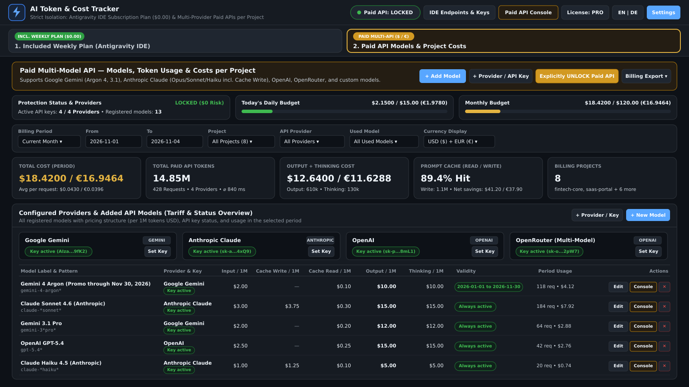
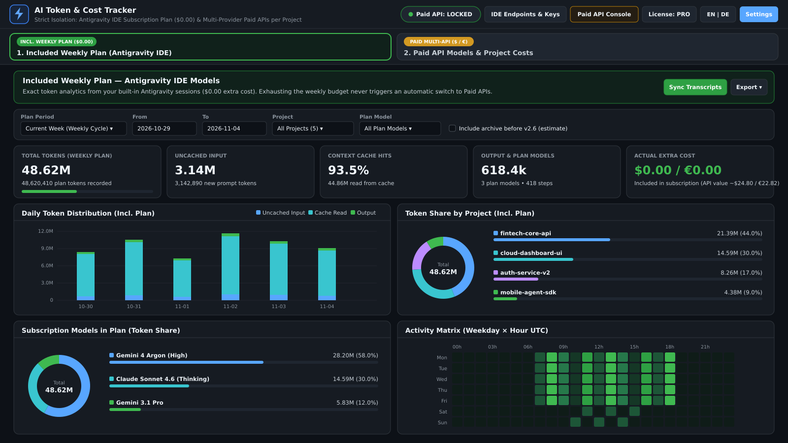
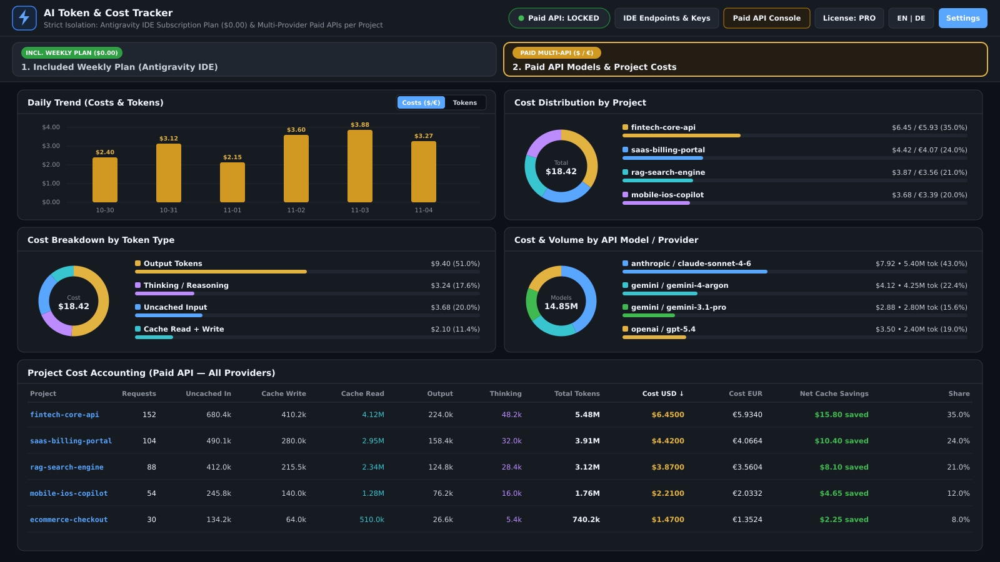
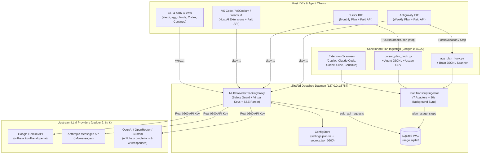

🌐 **Language:** **English** | [Deutsch](./README.de.md)

# ⚡ AI Token & Cost Tracker v1.1.4

**Multi-Provider LLM API Gateway, Per-Project Cost Accounting & IDE-Isolated Subscription Plan Analytics**

[](#)
[-3776AB.svg>)](#requirements--installation)
[](#multi-ide-extension--command-palette)
[-success.svg>)](#project-structure-quality-assurance--marketplace-packaging)
[-critical.svg>)](#security-architecture--zero-trust-guarantees)
[](#modern-web-dashboard--accessibility)
[-f59e0b.svg>)](https://buy.polar.sh/polar_cl_2EcUogc92f06pCVToDHs8lhxPJDNi1EBn7P6K1rB7V3)

> **Overview:** **AI Token & Cost Tracker** is a local-first, zero-dependency LLM telemetry gateway and multi-IDE extension for **Antigravity IDE, Cursor, VS Code, VSCodium, Windsurf, and JetBrains/CLI workflows**. It enforces a strict **Dual-Ledger Architecture** separating **Included IDE Subscription Plans (`$0.00` extra cost)** from **Paid Multi-Provider API usage (`USD $` / `EUR €`)** across **Google Gemini (incl. Gemini 4 Argon), Anthropic Claude, OpenAI, OpenRouter, and custom OpenAI/Anthropic-compatible endpoints** (DeepSeek, Mistral, xAI, Ollama) — complete with per-project cost attribution, hardware-style budget circuit breakers, and `chmod 0600` secret isolation.

### Dashboard Views (`16:9`)







---

## Table of Contents

1. [Why AI Token & Cost Tracker? (Dual-Ledger Architecture)](#why-ai-token--cost-tracker-dual-ledger-architecture)
2. [System Architecture & Data Flow](#system-architecture--data-flow)
3. [Strict IDE Context Isolation (4 Operating Modes)](#strict-ide-context-isolation-4-operating-modes)
4. [Security Architecture & Zero-Trust Guarantees](#security-architecture--zero-trust-guarantees)
5. [Multi-Provider LLM Gateway & Pricing Engine](#multi-provider-llm-gateway--pricing-engine)
6. [Requirements & Installation (Windows, macOS, Linux)](#requirements--installation)
7. [Multi-IDE Extension & Command Palette](#multi-ide-extension--command-palette)
8. [CLI Reference (`tracker-cli` & `ai-api`)](#cli-reference-tracker-cli--ai-api)
9. [Local Proxy Endpoints & SDK / Plugin Integration](#local-proxy-endpoints--sdk--plugin-integration)
10. [Modern Web Dashboard & Accessibility](#modern-web-dashboard--accessibility)
11. [REST API & SQLite Database Schema](#rest-api--sqlite-database-schema)
12. [Project Structure, Quality Assurance & Marketplace Packaging](#project-structure-quality-assurance--marketplace-packaging)
13. [Commercial Licensing (Free vs. Pro / Team Edition)](#commercial-licensing-free-vs-pro--team-edition)
14. [Uninstallation](#uninstallation)

---

<a id="why-ai-token--cost-tracker-dual-ledger-architecture"></a>

## 1. Why AI Token & Cost Tracker? (Dual-Ledger Architecture)

Modern AI-assisted engineering combines **flat-rate IDE subscriptions** (e.g., Antigravity Weekly Plan, Cursor Pro Monthly Plan) with **pay-as-you-go API keys** (Google Gemini, Anthropic Claude, OpenAI, OpenRouter, DeepSeek). Without a dedicated local telemetry layer, teams and freelancers face three major problems:

1. **Unattributed Client & Project Spend:** Monthly provider invoices cannot be broken down by repository, client project, or developer workflow.
2. **Silent Overage & Auto-Fallback Traps:** Exhausting an included IDE quota can silently fall back to billable API keys, causing unexpected cost spikes.
3. **Contaminated Analytics:** Mixing `$0.00` subscription tokens with billable API tokens distorts cost reporting and cache-efficiency metrics.

**AI Token & Cost Tracker v1.1.4** solves this at the root via a local daemon (`http://127.0.0.1:8787`) with two strictly isolated ledgers:

| Capability          | Ledger 1: Included IDE Plan (`panel-plan`)                                                         | Ledger 2: Paid Multi-Model API (`panel-paid`)                                                                |
| :------------------ | :------------------------------------------------------------------------------------------------- | :----------------------------------------------------------------------------------------------------------- |
| **Marginal Cost**   | **Always `$0.00` / `€0.00`** (covered by IDE subscription)                                         | **Exact accounting in `USD ($)` & `EUR (€)`**                                                                |
| **Data Sources**    | Local transcripts & logs across 7 IDE/extension sources (Antigravity, Cursor, Copilot, Claude Code, Codex, Cline, Continue), lifecycle hooks, 30s background sync & Cursor CSV import | Local Multi-Provider Tracking Reverse Proxy (`/p/<project>/...`)                                             |
| **IDE Visibility**  | Native IDEs (**Antigravity**, **Cursor**) strictly isolate to their own plan; **VS Code / VSCodium / Windsurf** show active host AI extensions; Browser shows **All Active AI Plans & Extensions** (`all`) + per-source cards | Displayed across **all** IDEs (Antigravity, Cursor, VS Code, VSCodium, Windsurf, Browser)                    |
| **Token Breakdown** | `Uncached Input`, `Cache Read`, `Output`, `Cache Hit Ratio (%)`, `Equivalent API Value`            | `Uncached Input`, `Cache Write (1.25×)`, `Cache Read`, `Output`, `Thinking / Reasoning`, `Net Cache Savings` |
| **Cost Protection** | Zero automatic fallback to Paid API when plan quota is exhausted                                   | Default **`LOCKED ($0.00 risk)`** + hard daily/monthly USD budget circuit breakers                           |

---

<a id="system-architecture--data-flow"></a>

## 2. System Architecture & Data Flow

Built on a clean **Ports-and-Adapters (Hexagonal) Architecture** using 100% Python Standard Library on the backend and zero-framework Modern Web APIs on the frontend:



---

<a id="strict-ide-context-isolation-4-operating-modes"></a>

## 3. Strict IDE Context Isolation (4 Operating Modes)

Both the IDE status bar item and the `/api/stats/plan` endpoint enforce strict tenant isolation based on the detected host IDE (`PlanTranscriptIngestor.resolve_ide_context`):

### Mode 1: Antigravity IDE (`ide=antigravity`)

- **Tab 1 — Included Weekly Plan (`$0.00`)**: Evaluates local Antigravity conversation transcripts (`~/.gemini/antigravity/brain/*/.system_generated/logs/transcript.jsonl` and `~/.gemini/antigravity-ide/brain/...`). Captures exact `input_tokens`, `cache_read_tokens`, and `output_tokens` per project and model, plus theoretical API value saved.
- **Tab 2 — Paid Multi-Provider API (`$` / `€`)**: Full multi-provider cost accounting and model registry.

### Mode 2: Cursor IDE (`ide=cursor`)

- **Tab 1 — Included Monthly Plan (`$0.00`)**: Aligned with Cursor's monthly billing cycle (`month_cycle`, configurable reset day via `cursor_monthly_reset_day`) and Cursor subscription models (`claude-*`, `gpt-*`, `gemini-*`).
- **Three Sanctioned Clean-Code Data Sources (Zero `state.vscdb` JWT Scraping):**
  1. Official Cursor lifecycle hook (`~/.cursor/hooks.json` → `stop` → `bin/cursor_plan_hook.py`).
  2. Local Cursor agent transcripts (`~/.cursor/projects/*/agent-transcripts/*.jsonl`) with automatic workspace slug resolution (`resolve_project_from_cursor_slug`).
  3. Idempotent **Cursor Dashboard Usage CSV Import** (UI modal or `tracker-cli import-cursor-csv`), deduplicating entries via SHA-256 signatures while automatically skipping `Usage-Based`, `On-Demand`, `Paid`, or `Overage` rows so Tab 1 remains strictly Included Plan.
- **Isolation Guarantee:** Cursor never displays foreign Antigravity data.

### Mode 3: VS Code, VSCodium, Windsurf & Multi-Extension IDEs (`vscode`, `vscodium`, `windsurf`, `jetbrains`)

- **Automatic AI Chat Extension Discovery (`vscode.extensions.all` + Local Session Adapters):**
  - Automatically detects installed AI chat extensions and local session logs for **Google Antigravity** (`google.google-antigravity`), **GitHub Copilot Chat** (`github.copilot-chat` / `workspaceStorage/*/chatSessions`), **Anthropic Claude Code** (`anthropic.claude-code` / `~/.claude/projects`), **OpenAI Codex / ChatGPT** (`openai.chatgpt` / `~/.codex/sessions`), **Cline / Roo Code / Kilo Code** (`saoudrizwan.claude-dev`, `rooveterinaryinc.roo-cline`, `kilocode.kilo-code`), and **Continue.dev** (`continue.continue` / `~/.continue/sessions`).
  - When one or more AI chat extensions are installed, **Tab 1 (`panel-plan`) is automatically unlocked** with both exact usage tokens (`is_estimated = 0`) and deterministic token estimation (`chars // 4`, `is_estimated = 1`, enabled by default) plus a switcher between **All Active AI Plans & Extensions (`all`)** and each individual extension.
- **Bare API-Only Mode:** If no AI chat extension or local session log is present in the IDE, Tab 1 is hidden (`has_plan: false`) and the dashboard opens directly into **Tab 2 (Paid Multi-Provider API)**.

### Mode 4: Standalone Web Browser (`http://127.0.0.1:8787`, `ide=browser`)

- Defaults to the unified **`All Active AI Plans & Extensions` (`surface=all`)** Control Center when multiple Plan IDEs or AI Chat Extensions exist on the host, or automatically hides Tab 1 if none are present.
- Displays clickable **Active IDE & AI Extension Sources** summary cards (`@container sources-area`) preserving each source's native reset window (`Weekly` vs. `Monthly`), an explicit **Mixed Billing Cycle** banner whenever weekly and monthly plans coexist, a **`By Model` / `By IDE / Source`** chart toggle, and a **`Sync Info ⓘ`** status popover (`sync_status`).
- A **30-second background daemon sync** continuously indexes transcripts across all 7 adapters—so even a second IDE operated **without** installing the extension stays accurately accounted for in SQLite WAL without breaking native-IDE Webview isolation (`?ide=antigravity`, `?ide=cursor`).

---

<a id="security-architecture--zero-trust-guarantees"></a>

## 4. Security Architecture & Zero-Trust Guarantees

> [!IMPORTANT]
> **Zero Automatic Fallback to Paid APIs:** When an IDE's weekly or monthly subscription quota is exhausted, AI Token & Cost Tracker **never** automatically switches to billable API keys.

1. **Hardware-Style Safety Switch (`paid_api_armed: false` by default):**
   - In its default **`PAID API: LOCKED`** state, the local proxy immediately rejects any billable request with `HTTP 403 PERMISSION_DENIED` (`$0.00` financial risk).
   - Paid API calls are only forwarded when explicitly unlocked (**`ARMED`**) via the IDE status bar, Dashboard, or `tracker-cli arm`.
2. **Hard Daily & Monthly Budget Circuit Breakers (`block_on_budget_exceeded: true`):**
   - Before forwarding any upstream request, `MultiProviderTrackingProxy.check_safety_guards()` verifies current daily and monthly spend against `daily_budget_limit_usd` (default `$15.00`) and `monthly_budget_limit_usd` (default `$120.00`).
   - Exceeding either cap immediately blocks the request with `HTTP 429 RESOURCE_EXHAUSTED`.
3. **`chmod 0600` Secret Storage & Virtual Project Keys (`vkey`):**
   - Real upstream API keys are stored exclusively in `config/secrets.json` with enforced POSIX `0600` permissions (owner read/write only, atomic writes via `_atomic_write_json`, excluded from Git).
   - IDE extensions, third-party plugins, and subshells never receive real provider keys. Instead, they authenticate with a project-scoped **Virtual Key**: `vkey::<project_name>::<local_proxy_token>`.
   - The proxy validates the token in constant time via `hmac.compare_digest` and injects the real upstream key only on the outbound TLS connection.
4. **Web & Path Hardening:**
   - Enforces strict `Content-Security-Policy` (nonce-guarded inside VS Code Webviews, `default-src 'self'` in browser), `X-Content-Type-Options: nosniff`, and `Referrer-Policy: no-referrer`.
   - Strict regex input sanitization (`PROJECT_NAME_RE`, `PROVIDER_ID_RE`, `MODEL_PATTERN_RE`) and path-traversal protection (`HTTP 404` on `..` segments).

---

<a id="multi-provider-llm-gateway--pricing-engine"></a>

## 5. Multi-Provider LLM Gateway & Pricing Engine

The local reverse proxy (`tracker/proxy_handler.py`) transparently handles both synchronous JSON responses and **real-time Server-Sent Events (`text/event-stream`)** across all major LLM wire protocols:

### Supported Wire Protocols & Capabilities

- **Google Gemini Native (`/v1beta/models/...`) & OpenAI-Compat (`/v1/chat/completions`):**
  - Automatic path normalization from `/p/<project>/gemini/v1/chat/completions` to `/v1beta/openai/chat/completions`.
  - Exact extraction of `promptTokenCount`, `cachedContentTokenCount`, `candidatesTokenCount`, and **`thoughtsTokenCount`** (Thinking/Reasoning tokens).
  - **Date-Scheduled Tariff Rules (`effective_from` / `effective_until`):** Supports automatic date-based pricing transitions, such as `gemini-4-argon` (promotional rate through `2026-11-30` vs. standard rate starting `2026-12-01`).
- **Anthropic Messages API (`/v1/messages`):**
  - Stateful **Split-Event SSE Accumulator (`SseUsageAccumulator`)**: Captures `input_tokens`, `cache_creation_input_tokens` (**Cache Write**), and `cache_read_input_tokens` (**Cache Read**) from the initial `message_start` event and merges cumulative `output_tokens` from `message_delta`.
  - Exact Prompt Caching accounting including Cache Write surcharge (`1.25×` for 5m TTL), Cache Read discount (`0.10×`), and **Net Cache Savings** (`read_discount - write_surcharge`).
- **OpenAI & OpenRouter (`/v1/chat/completions` & `/v1/responses`):**
  - Automatically injects `"stream_options": {"include_usage": true}` into streaming Chat Completions requests (`stream: true`) so token usage is reliably reported in the final SSE chunk.
  - Parses `prompt_tokens_details.cached_tokens`, `prompt_tokens_details.cache_write_tokens`, and `completion_tokens_details.reasoning_tokens` (as well as Responses API `input_tokens_details` / `output_tokens_details`).
- **Custom Providers:**
  - Dynamically register any OpenAI-, Anthropic-, or Gemini-compatible endpoint (e.g., **DeepSeek**, **Mistral**, **xAI / Grok**, **Groq**, **Ollama**, **vLLM**, **LM Studio**) via the Dashboard UI, CLI, or REST API.

### Built-in Model Pricing Schedule (`config/settings.default.json`)

| Provider    | Model Pattern          | Display Label             | Input / 1M | Cache Write / 1M | Cache Read / 1M | Output / 1M | Thinking / 1M | Validity                    |
| :---------- | :--------------------- | :------------------------ | ---------: | ---------------: | --------------: | ----------: | ------------: | :-------------------------- |
| `gemini`    | `gemini-4-argon*`      | Gemini 4 Argon (Promo)    |    `$2.00` |          `$0.00` |         `$0.10` |    `$10.00` |      `$10.00` | `2026-01-01` – `2026-11-30` |
| `gemini`    | `gemini-4-argon*`      | Gemini 4 Argon (Standard) |    `$4.00` |          `$0.00` |         `$0.20` |    `$20.00` |      `$20.00` | from `2026-12-01`           |
| `gemini`    | `gemini-3*pro*`        | Gemini 3.1 Pro            |    `$2.00` |          `$0.00` |         `$0.20` |    `$12.00` |      `$12.00` | Always                      |
| `gemini`    | `gemini-3*flash*`      | Gemini 3.1 Flash          |    `$0.30` |          `$0.00` |         `$0.03` |     `$2.50` |       `$2.50` | Always                      |
| `gemini`    | `gemini-3*flash-lite*` | Gemini 3.1 Flash-Lite     |    `$0.25` |          `$0.00` |        `$0.025` |     `$1.50` |       `$1.50` | Always                      |
| `anthropic` | `claude-*opus*`        | Claude Opus 4.6           |    `$5.00` |          `$6.25` |         `$0.50` |    `$25.00` |      `$25.00` | Always                      |
| `anthropic` | `claude-*sonnet*`      | Claude Sonnet 4.6         |    `$3.00` |          `$3.75` |         `$0.30` |    `$15.00` |      `$15.00` | Always                      |
| `anthropic` | `claude-*haiku*`       | Claude Haiku 4.5          |    `$1.00` |          `$1.25` |         `$0.10` |     `$5.00` |       `$5.00` | Always                      |
| `openai`    | `gpt-5.4*`             | OpenAI GPT-5.4            |    `$2.50` |          `$0.00` |         `$0.25` |    `$15.00` |      `$15.00` | Always                      |
| `openai`    | `gpt-5*mini*`          | OpenAI GPT-5.4 Mini       |    `$0.75` |          `$0.00` |        `$0.075` |     `$4.50` |       `$4.50` | Always                      |
| `openai`    | `gpt-5*nano*`          | OpenAI GPT-5.4 Nano       |    `$0.20` |          `$0.00` |         `$0.02` |     `$1.25` |       `$1.25` | Always                      |
| `openai`    | `gpt-5.2*`             | OpenAI GPT-5.2            |    `$1.75` |          `$0.00` |        `$0.175` |    `$14.00` |      `$14.00` | Always                      |
| `openai`    | `gpt-5*`               | OpenAI GPT-5              |    `$1.25` |          `$0.00` |        `$0.125` |    `$10.00` |      `$10.00` | Always                      |
| `*`         | `*`                    | Fallback Default Tariff   |    `$2.00` |          `$0.00` |         `$0.20` |    `$10.00` |      `$10.00` | Fallback                    |

---

<a id="requirements--installation"></a>

## 6. Requirements & Installation (Windows, macOS, Linux)

### System Requirements

- **Python:** `python3 >= 3.10` (100% Python Standard Library — **zero** external `pip` or `npm` runtime dependencies).
- **Operating Systems:** Linux (`systemd --user`), Windows Subsystem for Linux (WSL2), or macOS (`launchd`).
- **Environment Agnostic:** Runs as a lightweight user-space service completely independent of Docker, DDEV, or project-specific virtual environments.

### Installation Options

#### Option A: Install Self-Contained Extension (Marketplace / Open VSX / VSIX Release)

1. **Via IDE Extensions View:** Search for **`AI Token & Cost Tracker`** (`VladyslavVitko.ai-token-cost-tracker`) in the VS Code Marketplace or Open VSX Registry (Cursor, Antigravity IDE, Windsurf, VSCodium).
2. **Or via Direct VSIX Download:** Download [`ai-token-tracker-1.1.4.vsix`](https://github.com/Vladyslav-Vitko/ai-token-tracker/releases/latest) and run `Ctrl+Shift+P` → **`Extensions: Install from VSIX...`**. The extension includes the embedded Python backend and starts the local daemon (`127.0.0.1:8787`) automatically on IDE startup.

#### Option B: Standalone / Developer Service Installation (`./install.sh`)

```bash
./install.sh
```

#### What `./install.sh` Performs Deterministically & Idempotently:

1. **Service Discovery Registration:** Writes the repository path to `~/.config/ai-token-tracker/install_path` for automatic discovery by all IDE extensions.
2. **Config & SQLite Initialization:** Initializes or migrates `config/settings.json` (Schema v2), `config/secrets.json` (`chmod 0600`), and the SQLite WAL database `data/usage.sqlite3`.
3. **CLI Symlinks:** Links `ai-api`, `agy-api`, `tracker-cli`, and `ai-tracker-server` into `~/.local/bin/`.
4. **Conditional IDE Lifecycle Hook Registration:** Registers lifecycle hooks **only** for Plan IDEs actually present on the machine:
   - Antigravity IDE: `~/.gemini/config/hooks.json` (`PostInvocation` & `Stop`) and sets `useG1Credits: false` in `~/.gemini/antigravity-cli/settings.json`.
   - Cursor IDE: `~/.cursor/hooks.json` (`stop` hook invoking `bin/cursor_plan_hook.py`).
5. **Background Daemon Setup:** Configures and starts `~/.config/systemd/user/ai-token-tracker.service` on Linux/WSL2 (`systemctl --user enable --now`) or `~/Library/LaunchAgents/local.ai-token-tracker.plist` on macOS (`launchctl`) listening on `http://127.0.0.1:8787`.
6. **Multi-IDE VSIX Packaging & Rollout:** Builds self-contained `vscode-extension/ai-token-tracker-1.1.4.vsix` using `build_vsix.py`, removes legacy installations if present, and installs the extension into all detected local and Remote/WSL IDEs (`antigravity-ide`, `cursor`, `code`, `code-insiders`, `codium`, `windsurf`, `~/.antigravity-ide-server`, `~/.cursor-server`, `~/.vscode-server`, `~/.windsurf-server`).

After installation, reload your IDE window once via `Ctrl+Shift+P` (or `Cmd+Shift+P`) → **`Developer: Reload Window`**.

---

<a id="multi-ide-extension--command-palette"></a>

## 7. Multi-IDE Extension & Command Palette

Once active, the extension renders a live telemetry item in the right status bar of your IDE:

- **Default Locked State (`LOCKED`):**
  - Plan IDEs (Antigravity / Cursor): `🛡️ Plan: 17.5k | Paid API: LOCKED ($0.00)`
  - API-Only IDEs (VS Code / Windsurf / VSCodium): `🛡️ Paid API: LOCKED ($0.00 / €0.00)`
- **Armed State (`ARMED`):**
  - Highlighted with `statusBarItem.warningBackground`: `🔥 Plan: 17.5k | Paid API [ARMED]: $3.05 / €2.81`

### Command Palette Commands (`Ctrl+Shift+P` / `Cmd+Shift+P`)

| Command ID                         | Command Palette Title                                                | Description                                                                                                                        |
| :--------------------------------- | :------------------------------------------------------------------- | :--------------------------------------------------------------------------------------------------------------------------------- |
| `aiTokenTracker.quickMenu`         | **AI Token Tracker: Open Main Menu & Quick Controls**                | Opens the context-aware QuickPick menu (dashboards, model launcher, safety lock, API keys, language switcher, browser view).       |
| `aiTokenTracker.openPlanDashboard` | **AI Token Tracker: Open Included IDE Plan ($0.00)**                 | Opens Tab 1 directly inside the IDE Webview (_visible only in Antigravity & Cursor via `when: aiTokenTracker.hasPlan`_).           |
| `aiTokenTracker.openPaidDashboard` | **AI Token Tracker: Open Paid API & Cost Dashboard ($ / €)**         | Opens Tab 2 (Multi-Provider Paid API Cost Accounting & Model Registry) inside the IDE Webview.                                     |
| `aiTokenTracker.startPaidAgent`    | **AI Token Tracker [PAID]: Launch Model Session for Project**        | Interactive model picker: launch a tracked terminal (`ai-api`), copy project endpoint & virtual key, or open the Paid API Console. |
| `aiTokenTracker.togglePaidLock`    | **AI Token Tracker [PAID]: Toggle Spending Safety Lock**             | Immediately toggles the global Paid API spending safety switch (`paid_api_armed`).                                                 |
| `aiTokenTracker.setApiKey`         | **AI Token Tracker [PAID]: Configure Provider API Key (chmod 0600)** | Stores or clears provider API keys via a masked password input box (`chmod 0600`).                                                 |
| `aiTokenTracker.manageLicense`     | **AI Token Tracker: Manage License & Pro Edition**                   | Manages Free Community Edition vs. Pro/Team license key activation (Polar.sh, Lemon Squeezy, Offline `AITT1-*`).                   |
| `aiTokenTracker.selectPython`      | **AI Token Tracker: Select Python 3 Interpreter**                    | File picker dialog to explicitly select a Python 3.10+ executable (updates `aiTokenTracker.pythonPath`).                           |
| `aiTokenTracker.showLogs`          | **AI Token Tracker: View Extension & Daemon Output Logs**            | Opens the dedicated VS Code Output channel (`View` → `Output` → `AI Token Tracker`) for live diagnostics.                          |
| `aiTokenTracker.checkForUpdates`   | **AI Token Tracker: Check for Updates & Reload New Version**         | Checks Open VSX / VS Marketplace for updates, detects downloaded sibling packages, and prompts to reload.                          |
| `aiTokenTracker.stopService`       | **AI Token Tracker: Stop Background Service (Shared Daemon)**        | Gracefully stops the shared detached `127.0.0.1:8787` daemon across open IDEs (with active-client lease confirmation).             |

> **Shared Multi-IDE Daemon Lifecycle:** When multiple IDEs run concurrently on the same machine, all extension windows attach to one shared detached daemon (`127.0.0.1:8787`, PID & client leases tracked in `data/clients/`, startup diagnostics rotated in `data/daemon.log`). Closing one IDE window never terminates the daemon or disconnects other active IDEs; automatic orphan recovery runs cleanly if the daemon exits unexpectedly.

### Extension Settings (`settings.json`)

| Setting                              | Type      | Default       | Description                                                                                                                                                              |
| :----------------------------------- | :-------- | :------------ | :----------------------------------------------------------------------------------------------------------------------------------------------------------------------- |
| `aiTokenTracker.pythonPath`          | `string`  | `""`          | Optional explicit path to the Python 3 (>= 3.10) interpreter executable (e.g. `C:\Python312\python.exe` or `/usr/bin/python3`). Leave empty to auto-detect.              |
| `aiTokenTracker.servicePath`         | `string`  | `""`          | Optional explicit path to the local `ai-token-tracker` installation (auto-discovered via `~/.config/ai-token-tracker/install_path` or embedded VSIX backend when empty). |
| `aiTokenTracker.apiHost`             | `string`  | `"127.0.0.1"` | Local bind host of the AI Token Tracker daemon.                                                                                                                          |
| `aiTokenTracker.apiPort`             | `number`  | `8787`        | Local bind port of the AI Token Tracker daemon.                                                                                                                          |
| `aiTokenTracker.language`            | `string`  | `"en"`        | Interface language for the AI Token Tracker extension and dashboard (`"en"` = English default, `"de"` = German).                                                         |
| `aiTokenTracker.updateNotifications` | `boolean` | `true`        | Show notification prompts when a new version of AI Token & Cost Tracker is ready to reload or after updating.                                                            |

---

### Troubleshooting & Diagnostics

#### Extension Updates & Auto-Update Lifecycle

- **Gallery Auto-Updates:** VS Code and Open VSX-compatible IDEs check for extension updates periodically (every ~12 hours and on window startup). When a new version is downloaded in the background, a non-intrusive prompt appears allowing you to reload the window or extension host (`workbench.action.restartExtensionHost`) so updated menus and commands activate immediately.
- **Manual Update Check:** Run `Ctrl+Shift+P` → **`AI Token Tracker: Check for Updates & Reload New Version`** (or select **Check for Updates** in the Quick Menu) to query the gallery and open the extension view immediately.
- **Pinned VSIX vs. Gallery Installs:** Extensions installed from a local `.vsix` archive are marked `pinned` by VS Code and will not auto-update from the gallery. To install directly from the gallery with auto-updates enabled, run `./install.sh --marketplace`.

#### Status Bar shows `AI Tracker: Offline`

1. Click the status bar item or run `Ctrl+Shift+P` → **`AI Token Tracker: Open Main Menu & Quick Controls`** to trigger auto-launch.
2. Run `Ctrl+Shift+P` → **`AI Token Tracker: View Extension & Daemon Output Logs`** (or `View` → `Output` → select **AI Token Tracker**) to see the exact daemon startup logs.

#### "Python 3.10+ required" notification

- Ensure Python 3.10 or newer is installed on your machine ([python.org/downloads](https://www.python.org/downloads/)).
- On Windows, make sure **"Add Python to PATH"** was checked during installation.
- If using a custom virtual environment or Conda, run **`AI Token Tracker: Select Python 3 Interpreter`** and select the python binary.

#### Port 8787 Conflict

- If port 8787 is used by another service, change `"aiTokenTracker.apiPort": 8788` in VS Code settings. The extension will automatically bind to the new port.

---

<a id="cli-reference-tracker-cli--ai-api"></a>

## 8. CLI Reference (`tracker-cli` & `ai-api`)

### 8.1 `tracker-cli` — Administration, Model Registry & Terminal Reports

```bash
# Inspect safety switch status, configured provider keys, daily/monthly spend, and detected Plan IDEs
tracker-cli status

# Explicitly unlock (ARM) or lock (DISARM) Paid API usage
tracker-cli arm
tracker-cli lock

# Store provider API keys securely in config/secrets.json (chmod 0600)
tracker-cli set-key --provider gemini
tracker-cli set-key --provider anthropic
tracker-cli set-key --provider openai
tracker-cli set-key --provider openrouter

# Register a custom OpenAI/Anthropic/Gemini-compatible provider (e.g., DeepSeek, Mistral, Ollama)
tracker-cli add-provider \
  --id deepseek \
  --label "DeepSeek API" \
  --protocol openai \
  --base-url https://api.deepseek.com \
  --key sk-deepseek-...

# List all registered models and pricing rules (optionally filtered by provider)
tracker-cli list-models
tracker-cli list-models --provider anthropic

# Add or update a model tariff rule in the registry (rates per 1M tokens in USD)
tracker-cli add-model \
  --provider deepseek \
  --pattern "deepseek-reasoner*" \
  --label "DeepSeek R1 Reasoner" \
  --input 0.55 \
  --cache-write 0.00 \
  --cached-input 0.14 \
  --output 2.19 \
  --thinking 2.19

# Manually trigger local IDE subscription transcript synchronization
tracker-cli sync --ide all
tracker-cli sync --ide antigravity
tracker-cli sync --ide cursor

# Idempotently import an official Cursor Dashboard Usage CSV export into Cursor's monthly plan
tracker-cli import-cursor-csv ~/Downloads/cursor-usage.csv --project cms

# Print strictly isolated terminal reports
tracker-cli report --ledger plan --ide antigravity --period week
tracker-cli report --ledger plan --ide cursor --period month_cycle
tracker-cli report --ledger paid --period month --provider all

# Inspect, refresh, activate, or deactivate a commercial Pro / Team license key
tracker-cli license
tracker-cli license --refresh
tracker-cli activate AITT1-PRO-PERPETUAL-...
tracker-cli deactivate
```

### 8.2 `ai-api` (and alias `agy-api`) — Per-Project Paid API Launcher

`ai-api` automatically detects the current working directory as the project name (or accepts `--project <name>`), generates the virtual project key `vkey::<project>::<token>`, and routes all SDK/CLI traffic through the local tracking proxy:

```bash
# 1. Launch Google Gemini Paid API session (starts 'agy' CLI or tracked shell with Gemini env vars)
ai-api --model gemini-4-argon --effort high

# 2. Launch Anthropic Claude Paid API session (starts 'claude' CLI or tracked shell with ANTHROPIC_BASE_URL)
ai-api --provider anthropic --model claude-sonnet-4-20250514

# 3. Execute any command or script inside a tracked project environment
ai-api --project shop2022 --provider openai --model gpt-5 -- python3 scripts/migrate.py

# 4. Print shell export statements for the current project and provider
eval "$(ai-api --project cms --provider anthropic --model claude-sonnet-4-20250514 --print-env)"
```

---

<a id="local-proxy-endpoints--sdk--plugin-integration"></a>

## 9. Local Proxy Endpoints & SDK / Plugin Integration

Any external IDE plugin (Continue, Cline, Roo Code, JetBrains AI, Zed, Aider) or custom application can route requests through the local project endpoints. Retrieve your project's **Virtual Key** (`vkey::<project>::<token>`) from the Dashboard (**Endpoints & Keys**), via `ai-api --print-env`, or via `GET /api/ide-connection?project=<project>`.

### Local Routing URL Matrix

| Protocol / Target                                                            | Local Base URL (Per Project)                                     | Authentication Header                            |
| :--------------------------------------------------------------------------- | :--------------------------------------------------------------- | :----------------------------------------------- |
| **Unified OpenAI-Compatible** _(Auto-routes by model name)_                  | `http://127.0.0.1:8787/p/<project>/v1`                           | `Authorization: Bearer vkey::<project>::<token>` |
| **Provider-Explicit OpenAI-Compat** _(OpenAI, OpenRouter, DeepSeek, Custom)_ | `http://127.0.0.1:8787/p/<project>/<provider>/v1`                | `Authorization: Bearer vkey::<project>::<token>` |
| **Anthropic Messages API** (`/v1/messages`)                                  | `http://127.0.0.1:8787/p/<project>/anthropic`                    | `x-api-key: vkey::<project>::<token>`            |
| **Google Gemini Native API** (`/v1beta/models/...`)                          | `http://127.0.0.1:8787/p/<project>/gemini` _(or `/p/<project>`)_ | `X-Goog-Api-Key: vkey::<project>::<token>`       |

> **Header-Based Routing Alternative:** Clients using fixed base URLs (`http://127.0.0.1:8787/v1/...`) can also specify the project and provider via `X-Project-Name: <project>` and `X-Provider: <provider_id>` HTTP headers.

### Example 1: Continue / Cline / Roo Code (`config.json`)

```json
{
  "models": [
    {
      "title": "Claude Sonnet 4 (Tracked via AI Token Tracker)",
      "provider": "openai",
      "model": "claude-sonnet-4-20250514",
      "apiBase": "http://127.0.0.1:8787/p/my-project/v1",
      "apiKey": "vkey::my-project::<YOUR-LOCAL-PROXY-TOKEN>"
    }
  ]
}
```

### Example 2: Python OpenAI SDK (Unified Auto-Routing Across Providers)

```python
from openai import OpenAI

client = OpenAI(
    base_url="http://127.0.0.1:8787/p/erp-portal/v1",
    api_key="vkey::erp-portal::<YOUR-LOCAL-PROXY-TOKEN>",
)

response = client.chat.completions.create(
    model="gemini-4-argon",
    messages=[{"role": "user", "content": "Run a security audit on the schema."}],
    stream=True,
)
for chunk in response:
    if chunk.choices and chunk.choices[0].delta.content:
        print(chunk.choices[0].delta.content, end="")
```

---

<a id="modern-web-dashboard--accessibility"></a>

## 10. Modern Web Dashboard & Accessibility

The dashboard (`web/index.html`, `web/styles.css`, `web/app.js`), served both at `http://127.0.0.1:8787` and inside the native VS Code Webview, is built without heavy frontend frameworks using **Modern Web Platform APIs**:

- **Native Browser Standards:**
  - **HTML `<dialog>` Modals:** 8 unified native `<dialog>` modals (Local Proxy Endpoints & Keys with one-click clipboard copy for `vkey`, base URLs, and `ai-api`, Model Pricing Rule Editor, Provider & Key Storage, Settings & Safety Limits with preserved `0` budget references & persistent currency display, API Test Console with protocol-aware reasoning hints, API Request Receipt, Cursor Usage CSV Import, and Commercial License & Editions Manager with live Free/Pro quota meters) featuring a unified dimmed/blurred `::backdrop`, reduced-motion-safe `@starting-style` transitions, and safe backdrop light-dismiss (`closedby="any"`) on non-destructive inspection views.
  - **Native Popover API & CSS Anchor Positioning (`popover="auto"`, `popovertarget`):** Declarative, trigger-anchored contextual menus for CSV/JSON exports (`Export ▾`) and live **Sync Info** (`#plan-sync-popover` via `--sync-plan-anchor`) with automatic `aria-expanded` synchronization and viewport-aware flip fallbacks.
  - **CSS Container Queries (`container-type: inline-size`):** Responsive component grids (`@container sources-area`, `@container kpi-area`, `@container charts-area`, `@container providers-area`) that adapt cleanly to narrow IDE side-by-side panels and ultra-wide monitors.
  - **Zero-Friction Auto-Refresh:** Transparent background updates on window focus (`visibilitychange` / `window.focus`) and periodic 30-second soft-polling keep token metrics immediately up-to-date as you chat in your IDE.
- **Strict Accessibility (WCAG 2.2 AA & WAI-ARIA):**
  - Full keyboard operability including `.skip-link`, high-contrast `:focus-visible` outlines, and arrow-key navigation across both the WAI-ARIA `role="tablist"` and the license plan `role="radiogroup"` (with roving `tabindex`).
  - Polite screen-reader announcements via `aria-live="polite"` (`#live-announcer`) on filter updates, transcript syncs, and safety switch toggles.
  - Sortable data tables with dynamic `aria-sort` state (`ascending` / `descending` / `none`) and semantic `<caption>` descriptions.

---

<a id="rest-api--sqlite-database-schema"></a>

## 11. REST API & SQLite Database Schema

### 11.1 REST API Endpoints (`tracker/server.py`)

| Method | Route                                                             | Description                                                                                                          |
| :----- | :---------------------------------------------------------------- | :------------------------------------------------------------------------------------------------------------------- |
| `GET`  | `/api/health?ide=<hostIde>`                                       | Returns daemon health, `paid_api_armed`, masked secret status, spend caps, `ide_context`, and `sync_status`.       |
| `GET`  | `/api/bootstrap?ide=<hostIde>&plan_surface=<surf>`                | Bootstrap payload for Dashboard & QuickPick menus (settings, projects, spend totals, `ide_context`, `sync_status`).|
| `GET`  | `/api/stats/plan?ide=<hostIde>&surface=<surf>&period=<p>`         | IDE-isolated or unified (`all`) Plan analytics (`weekly`/`monthly`/`mixed` cycle, `by_surface`, `by_model`, `sync_status`). |
| `GET`  | `/api/stats/paid?period=<p>&project=<pr>&provider=<pv>&model=<m>` | Paid API cost analytics including enriched model catalog (`configured_models`), provider breakdown, and request log. |
| `GET`  | `/api/ide-connection?project=<project>`                           | Generates all per-project proxy URLs and the `virtual_key` (`vkey::<project>::<token>`).                             |
| `GET`  | `/api/export/plan.csv` / `/api/export/paid.csv`                   | UTF-8-BOM CSV export of per-project token and cost tables (requires Pro or Team license).                            |
| `GET`  | `/api/export/plan.json` / `/api/export/paid.json`                 | Full JSON analytics export of plan and paid telemetry (requires Pro or Team license).                                |
| `POST` | `/api/safety/toggle`                                              | Toggles `paid_api_armed` (`true` / `false`).                                                                         |
| `POST` | `/api/settings`                                                   | Updates currency (`primary_display`), safety, budget cap, IDE default, and subscription cycle settings (validates Free-tier quotas with immutable `free_limits`). |
| `POST` | `/api/providers/upsert` / `/api/providers/delete`                 | Creates, updates, or deletes provider configurations (optionally saving `api_key` atomically).                       |
| `POST` | `/api/models/upsert` / `/api/models/delete`                       | Creates, updates, or deletes model pricing rules prior to the wildcard fallback (`*`).                               |
| `POST` | `/api/secrets/apikey`                                             | Saves or clears API keys for one or multiple providers (`chmod 0600`).                                               |
| `POST` | `/api/plan/sync`                                                  | Triggers immediate incremental synchronization of local IDE plan transcripts.                                        |
| `POST` | `/api/plan/cursor/import-csv`                                     | Imports and idempotently deduplicates official Cursor Dashboard Usage CSV exports (Free limit: 500 rows/import, `HTTP 402` above). |
| `POST` | `/api/playground/chat`                                            | Executes an explicit Paid API test prompt through the local tracking proxy with optional reasoning config (`thinking_level` / `thinking_applied`), usage, and cost metrics. |
| `GET`  | `/api/license/status`                                             | Returns current license tier (`free`, `pro`, `team`), entitlements, live quota `usage` counters, and masked key status. |
| `POST` | `/api/license/refresh`                                            | Re-verifies active subscription status online with merchant (Polar.sh / Lemon Squeezy) and checks grace periods.    |
| `POST` | `/api/license/activate` / `/api/license/deactivate`               | Activates or deactivates a commercial Pro / Team license key (Polar.sh, Lemon Squeezy, or Offline `AITT1-*`).        |
| `POST` | `/api/admin/shutdown`                                             | Gracefully stops the local daemon process for version upgrades (restricted to local IDE extensions; rejects Origin). |

### 11.2 SQLite WAL Tables (`data/usage.sqlite3`)

1. **`plan_usage_steps`**: Stores IDE & extension plan steps (`conversation_id`, `step_index`, `created_at`, `project_name`, `model_name`, `surface` [`antigravity` | `cursor` | `copilot` | `claude-code` | `codex` | `cline` | `continue`], `billing_cycle` [`weekly` | `monthly`], `uncached_input_tokens`, `cached_input_tokens`, `output_tokens`, `total_tokens`, `is_estimated`) with `UNIQUE(conversation_id, step_index)`.
2. **`plan_sync_state`**: Incremental file-stat index (`transcript_path`, `mtime_ns`, `file_size`, `project_name`, `model_name`, `updated_at`) preventing redundant disk reads.
3. **`paid_api_requests`**: Audit-grade ledger of billable API calls (`request_uid`, `created_at`, `project_name`, `provider`, `model_name`, `endpoint`, `is_stream`, `http_status`, `latency_ms`, all 6 token counters, `pricing_rule_id`, per-category USD costs, `cache_savings_usd`, `total_cost_usd`, `total_cost_eur`, `client_agent`, `error_message`).

---

<a id="project-structure-quality-assurance--marketplace-packaging"></a>

## 12. Project Structure, Quality Assurance & Marketplace Packaging

### Repository Layout

```text
ai-token-tracker/
├── bin/
│   ├── ai-api                  # Universal Multi-Provider Paid API CLI launcher & tracked shell
│   ├── agy-api                 # Backwards-compatible wrapper delegating to bin/ai-api
│   ├── tracker-cli             # Administration, model registry, CSV import & reporting CLI
│   ├── ai-tracker-server       # HTTP & proxy daemon entrypoint (127.0.0.1:8787)
│   ├── agy_plan_hook.py        # Antigravity IDE lifecycle hook (PostInvocation / Stop)
│   └── cursor_plan_hook.py     # Cursor IDE lifecycle hook (~/.cursor/hooks.json -> stop)
├── config/
│   ├── settings.default.json   # Default configuration & multi-provider pricing schedule (Schema v2)
│   ├── settings.json           # Active runtime configuration (auto-generated/migrated)
│   └── secrets.json            # Isolated API key & proxy token store (chmod 0600, git-ignored)
├── data/
│   ├── usage.sqlite3           # Local SQLite database in WAL mode (git-ignored)
│   ├── daemon.log              # Rotated detached daemon startup & sync log (git-ignored)
│   └── clients/                # Per-IDE client lease files for shared daemon coordination
├── tracker/
│   ├── __init__.py
│   ├── config_store.py         # Thread-safe config, 0600 secrets, licensing & pricing calculation engine
│   ├── database.py             # SQLite persistence layer for isolated Plan, by_surface & Paid API analytics
│   ├── licensing_policy.py     # Immutable Free-tier quotas & central Pro/Team entitlement enforcement
│   ├── plan_ingestor.py        # Ports & Adapters for 7 IDE/extension sources + strict IDE isolation
│   ├── proxy_handler.py        # Multi-Provider Tracking Reverse Proxy & Split-Event SSE parser
│   └── server.py               # ThreadingHTTPServer, REST API, 30s background sync & security headers
├── web/
│   ├── index.html              # Adaptive Dual-Tab Dashboard (<dialog>, Popover API, WAI-ARIA)
│   ├── styles.css              # Modern CSS with Container Queries (@container) & Dark/Light themes
│   └── app.js                  # Vanilla JS controller with SVG charts & strict XSS escaping
├── vscode-extension/
│   ├── package.json            # Extension manifest (commands, settings, context keys)
│   ├── extension.js            # StatusBar controller, shared detached daemon manager & Webview bridge
│   ├── build_vsix.py           # Zero-dependency Open Packaging Conventions (.vsix) builder
│   └── ai-token-tracker-1.1.4.vsix
├── tests/
│   ├── test_backend_e2e.py     # End-to-end backend, multi-IDE isolation, proxy & security suite
│   ├── test_frontend_ui.mjs    # Static & runtime audit (Modern Web APIs, WCAG/ARIA, i18n parity, JS syntax)
│   └── test_release_pipeline.py # Release tooling & Open Packaging Conventions VSIX inspection suite
├── LICENSE.md                  # Dual-Tier Freemium & Commercial Pro Software License
├── README.md                   # Primary English Marketplace & repository documentation
├── README.de.md                # Complete German documentation
├── install.sh                  # Universal installer (Linux, WSL2, macOS & multi-IDE rollout)
└── uninstall.sh                # Clean uninstaller (with optional --purge-data flag)
```

### Running the Automated Test Suites

```bash
# 1. Backend End-to-End Test Suite (0600 secrets, Argon tariff schedule, Anthropic split-SSE, budget caps, multi-IDE isolation)
python3 tests/test_backend_e2e.py

# 2. Frontend, Modern Web APIs, Extension Command Sync, EN/DE Parity & WCAG 2.2 AA / WAI-ARIA Audit
node tests/test_frontend_ui.mjs

# 3. Release Pipeline & Open Packaging Conventions (.vsix) Verification Suite
python3 tests/test_release_pipeline.py
```

### Building the VSIX Package for Marketplace / Open VSX Distribution

```bash
python3 vscode-extension/build_vsix.py
# Outputs: vscode-extension/ai-token-tracker-1.1.4.vsix (with embedded backend, icon, LICENSE.md & README.md)
```

The generated `vscode-extension/ai-token-tracker-1.1.4.vsix` archive conforms to the Open Packaging Conventions specification and is ready for direct installation (**`Extensions: Install from VSIX...`**) or publishing to the **VS Code Marketplace** and **Open VSX Registry**.

---

<a id="commercial-licensing-free-vs-pro--team-edition"></a>

## 13. Commercial Licensing (Free vs. Pro / Team Edition)

AI Token & Cost Tracker is distributed under a **Dual-Tier Freemium & Commercial Usage License** (see [LICENSE.md](./LICENSE.md) and [PRIVACY.md](./PRIVACY.md)):

| Feature / Entitlement                                                      | Free Community Edition (`FREE`)      | Commercial Pro / Team Edition (`PRO` / `TEAM`)                                                                                                                        |
| :------------------------------------------------------------------------- | :----------------------------------- | :-------------------------------------------------------------------------------------------------------------------------------------------------------------------- |
| **Included IDE Subscription Plan Analytics (`$0.00`)**                     | Unlimited (All 7 Plan IDEs & Extensions) | Unlimited (All 7 Plan IDEs & Extensions)                                                                                              |
| **Paid API Safety Switch (`LOCKED` / `ARMED`) & Budget Caps**              | Included                             | Included                                                                                                                                                              |
| **Built-in Core Providers (Gemini, Claude, OpenAI, OpenRouter)**           | All 4 included                       | All 4 included                                                                                                                                                        |
| **Tracked Paid API Client / Repository Projects**                          | Up to **5 projects**                 | **Unlimited projects**                                                                                                                                                |
| **Custom Providers (DeepSeek, Mistral, Ollama, vLLM, etc.)**               | Up to **2 custom providers**         | **Unlimited custom providers**                                                                                                                                        |
| **Custom & Date-Scheduled Model Pricing Rules**                            | Up to **3 custom model rules**       | **Unlimited custom model rules**                                                                                                                                      |
| **Cursor Dashboard Usage CSV Import**                                      | Up to **500 rows** per import        | **Unlimited bulk CSV import**                                                                                                                                         |
| **Client Invoicing & Reporting Data Exports (`CSV` & `JSON`)**             | Disabled (`HTTP 402` on all exports) | **Full UTF-8-BOM CSV & JSON exports (`/api/export/*`)**                                                                               |
| **Commercial Pricing & Activation Modes**                                  | Free forever ($0.00)                 | **Monthly ($4.99/mo)**, **Annual ($24.99/yr — Save 58%)**, or **Lifetime ($49.99)** via **[Polar.sh Checkout](https://buy.polar.sh/polar_cl_2EcUogc92f06pCVToDHs8lhxPJDNi1EBn7P6K1rB7V3)** & 100% Offline (`AITT1-PRO-...`) |

---

<a id="uninstallation"></a>

## 14. Uninstallation

```bash
# Stop background daemon and remove symlinks & IDE lifecycle hooks (preserves SQLite history)
./uninstall.sh

# Complete removal including local SQLite database, runtime settings, and 0600 secrets
./uninstall.sh --purge-data
```
