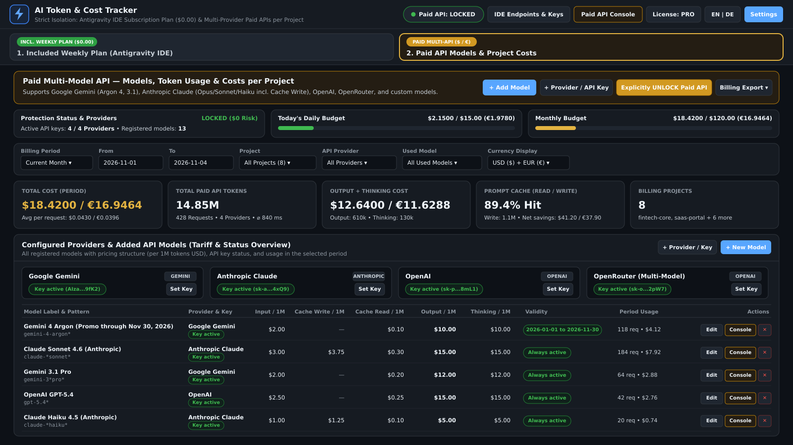
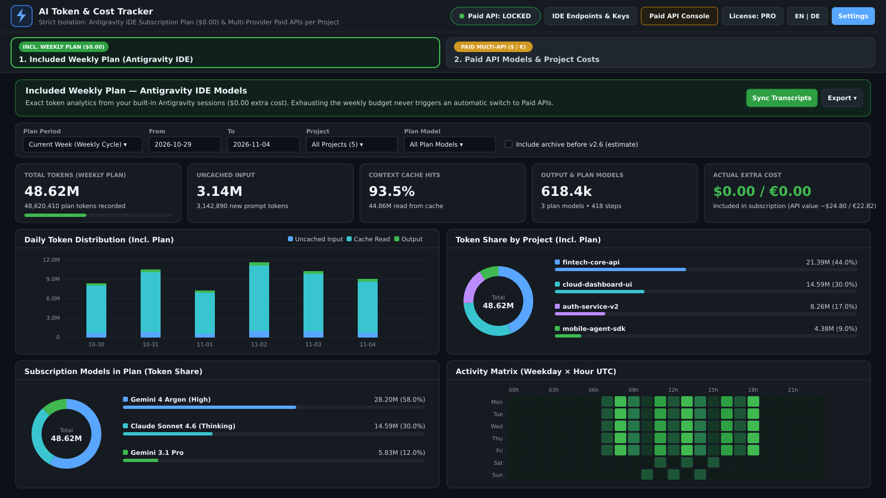
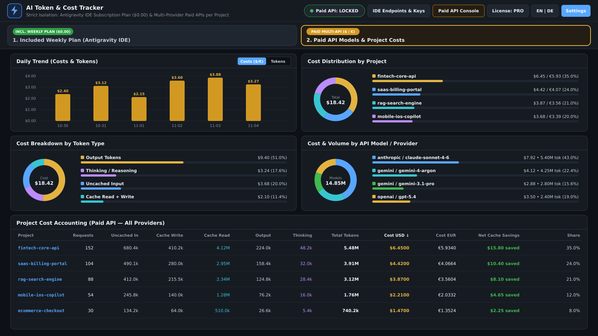
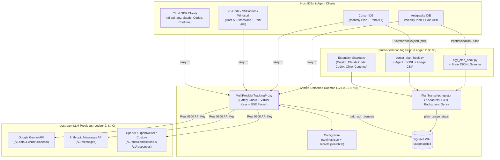

🌐 **Language:** **English** | [Deutsch](./README.de.md)

# ⚡ AI Token & Cost Tracker v1.1.8

**Local-First Multi-Provider LLM Gateway, Per-Project Cost Accounting & IDE-Isolated Subscription Plan Analytics**

[](https://github.com/Vladyslav-Vitko/ai-token-tracker/releases/latest)
[](https://marketplace.visualstudio.com/items?itemName=VladyslavVitko.ai-token-cost-tracker)
[](https://open-vsx.org/extension/VladyslavVitko/ai-token-cost-tracker)
[-3776AB.svg>)](#2-60-second-quickstart--installation)
[-success.svg>)](#9-system-architecture-rest-api--sqlite-schema)
[-critical.svg>)](#5-zero-trust-cost-protection--key-security)
[-f59e0b.svg>)](#8-commercial-licensing-free-vs-pro--team-edition)

[**Install from VS Code Marketplace**](https://marketplace.visualstudio.com/items?itemName=VladyslavVitko.ai-token-cost-tracker) · [**Install from Open VSX**](https://open-vsx.org/extension/VladyslavVitko/ai-token-cost-tracker) · [**Download `.vsix` Release**](https://github.com/Vladyslav-Vitko/ai-token-tracker/releases/latest) · [**60-Second Quickstart**](#2-60-second-quickstart--installation) · [**Get Pro / Team**](#8-commercial-licensing-free-vs-pro--team-edition) · [**Changelog**](./CHANGELOG.md)

> **One Local Control Center for All Your AI Coding Costs:** **AI Token & Cost Tracker v1.1.8** is a 100% local-first (`127.0.0.1:8787`), zero-dependency telemetry gateway and multi-IDE extension for **Antigravity IDE, Cursor, VS Code, VSCodium, Windsurf, and CLI/SDK workflows**. It enforces a strict **Dual-Ledger Architecture** that separates **Included IDE Subscription Plans (`$0.00` extra cost)** from **Paid Multi-Provider API usage (`USD $` / `EUR €`)** across **Google Gemini (incl. Gemini 4 Argon & Carbon), Anthropic Claude, OpenAI, OpenRouter, and custom endpoints** (DeepSeek, Mistral, xAI, Ollama) — complete with per-project cost attribution, hardware-style budget circuit breakers, and `chmod 0600` API key isolation.

---

### Visual Product Tour (`16:9`)

**1. Paid Multi-Provider API Cost Center — Per-Project Attribution, Safety Switch & Budget Guards (`USD $` / `EUR €`):**


**2. Included IDE Subscription Plan Analytics — Zero Cross-IDE Leakage, Cache Hit Ratio & Equivalent API Value Saved (`$0.00`):**


**3. Multi-Provider Model Registry, 2×2 Responsive Analytics Charts & Commercial Pro License Management:**


---

## Table of Contents

1. [Why AI Token & Cost Tracker? (Dual-Ledger Architecture)](#1-why-ai-token--cost-tracker-dual-ledger-architecture)
2. [60-Second Quickstart & Installation (Windows, macOS, Linux, WSL2)](#2-60-second-quickstart--installation)
3. [Multi-IDE Experience, Status Bar & Quick Menu](#3-multi-ide-experience-status-bar--quick-menu)
4. [Context-Aware IDE Isolation (4 Operating Modes)](#4-context-aware-ide-isolation-4-operating-modes)
5. [Zero-Trust Cost Protection & Key Security (`chmod 0600`)](#5-zero-trust-cost-protection--key-security)
6. [Multi-Provider LLM Gateway & Model Pricing Catalog](#6-multi-provider-llm-gateway--model-pricing-catalog)
7. [Connecting SDKs, AI Plugins & CLI (`ai-api` & `tracker-cli`)](#7-connecting-sdks-ai-plugins--cli-ai-api--tracker-cli)
8. [Commercial Licensing (Free vs. Pro / Team Edition)](#8-commercial-licensing-free-vs-pro--team-edition)
9. [System Architecture, REST API & SQLite Schema](#9-system-architecture-rest-api--sqlite-schema)
10. [Troubleshooting, Developer QA & Uninstallation](#10-troubleshooting-developer-qa--uninstallation)

---

<a id="1-why-ai-token--cost-tracker-dual-ledger-architecture"></a>
<a id="why-ai-token--cost-tracker-dual-ledger-architecture"></a>

## 1. Why AI Token & Cost Tracker? (Dual-Ledger Architecture)

Modern AI-assisted software engineering combines **flat-rate IDE subscriptions** (Antigravity Weekly Plan, Cursor Pro Monthly Plan, GitHub Copilot, Claude Code) with **pay-as-you-go API keys** (Google Gemini, Anthropic Claude, OpenAI, OpenRouter, DeepSeek). Without a dedicated local control layer, developers, freelancers, and engineering teams face three critical problems:

1. **Unattributed Client & Repository Spend:** Monthly provider invoices lump all API calls together, making it impossible to attribute costs to specific client projects, repositories, or workflows.
2. **Silent Overage & Auto-Fallback Traps:** Exhausting an included IDE quota can silently fall back to billable API keys, causing unexpected cost spikes.
3. **Contaminated Analytics:** Mixing `$0.00` flat-rate subscription tokens with billable API tokens distorts both financial reporting and prompt-cache efficiency metrics.

**AI Token & Cost Tracker v1.1.8** eliminates these risks at the root via a shared local daemon (`http://127.0.0.1:8787`) backed by two strictly isolated SQLite WAL ledgers:

| Dimension | Ledger 1: Included IDE Subscription Plan (`panel-plan`) | Ledger 2: Paid Multi-Model API (`panel-paid`) |
| :--- | :--- | :--- |
| **Marginal Cost** | **Always `$0.00` / `€0.00`** (covered by your IDE subscription) | **Exact per-request accounting in `USD ($)` & `EUR (€)`** |
| **Data Sources** | Local IDE & AI chat extension transcripts across **7 sources** (`antigravity`, `cursor`, `copilot`, `claude-code`, `codex`, `cline`, `continue`), live IDE quota telemetry & hooks (`agy_plan_hook.py`, `cursor_plan_hook.py`, `claude_plan_hook.py`), 30s background sync & Cursor Usage CSV import | Local Multi-Provider Tracking Reverse Proxy (`/p/<project>/...` and `/p/<project>/v1/...`) |
| **IDE Visibility** | Native Plan IDEs (**Antigravity**, **Cursor**) strictly isolate to their own plan & live circular quota ring gauges (`Weekly` / `5-Hour` / `Monthly` `%` remaining + reset countdown); **VS Code / VSCodium / Windsurf** show active host AI extensions; **Browser Hub** shows **All Active AI Plans & Extensions (`all`)** | Available across **all** IDEs (Antigravity, Cursor, VS Code, VSCodium, Windsurf) and standalone browsers |
| **Token Metrics** | Live IDE Quota Rings (`%` remaining + refresh timer), `Uncached Input`, `Cache Read`, `Output`, `Cache Hit Ratio (%)`, `Equivalent API Value Saved ($)` | `Uncached Input`, `Cache Write (1.25×)`, `Cache Read`, `Output`, `Thinking / Reasoning`, `Net Cache Savings ($)` |
| **Financial Safety** | Dynamic IDE/extension limits (auto-updated across IDE releases); never triggers billable API calls when plan quota is exhausted | Default **`LOCKED ($0.00 risk)`** + gold-framed daily/monthly UTC **USD & Token** circuit breakers (`HTTP 429`) |

---

<a id="2-60-second-quickstart--installation"></a>
<a id="requirements--installation"></a>

## 2. 60-Second Quickstart & Installation

### System Requirements

- **Operating Systems:** **Windows 10/11** (native & WSL2), **macOS** (`launchd`), and **Linux** (`systemd --user`, Desktop, and Remote-SSH).
- **Python Runtime:** `python3 >= 3.10` using **100% Python Standard Library** (`0 pip` and `0 npm` runtime packages; no virtual environments, Docker, or DDEV dependencies).
- **Supported IDEs:** VS Code (`^1.85.0`), Antigravity IDE, Cursor, Windsurf, VSCodium, plus CLI/JetBrains integration via the local proxy and Browser Hub.

### Option A: Zero-Config Extension Install (Recommended — 1 Click)

The extension archive is **100% self-contained**: it embeds both the Webview UI and the complete Python stdlib backend (`extension/backend/`), automatically launching and sharing the background daemon (`127.0.0.1:8787`) on IDE startup.

1. **Install from Registry:**
   - **VS Code:** Install from the [**Visual Studio Marketplace (`VladyslavVitko.ai-token-cost-tracker`)**](https://marketplace.visualstudio.com/items?itemName=VladyslavVitko.ai-token-cost-tracker).
   - **Antigravity IDE, Cursor, Windsurf, VSCodium:** Install from the [**Open VSX Registry (`VladyslavVitko/ai-token-cost-tracker`)**](https://open-vsx.org/extension/VladyslavVitko/ai-token-cost-tracker).
   - **Or Direct `.vsix` Offline Install:** Download [`ai-token-tracker-1.1.8.vsix`](https://github.com/Vladyslav-Vitko/ai-token-tracker/releases/latest) and run `Ctrl+Shift+P` (`Cmd+Shift+P` on macOS) → **`Extensions: Install from VSIX...`**.
2. **Start Working:**
   - Check the bottom-right IDE status bar: `🛡️ Plan: ... | Paid API: LOCKED ($0.00)`.
   - Click the status bar item to open the **Quick Menu**, view your **Included Plan (`$0.00`)** or **Paid API (`$ / €`)** dashboards, configure provider API keys (`chmod 0600`), or open the cross-IDE **Browser Hub** (`http://127.0.0.1:8787`).

### Option B: CLI & Source Service Installation (`./install.sh` — Linux, WSL2, macOS)

If you have a local source checkout and also want terminal CLI symlinks (`ai-api`, `tracker-cli`) in `~/.local/bin` plus an OS-level user service (`systemd --user` or `launchd`):

```bash
# Build & install self-contained local .vsix across all detected IDEs + register OS daemon & CLI tools
./install.sh

# Or install unpinned directly from the Marketplace/Open VSX gallery to keep automatic gallery updates enabled
./install.sh --marketplace
```

What `./install.sh` performs idempotently:
1. Registers the installation path in `~/.config/ai-token-tracker/install_path` and initializes `config/settings.json`, `config/secrets.json` (`chmod 0600`), and SQLite WAL `data/usage.sqlite3`.
2. Symlinks `ai-api`, `agy-api`, `tracker-cli`, and `ai-tracker-server` into `~/.local/bin/`.
3. Registers fail-open lifecycle & quota hooks (`bin/agy_plan_hook.py`, `bin/cursor_plan_hook.py`, and `bin/claude_plan_hook.py`) exclusively for Plan IDEs/CLIs present on the host.
4. Enables the background service (`~/.config/systemd/user/ai-token-tracker.service` on Linux/WSL2 or `~/Library/LaunchAgents/local.ai-token-tracker.plist` on macOS).
5. Packages `vscode-extension/ai-token-tracker-1.1.8.vsix` and installs it across all detected desktop and Remote/WSL IDE servers (`antigravity-ide`, `cursor`, `code`, `code-insiders`, `codium`, `windsurf`).

---

<a id="3-multi-ide-experience-status-bar--quick-menu"></a>
<a id="multi-ide-extension--command-palette"></a>

## 3. Multi-IDE Experience, Status Bar & Quick Menu

Once installed, the extension displays a live, context-aware telemetry widget in the right status bar of your IDE:

- **Default Locked State (`LOCKED` — `$0.00` Financial Risk):**
  - Plan IDEs (Antigravity / Cursor / AI Extensions): `🛡️ Plan: 17.5k | Paid API: LOCKED ($0.00)`
  - API-Only IDEs (without AI chat extensions): `🛡️ Paid API: LOCKED ($0.00 / €0.00)`
- **Armed State (`ARMED` — Highlighted with Warning Background):**
  - `🔥 Plan: 17.5k | Paid API [ARMED]: $3.05 / €2.81`

### Two-Level Quick Menu & Command Palette (`Ctrl+Shift+P` / `Cmd+Shift+P`)

Clicking the status bar widget opens a categorized **two-level QuickPick control center** featuring:
- **Title-Bar Quick Action Buttons:** One-click **Sync/Refresh**, **EN | DE Language Switch**, and **Extension Settings**.
- **Context-Aware Smart Promotions:** Automatically surfaces a **Reload to Activate New Version** action at the top when a background update finishes downloading, or promotes **Service Recovery Actions** if the daemon is offline.
- **Level 2 System, Diagnostics & Service Submenu:** Dedicated maintenance view with `Back` navigation, transcript re-scan, log inspection, Python interpreter selection, and shared daemon restart/stop controls.

| Command ID | Command Palette Title | Action & Scope |
| :--- | :--- | :--- |
| `aiTokenTracker.quickMenu` | **AI Token Tracker: Open Main Menu & Quick Controls** | Opens the two-level QuickPick control menu (dashboards, model launcher, safety lock, API keys, license, browser hub, diagnostics). |
| `aiTokenTracker.openPlanDashboard` | **AI Token Tracker: Open Included IDE Plan ($0.00)** | Opens Tab 1 (`panel-plan`) inside the IDE Webview *(visible when an active plan or AI extension is detected via `aiTokenTracker.hasPlan`)*. |
| `aiTokenTracker.openPaidDashboard` | **AI Token Tracker: Open Paid API & Cost Dashboard ($ / €)** | Opens Tab 2 (`panel-paid` — Multi-Provider Cost Accounting & Model Registry) inside the IDE Webview. |
| `aiTokenTracker.openBrowserHub` | **AI Token Tracker: Open Multi-IDE Hub in Browser** | Opens the unified cross-IDE Web Control Center (`http://127.0.0.1:8787`) in your default browser. |
| `aiTokenTracker.startPaidAgent` | **AI Token Tracker: Paid API — Launch Model Session for Project** | Interactive model picker: launch a tracked terminal (`ai-api`), copy project endpoint & virtual key (`vkey`), or open the API Test Console. |
| `aiTokenTracker.togglePaidLock` | **AI Token Tracker: Paid API — Toggle Spending Safety Lock** | Immediately toggles the global Paid API spending safety switch (`paid_api_armed`: `LOCKED` ↔ `ARMED`). |
| `aiTokenTracker.setApiKey` | **AI Token Tracker: Paid API — Configure Provider API Key (chmod 0600)** | Stores or clears upstream provider API keys via a masked password input box (`chmod 0600`). |
| `aiTokenTracker.manageLicense` | **AI Token Tracker: Manage License & Pro Edition** | Manages Free Community Edition quotas and Pro/Team license activation (Polar.sh, Lemon Squeezy, or Offline `AITT1-*`). |
| `aiTokenTracker.syncPlanTranscripts` | **AI Token Tracker: Re-scan Local Transcripts** | Triggers an immediate incremental SQLite sync across active IDE & AI extension logs (`when: aiTokenTracker.hasPlan`). |
| `aiTokenTracker.selectPython` | **AI Token Tracker: Select Python 3 Interpreter** | File picker to explicitly select a Python `>= 3.10` executable (updates `aiTokenTracker.pythonPath`). |
| `aiTokenTracker.showLogs` | **AI Token Tracker: View Extension & Daemon Output Logs** | Opens the dedicated VS Code Output channel (`View` → `Output` → `AI Token Tracker`) for live diagnostics. |
| `aiTokenTracker.checkForUpdates` | **AI Token Tracker: Check for Updates & Reload New Version** | Queries the extension gallery for updates, detects staged packages, and prompts to reload the extension host. |
| `aiTokenTracker.restartService` | **AI Token Tracker: Restart Background Service (Shared Daemon)** | Cleanly restarts the shared detached `127.0.0.1:8787` daemon (`systemd --user` or detached background process). |
| `aiTokenTracker.stopService` | **AI Token Tracker: Stop Background Service (Shared Daemon)** | Gracefully stops the shared daemon across open IDEs (with active-client lease confirmation when other IDEs are connected). |

> **Shared Multi-IDE Daemon & SemVer Upgrade Handshake:** Multiple IDEs running simultaneously on the same machine share a single detached daemon (`127.0.0.1:8787`, client leases tracked in `data/clients/`, logs rotated in `data/daemon.log`). Closing one IDE window never disconnects other open IDEs. When the extension updates to a newer version, it automatically performs a graceful SemVer upgrade handshake with the running daemon and reloads open Webview/Browser tabs while preserving your SQLite history.

### Extension Settings (`settings.json`)

| Setting | Type | Default | Description |
| :--- | :--- | :--- | :--- |
| `aiTokenTracker.pythonPath` | `string` | `""` | Optional explicit path to a Python 3 (`>= 3.10`) executable (e.g., `C:\Python312\python.exe` or `/usr/bin/python3`). Auto-detected when empty. |
| `aiTokenTracker.servicePath` | `string` | `""` | Optional explicit path to a local `ai-token-tracker` checkout (auto-discovers embedded VSIX backend or `~/.config/ai-token-tracker/install_path` when empty). |
| `aiTokenTracker.apiHost` | `string` | `"127.0.0.1"` | Local bind address of the AI Token Tracker daemon. |
| `aiTokenTracker.apiPort` | `number` | `8787` | Local TCP port of the AI Token Tracker daemon. |
| `aiTokenTracker.language` | `string` | `"en"` | UI and status bar language (`"en"` = English default, `"de"` = German). |
| `aiTokenTracker.updateNotifications` | `boolean` | `true` | Show notification prompts when a new extension version is ready to reload or after updating. |

---

<a id="4-context-aware-ide-isolation-4-operating-modes"></a>
<a id="strict-ide-context-isolation-4-operating-modes"></a>

## 4. Context-Aware IDE Isolation (4 Operating Modes)

Both the IDE status bar and the dashboard automatically adapt to the host environment, enforcing strict tenant isolation so native Plan IDEs never leak foreign IDE telemetry:

### Mode 1: Antigravity IDE (`ide=antigravity`)
- **Tab 1 — Included Weekly Plan (`$0.00`):** Tracks local Antigravity conversation transcripts (`~/.gemini/antigravity/brain/`, `~/.gemini/antigravity-ide/brain/`, step fallbacks, and `.pb` metadata) plus the auto-registered fail-open lifecycle hook (`bin/agy_plan_hook.py`). Reports exact and estimated `Uncached Input`, `Cache Read`, `Output` tokens, cache efficiency, and equivalent API cost saved on a configurable weekly reset cycle.
- **Tab 2 — Paid Multi-Provider API (`$` / `€`):** Full multi-provider cost accounting, budget guards, and model catalog.

### Mode 2: Cursor IDE (`ide=cursor`)
- **Tab 1 — Included Monthly Plan (`$0.00`):** Aligned with Cursor's monthly billing cycle (`month_cycle`, configurable reset day `cursor_monthly_reset_day`) across Cursor subscription models (`claude-*`, `gpt-*`, `gemini-*`).
- **Three Sanctioned Clean-Code Sources (Zero `state.vscdb` Token Scraping):**
  1. Official Cursor lifecycle hook (`~/.cursor/hooks.json` → `stop` → `bin/cursor_plan_hook.py`).
  2. Local Cursor agent transcripts (`~/.cursor/projects/*/agent-transcripts/*.{jsonl,txt,json}`) with automatic workspace project mapping.
  3. Idempotent **Cursor Dashboard Usage CSV Import** (via Dashboard modal or `tracker-cli import-cursor-csv`), deduplicating rows via SHA-256 signatures while automatically filtering out `Usage-Based`, `On-Demand`, `Paid`, or `Overage` rows so Tab 1 remains strictly `$0.00` Included Plan.
- **Strict Isolation:** Cursor never displays Antigravity data, and Antigravity never displays Cursor data.

### Mode 3: VS Code, VSCodium, Windsurf & Multi-Extension IDEs (`vscode`, `vscodium`, `windsurf`, `jetbrains`)
- **Automatic AI Chat Extension Discovery (including Custom VS Code Profiles & WSL/Windows Path Bridge):**
  - Automatically detects installed AI chat extensions and local session transcripts across default and custom VS Code profiles (`User/profiles/*`) for:
    - **Google Antigravity** (`google.google-antigravity`)
    - **GitHub Copilot Chat** (`github.copilot-chat` — delta streams, editing sessions & read-only session fallback)
    - **Anthropic Claude Code** (`anthropic.claude-code` / `~/.claude/projects`)
    - **OpenAI Codex / ChatGPT** (`openai.chatgpt` / `~/.codex/sessions`)
    - **Cline / Roo Code / Kilo Code** (`saoudrizwan.claude-dev`, `rooveterinaryinc.roo-cline`, `kilocode.kilo-code`)
    - **Continue.dev** (`continue.continue` / `~/.continue/sessions`)
  - When one or more AI extensions are active, **Tab 1 (`panel-plan`) unlocks automatically** with a source switcher between **All Active AI Plans & Extensions (`all`)** and each individual extension.
- **Bare API-Only Mode:** If no AI chat extension is installed in the host IDE, Tab 1 is hidden (`has_plan: false`) and the UI opens directly into **Tab 2 (Paid Multi-Provider API)**.

### Mode 4: Standalone Web Browser Hub (`http://127.0.0.1:8787`, `ide=browser`)
- Acts as your **Unified Cross-IDE Control Center (`surface=all`)** across all 7 IDE and extension sources on your workstation.
- Displays interactive **Active IDE & AI Extension Source Cards** preserving each tool's native billing cycle (`Weekly` vs. `Monthly`), an explicit **Mixed Billing Cycle** callout when weekly and monthly plans coexist, and a **`By Model` / `By IDE / Source`** chart breakdown switch.
- **30-Second Background Daemon Sync:** Continuously indexes transcripts across all 7 adapters in the background—so even a second IDE used without installing the extension is accurately tracked in SQLite WAL without breaking native IDE isolation.

---

<a id="5-zero-trust-cost-protection--key-security"></a>
<a id="security-architecture--zero-trust-guarantees"></a>

## 5. Zero-Trust Cost Protection & Key Security (`chmod 0600`)

> [!IMPORTANT]
> **Zero Automatic Fallback to Paid APIs:** When an IDE's weekly or monthly subscription quota is exhausted, AI Token & Cost Tracker **never** switches to billable API keys behind your back.

1. **Hardware-Style Spending Safety Switch (`paid_api_armed: false` by default):**
   - In its default **`PAID API: LOCKED`** state, the local proxy immediately rejects every billable request with `HTTP 403 PERMISSION_DENIED` (`$0.00` financial risk).
   - Paid API requests are only forwarded when you explicitly unlock (**`ARMED`**) the switch via the IDE status bar, Dashboard, or `tracker-cli arm`.
2. **Hard Daily & Monthly UTC Cost & Token Circuit Breakers (`block_on_budget_exceeded: true`):**
   - Configured in a dedicated **gold-framed External Paid API** settings section so Paid API limits are unmistakably separated from `$0.00` IDE subscriptions.
   - Before forwarding any upstream request, the proxy checks cumulative UTC daily and monthly usage against `daily_budget_limit_usd` (default `$15.00`), `monthly_budget_limit_usd` (default `$120.00`), and optional `daily_token_limit` / `monthly_token_limit` caps.
   - Reaching any active threshold immediately blocks further billable requests with `HTTP 429 RESOURCE_EXHAUSTED`.
3. **`chmod 0600` Key Vault & Virtual Project Keys (`vkey`):**
   - Your real upstream provider API keys are stored exclusively on your local disk in `config/secrets.json` with enforced POSIX `0600` owner-only permissions.
   - IDE plugins, CLI scripts, and subshells never receive your real API keys. Instead, they authenticate with a project-scoped **Virtual Key**: `vkey::<project_name>::<local_proxy_token>`.
   - The local proxy validates the token in constant time (`hmac.compare_digest`), attributes the request to `<project_name>`, and injects the real provider key only on the outbound HTTPS connection.
4. **100% Local-First Privacy (GDPR / DSGVO Compliant) & Web Hardening:**
   - Zero cloud telemetry: prompts, completions, project names, and keys never leave your machine (see [PRIVACY.md](./PRIVACY.md)).
   - Protected by strict `Content-Security-Policy` (nonce-guarded in Webviews, `default-src 'self'` in browser), `X-Content-Type-Options: nosniff`, regex input sanitization, and path-traversal guards.

---

<a id="6-multi-provider-llm-gateway--model-pricing-catalog"></a>
<a id="multi-provider-llm-gateway--pricing-engine"></a>

## 6. Multi-Provider LLM Gateway & Model Pricing Catalog

The local reverse proxy (`tracker/proxy_handler.py`) transparently tracks both synchronous JSON responses and **real-time Server-Sent Events (`text/event-stream`)** across all major LLM wire protocols:

### Supported Protocols & Accounting Capabilities

- **Google Gemini Native (`/v1beta/models/...`) & OpenAI-Compat (`/v1/chat/completions`):**
  - Automatically normalizes `/p/<project>/gemini/v1/chat/completions` to `/v1beta/openai/chat/completions`.
  - Extracts `promptTokenCount`, `cachedContentTokenCount`, `candidatesTokenCount`, and **`thoughtsTokenCount`** (Thinking/Reasoning tokens).
  - Supports **Date-Scheduled Tariff Rules (`effective_from` / `effective_until`)** for automatic promotional-to-standard pricing transitions (e.g., `gemini-4-argon` and `gemini-4-carbon`).
- **Anthropic Messages API (`/v1/messages`):**
  - Stateful **Split-Event SSE Accumulator**: combines `input_tokens`, `cache_creation_input_tokens` (**Cache Write**), and `cache_read_input_tokens` (**Cache Read**) from `message_start` with cumulative `output_tokens` from `message_delta`.
  - Calculates exact Prompt Caching economics: Cache Write surcharge (`1.25×` for 5m TTL), Cache Read discount (`0.10×`), and **Net Cache Savings** (`read_discount - write_surcharge`).
- **OpenAI & OpenRouter (`/v1/chat/completions` & `/v1/responses`):**
  - Automatically injects `"stream_options": {"include_usage": true}` into streaming Chat Completions requests so final SSE chunks always report exact token counts.
  - Extracts cached input tokens, cache write tokens, and reasoning tokens (`completion_tokens_details.reasoning_tokens` / `output_tokens_details`).
- **Custom Providers (Local & Cloud):**
  - Dynamically connect any OpenAI-, Anthropic-, or Gemini-compatible endpoint (e.g., **DeepSeek**, **Mistral**, **xAI / Grok**, **Groq**, **Ollama**, **vLLM**, **LM Studio**) via the Dashboard, CLI, or REST API.

### Built-in Model Pricing Schedule (`config/settings.default.json`)

| Provider | Model Pattern | Display Label | Input / 1M | Cache Write / 1M | Cache Read / 1M | Output / 1M | Thinking / 1M | Validity |
| :--- | :--- | :--- | ---: | ---: | ---: | ---: | ---: | :--- |
| `gemini` | `gemini-4-carbon*` | Gemini 4 Carbon (Promo) | `$2.00` | `$0.00` | `$0.10` | `$10.00` | `$10.00` | `2026-01-01` – `2026-11-30` |
| `gemini` | `gemini-4-carbon*` | Gemini 4 Carbon (Standard) | `$4.00` | `$0.00` | `$0.20` | `$20.00` | `$20.00` | from `2026-12-01` |
| `gemini` | `gemini-4-argon*` | Gemini 4 Argon (Promo) | `$2.00` | `$0.00` | `$0.10` | `$10.00` | `$10.00` | `2026-01-01` – `2026-11-30` |
| `gemini` | `gemini-4-argon*` | Gemini 4 Argon (Standard) | `$4.00` | `$0.00` | `$0.20` | `$20.00` | `$20.00` | from `2026-12-01` |
| `gemini` | `gemini-4-hydrogen*` | Gemini 4 Hydrogen (Flash) | `$1.50` | `$0.00` | `$0.075` | `$7.50` | `$7.50` | Always |
| `gemini` | `gemini-3*flash*` | Gemini 3.8 Flash | `$0.75` | `$0.00` | `$0.075` | `$3.75` | `$3.75` | Always |
| `gemini` | `gemini-3*flash-lite*` | Gemini 3.5 Flash-Lite | `$0.30` | `$0.00` | `$0.03` | `$2.50` | `$2.50` | Always |
| `anthropic` | `claude-*fable*` | Claude Fable 5.2 | `$8.00` | `$10.00` | `$0.20` | `$40.00` | `$40.00` | Always |
| `anthropic` | `claude-*opus*` | Claude Opus 5.5 | `$4.00` | `$5.00` | `$0.20` | `$20.00` | `$20.00` | Always |
| `anthropic` | `claude-*sonnet*` | Claude Sonnet 5.5 | `$2.00` | `$2.50` | `$0.10` | `$10.00` | `$10.00` | Always |
| `anthropic` | `claude-*haiku*` | Claude Haiku 5.5 | `$0.10` | `$0.125` | `$0.01` | `$0.50` | `$0.50` | Always |
| `openai` | `gpt-6*astra*` | OpenAI GPT-6 Astra | `$10.00` | `$0.00` | `$1.00` | `$50.00` | `$50.00` | Always |
| `openai` | `gpt-6*sol*` | OpenAI GPT-6.1 Sol | `$2.00` | `$0.00` | `$0.10` | `$10.00` | `$10.00` | Always |
| `openai` | `gpt-6*terra*` | OpenAI GPT-6.1 Terra | `$1.00` | `$0.00` | `$0.05` | `$5.00` | `$5.00` | Always |
| `openai` | `gpt-6*luna*` | OpenAI GPT-6 Luna | `$0.10` | `$0.00` | `$0.01` | `$0.50` | `$0.50` | Always |
| `openai` | `gpt-5*` | OpenAI GPT-5.4 | `$2.50` | `$0.00` | `$0.25` | `$15.00` | `$15.00` | Always |
| `openrouter` | `deepseek/deepseek-v4*` | DeepSeek V4 Pro | `$0.66` | `$0.00` | `$0.022` | `$1.98` | `$1.98` | Always |
| `*` | `*` | Fallback Default Rate | `$2.00` | `$0.00` | `$0.20` | `$10.00` | `$10.00` | Fallback |

---

<a id="7-connecting-sdks-ai-plugins--cli-ai-api--tracker-cli"></a>
<a id="local-proxy-endpoints--sdk--plugin-integration"></a>
<a id="cli-reference-tracker-cli--ai-api"></a>

## 7. Connecting SDKs, AI Plugins & CLI (`ai-api` & `tracker-cli`)

Any external IDE plugin (**Continue, Cline, Roo Code, Kilo Code, JetBrains AI, Zed, Aider**) or custom application can route requests through the local project proxy. Copy your project's **Virtual Key** (`vkey::<project>::<token>`) with one click from the Dashboard (**Endpoints & Keys**), via `ai-api --print-env`, or via `GET /api/ide-connection?project=<project>`.

### 7.1 Local Routing URL Matrix

| Protocol / Target | Local Base URL (Per Project) | Authentication Header |
| :--- | :--- | :--- |
| **Unified OpenAI-Compatible** *(Auto-routes by model name)* | `http://127.0.0.1:8787/p/<project>/v1` | `Authorization: Bearer vkey::<project>::<token>` |
| **Provider-Explicit OpenAI-Compat** *(OpenAI, OpenRouter, DeepSeek, Custom)* | `http://127.0.0.1:8787/p/<project>/<provider>/v1` | `Authorization: Bearer vkey::<project>::<token>` |
| **Anthropic Messages API** (`/v1/messages`) | `http://127.0.0.1:8787/p/<project>/anthropic` | `x-api-key: vkey::<project>::<token>` |
| **Google Gemini Native API** (`/v1beta/models/...`) | `http://127.0.0.1:8787/p/<project>/gemini` *(or `/p/<project>`)* | `X-Goog-Api-Key: vkey::<project>::<token>` |

> **Header-Based Routing Alternative:** Clients with fixed base URLs (`http://127.0.0.1:8787/v1/...`) can pass the project and provider via `X-Project-Name: <project>` and `X-Provider: <provider_id>` HTTP headers.

### 7.2 SDK & Plugin Configuration Examples

#### Continue / Cline / Roo Code (`config.json`)

```json
{
  "models": [
    {
      "title": "Claude Sonnet 5.5 (Tracked via AI Token Tracker)",
      "provider": "openai",
      "model": "claude-sonnet-5-5",
      "apiBase": "http://127.0.0.1:8787/p/my-project/v1",
      "apiKey": "vkey::my-project::<YOUR-LOCAL-PROXY-TOKEN>"
    }
  ]
}
```

#### Python OpenAI SDK (Unified Auto-Routing Across Providers)

```python
from openai import OpenAI

client = OpenAI(
    base_url="http://127.0.0.1:8787/p/erp-portal/v1",
    api_key="vkey::erp-portal::<YOUR-LOCAL-PROXY-TOKEN>",
)

response = client.chat.completions.create(
    model="gemini-4-argon",
    messages=[{"role": "user", "content": "Run a security audit on the database schema."}],
    stream=True,
)
for chunk in response:
    if chunk.choices and chunk.choices[0].delta.content:
        print(chunk.choices[0].delta.content, end="")
```

### 7.3 `ai-api` (and alias `agy-api`) — Per-Project Paid API Launcher

`ai-api` detects your current working directory as the project name (or accepts `--project <name>`), injects `vkey::<project>::<token>` and local proxy base URLs (`GOOGLE_GEMINI_BASE_URL`, `ANTHROPIC_BASE_URL`, `OPENAI_BASE_URL`), and launches tracked CLI agents or scripts (can also be launched directly from the IDE via **`AI Token Tracker: Paid API — Launch Model Session for Project`**):

```bash
# 1. Launch Google Gemini Paid API session (starts 'agy' CLI or tracked shell; --auto-arm unlocks proxy if locked)
ai-api --model gemini-4-argon --effort high --auto-arm

# 2. Launch Anthropic Claude Paid API session (starts 'claude' CLI or tracked shell with ANTHROPIC_BASE_URL)
ai-api --provider anthropic --model claude-sonnet-5-5

# 3. Execute any script or command inside a tracked project environment (--exec or --)
ai-api --project shop2022 --provider openai --model gpt-6.1-sol -- python3 scripts/migrate.py

# 4. Print shell export statements for your current project and provider
eval "$(ai-api --project cms --provider anthropic --model claude-sonnet-5-5 --print-env)"
```

### 7.4 `tracker-cli` — Terminal Administration, Registry & Reports

```bash
# Inspect safety switch status, configured provider keys, daily/monthly spend, and detected Plan IDEs
tracker-cli status

# Explicitly unlock (ARM) or lock (DISARM) Paid API usage
tracker-cli arm
tracker-cli lock

# Store provider API keys securely in config/secrets.json (chmod 0600)
tracker-cli set-key --provider gemini
tracker-cli set-key --provider anthropic
tracker-cli set-key --provider openai
tracker-cli set-key --provider openrouter

# Register a custom OpenAI/Anthropic/Gemini-compatible provider (e.g., DeepSeek, Mistral, Ollama)
tracker-cli add-provider \
  --id deepseek \
  --label "DeepSeek API" \
  --protocol openai \
  --base-url https://api.deepseek.com \
  --key sk-deepseek-...

# List all registered models and pricing rules (optionally filtered by provider)
tracker-cli list-models
tracker-cli list-models --provider anthropic

# Add or update a model tariff rule in the registry (rates per 1M tokens in USD)
tracker-cli add-model \
  --provider deepseek \
  --pattern "deepseek-reasoner*" \
  --label "DeepSeek R1 Reasoner" \
  --input 0.55 \
  --cache-write 0.00 \
  --cached-input 0.14 \
  --output 2.19 \
  --thinking 2.19

# Manually trigger local IDE subscription transcript synchronization or Cursor CSV import
tracker-cli sync --ide all
tracker-cli import-cursor-csv ~/Downloads/cursor-usage.csv --project cms

# Print strictly isolated terminal reports or export HTML/PDF, CSV & JSON reports (Pro/Team)
tracker-cli report --ledger plan --ide antigravity --period week
tracker-cli report --ledger plan --ide cursor --period month_cycle
tracker-cli report --ledger paid --period month --provider all
tracker-cli export --ledger paid --format html --period month --markup 15 --vat 19 --client "Acme GmbH" -o paid_report.html

# Inspect, refresh, activate, or deactivate a commercial Pro / Team license key
tracker-cli license
tracker-cli license --refresh
tracker-cli activate AITT1-PRO-PERPETUAL-...
tracker-cli deactivate
```

---

<a id="8-commercial-licensing-free-vs-pro--team-edition"></a>
<a id="commercial-licensing-free-vs-pro--team-edition"></a>

## 8. Commercial Licensing (Free vs. Pro / Team Edition)

AI Token & Cost Tracker is distributed under a **Dual-Tier Freemium & Commercial Usage License** (see [LICENSE.md](./LICENSE.md) and [PRIVACY.md](./PRIVACY.md)). All safety guardrails (`LOCKED` / `ARMED`, budget circuit breakers) and all `$0.00` Included IDE Plan analytics are **100% free forever**.

The **Commercial Pro & Team Editions** are built for freelancers, agencies, and engineering teams who bill clients by project, manage multiple repositories, or need audit-ready `CSV` / `JSON` accounting exports:

| Feature / Entitlement | Free Community Edition (`FREE`) | Commercial Pro / Team Edition (`PRO` / `TEAM`) |
| :--- | :--- | :--- |
| **Included IDE Subscription Plan Analytics (`$0.00`)** | **Unlimited** (All 7 Plan IDEs & Extensions) | **Unlimited** (All 7 Plan IDEs & Extensions) |
| **Paid API Safety Switch (`LOCKED` / `ARMED`) & Budget Caps** | **Included** | **Included** |
| **Built-in Core Providers (Gemini, Claude, OpenAI, OpenRouter)** | **All 4 included** | **All 4 included** |
| **Tracked Paid API Client / Repository Projects** | Up to **5 projects** | **Unlimited projects** |
| **Custom Providers (DeepSeek, Mistral, Ollama, vLLM, etc.)** | Up to **2 custom providers** | **Unlimited custom providers** |
| **Custom & Date-Scheduled Model Pricing Rules** | Up to **3 custom model rules** | **Unlimited custom model rules** |
| **Cursor Dashboard Usage CSV Import** | Up to **500 rows** per import | **Unlimited bulk CSV import** |
| **Client Invoicing & Tax Accounting Exports (`CSV`, `JSON` & `HTML / PDF`)** | Disabled (`HTTP 402` on all exports) | **Full UTF-8-BOM CSV, JSON & Print-Ready HTML/PDF Reports (`/api/export/*`)** |
| **Pricing & Activation Modes** | **Free forever (`$0.00`)** | Polar.sh Checkout: [**Annual (`$2.08/mo` — `$24.99/yr`, Save 58%)**](https://buy.polar.sh/polar_cl_BPHF2Z8AmhOizEDRbn87n1ynZZDs8jcK9MXle05eXax) · [**Monthly (`$4.99/mo`)**](https://buy.polar.sh/polar_cl_cD8C56yfFsudWCoEfE6Wr8RnROjqU1nZvFocX3ta7cZ) · [**Lifetime (`$49.99`)**](https://buy.polar.sh/polar_cl_2EcUogc92f06pCVToDHs8lhxPJDNi1EBn7P6K1rB7V3) & 100% Offline Signed Keys (`AITT1-PRO-...`) |

### Commercial Pro Checkout Options (Polar.sh)

| Plan | Price | Billing Cycle | Polar.sh Checkout |
| :--- | :--- | :--- | :--- |
| **Annual Pro** *(Save 58% · Best Value)* | **`$24.99/yr`** (`~$2.08/mo`) | Annual subscription, cancel anytime | [**Subscribe Annual Pro (Polar.sh)**](https://buy.polar.sh/polar_cl_BPHF2Z8AmhOizEDRbn87n1ynZZDs8jcK9MXle05eXax) |
| **Monthly Pro** | **`$4.99/mo`** | Monthly subscription, cancel anytime | [**Subscribe Monthly Pro (Polar.sh)**](https://buy.polar.sh/polar_cl_cD8C56yfFsudWCoEfE6Wr8RnROjqU1nZvFocX3ta7cZ) |
| **Lifetime Pro** | **`$49.99`** *(one-time)* | Perpetual license, all future updates | [**Buy Lifetime Pro (Polar.sh)**](https://buy.polar.sh/polar_cl_2EcUogc92f06pCVToDHs8lhxPJDNi1EBn7P6K1rB7V3) |

---

<a id="9-system-architecture-rest-api--sqlite-schema"></a>
<a id="system-architecture--data-flow"></a>
<a id="modern-web-dashboard--accessibility"></a>
<a id="rest-api--sqlite-database-schema"></a>
<a id="project-structure-quality-assurance--marketplace-packaging"></a>

## 9. System Architecture, REST API & SQLite Schema

### 9.1 Hexagonal Architecture & Data Flow

Built on a clean **Ports-and-Adapters (Hexagonal) Architecture** using 100% Python Standard Library (`tracker/`) on the backend and zero-framework Modern Web APIs (`web/`) on the frontend:



### 9.2 Modern Web Dashboard & Accessibility Standards (WCAG 2.2 AA)

Served both at `http://127.0.0.1:8787` and inside the native VS Code Webview without heavy frontend frameworks:
- **Native `<dialog>` Modals & Popover API:** 10 unified `<dialog>` modals (Endpoints & Keys with one-click copy, Model Tariff Editor, Provider & Key Vault, 4-tab Settings [`Safety & Limits` with gold-framed External Paid API USD & token caps, `Currency & Defaults`, `Plan Cycles`, `Diagnostics & Data`] with dirty-state protection, Live IDE Quota Sync & Calibration, API Test Console with protocol-aware reasoning hints, Request Receipt Inspector, Cursor CSV Import, License Manager with live quota meters, and Sticky Bottom-Right Bug Bounty & Feedback Reporter with previewable anonymized diagnostics) plus CSS-Anchor-Positioned export menus (`popover="auto"`).
- **Responsive CSS Container Queries (`@container`):** Fluid component layouts (`sources-area`, `quotas-area`, `kpi-area`, `charts-area`, `providers-area`, `table-card`), live circular SVG quota ring gauges (`Weekly` / `5-Hour` / `Monthly` remaining `%`), and paired full-width SVG charts/heatmaps that adapt cleanly from narrow IDE split panels to ultra-wide monitors.
- **Strict WCAG 2.2 AA & WAI-ARIA Compliance:** Full keyboard navigation (`.skip-link`, `:focus-visible`, arrow-key `role="tablist"` & `role="radiogroup"`), polite live announcements (`aria-live="polite"`), and universal multi-column sorting across all 7 analytics & catalog tables (`aria-sort`, natural string collation, 3-state priority reset).

### 9.3 REST API Endpoints (`tracker/server.py`)

| Method | Route | Description |
| :--- | :--- | :--- |
| `GET` | `/api/health?ide=<hostIde>` | Returns daemon health, version, `paid_api_armed`, masked secret status, spend caps, `ide_context`, and `sync_status`. |
| `GET` | `/api/bootstrap?ide=<hostIde>&plan_surface=<surf>` | Bootstrap payload for Dashboard & QuickPick menus (settings, projects, spend totals, `ide_context`, `sync_status`). |
| `GET` | `/api/stats/plan?ide=<hostIde>&surface=<surf>&period=<p>` | IDE-isolated or unified (`all`) Plan analytics (`weekly`/`monthly`/`mixed` cycle, `by_surface`, `by_model`, `sync_status`). |
| `GET` | `/api/stats/paid?period=<p>&project=<pr>&provider=<pv>&model=<m>` | Paid API cost analytics including enriched model catalog (`configured_models`), provider breakdown, and request log. |
| `GET` | `/api/ide-connection?project=<project>` | Generates all per-project proxy URLs and the `virtual_key` (`vkey::<project>::<token>`). |
| `GET` | `/api/export/plan.csv` / `/api/export/paid.csv` | UTF-8-BOM CSV export of per-project token and cost tables (requires Pro or Team license). |
| `GET` | `/api/export/plan.json` / `/api/export/paid.json` | Full JSON analytics export of plan and paid telemetry (requires Pro or Team license). |
| `GET` | `/api/export/plan.html` / `/api/export/paid.html` | Print-ready HTML / PDF audit & client billing reports with live Markup %, VAT/MwSt. %, and SHA-256 verification hash (requires Pro or Team license). |
| `POST` | `/api/safety/toggle` | Toggles `paid_api_armed` (`true` / `false`). |
| `POST` | `/api/settings` | Updates currency (`primary_display`), safety, budget cap, IDE default, and subscription cycle settings. |
| `POST` | `/api/providers/upsert` / `/api/providers/delete` | Creates, updates, or deletes provider configurations (optionally saving `api_key` atomically). |
| `POST` | `/api/models/upsert` / `/api/models/delete` | Creates, updates, or deletes model pricing rules prior to the wildcard fallback (`*`). |
| `POST` | `/api/secrets/apikey` | Saves or clears API keys for one or multiple providers (`chmod 0600`). |
| `POST` | `/api/plan/sync` | Triggers immediate incremental synchronization of local IDE plan transcripts (`ide`, `exts`, `surface`, `force`). |
| `POST` | `/api/plan/quotas` | Synchronizes or resets (`action: "upsert"` / `"clear"`) live IDE & extension model quota windows (`%` remaining + refresh timestamps). |
| `POST` | `/api/plan/cursor/import-csv` | Imports and idempotently deduplicates official Cursor Dashboard Usage CSV exports (Free limit: 500 rows/import). |
| `POST` | `/api/playground/chat` | Executes an explicit Paid API test prompt through the local tracking proxy with optional reasoning config and cost receipt. |
| `GET` | `/api/license/status` | Returns current license tier (`free`, `pro`, `team`), entitlements, live quota `usage` counters, and masked key status. |
| `POST` | `/api/license/refresh` | Re-verifies active subscription status online with merchant (Polar.sh / Lemon Squeezy) and checks grace periods. |
| `POST` | `/api/license/activate` / `/api/license/deactivate` | Activates or deactivates a commercial Pro / Team license key (Polar.sh, Lemon Squeezy, or Offline `AITT1-*`). |
| `GET` | `/api/feedback/diagnostics` | Returns a sanitized, GDPR-safe technical diagnostic snapshot (`version`, `host_ide`, `os_platform`, `python_version`, `license_tier` — zero API keys or project names). |
| `POST` | `/api/feedback/submit` | Submits a bug report or feedback item (with optional sanitized diagnostics) for the 1-Month Pro Bug Bounty / Priority Gift Key program. |
| `POST` | `/api/admin/shutdown` | Gracefully stops the local daemon process for version upgrades (restricted to local IDE extensions; rejects Origin). |

### 9.4 Local Storage Paths & SQLite WAL Schema (`usage.sqlite3`)

When running from the self-contained Marketplace / `.vsix` extension, all runtime configuration and database files are stored in **`~/.config/ai-token-tracker/`** (or `$AI_TRACKER_DATA_DIR`, preserving any existing local installation):
- `~/.config/ai-token-tracker/config/settings.json` — Active user settings, custom providers, and custom tariff rules.
- `~/.config/ai-token-tracker/config/secrets.json` — Isolated `chmod 0600` provider API keys, proxy token, and license state.
- `~/.config/ai-token-tracker/data/usage.sqlite3` — Local SQLite database in `WAL` mode containing four tables:
  1. **`plan_usage_steps`**: IDE & extension subscription steps (`conversation_id`, `step_index`, `created_at`, `project_name`, `model_name`, `surface` [`antigravity` | `cursor` | `copilot` | `claude-code` | `codex` | `cline` | `continue`], `billing_cycle` [`weekly` | `monthly`], `uncached_input_tokens`, `cached_input_tokens`, `output_tokens`, `total_tokens`, `is_estimated`) with `UNIQUE(conversation_id, step_index)`.
  2. **`plan_sync_state`**: Incremental file-stat index (`transcript_path`, `mtime_ns`, `file_size`, `project_name`, `model_name`, `updated_at`) preventing redundant disk reads.
  3. **`plan_live_quotas`**: Dynamic IDE & AI extension quota pools (`surface`, `group_id`, `group_label`, `window_id`, `window_label`, `window_minutes`, `remaining_pct`, `used_pct`, `remaining_count`, `limit_count`, `resets_at`, `plan_tier`, `source_method`, `updated_at`) with automatic rollover healing.
  4. **`paid_api_requests`**: Audit-grade ledger of billable API calls (`request_uid`, `created_at`, `project_name`, `provider`, `model_name`, `endpoint`, `is_stream`, `http_status`, `latency_ms`, all 6 token counters, `pricing_rule_id`, per-category USD costs, `cache_savings_usd`, `total_cost_usd`, `total_cost_eur`, `client_agent`, `error_message`).

---

<a id="10-troubleshooting-developer-qa--uninstallation"></a>
<a id="uninstallation"></a>

## 10. Troubleshooting, Developer QA & Uninstallation

### Troubleshooting & Common Questions

- **Extension Updates & Pinned VSIX vs. Gallery Auto-Updates:**
  - Extensions installed from the VS Code Marketplace or Open VSX update automatically in the background and prompt you to reload the extension host (`workbench.action.restartExtensionHost`) when ready.
  - Extensions installed manually from a local `.vsix` file are marked `pinned` by VS Code; run `Ctrl+Shift+P` → **`AI Token Tracker: Check for Updates & Reload New Version`** or `./install.sh --marketplace` to switch to unpinned gallery auto-updates.
- **Status Bar Shows `AI Tracker: Offline`:**
  1. Click the status bar item or run `Ctrl+Shift+P` → **`AI Token Tracker: Open Main Menu & Quick Controls`** to trigger auto-recovery.
  2. Run `Ctrl+Shift+P` → **`AI Token Tracker: View Extension & Daemon Output Logs`** to inspect startup logs.
- **"Python 3.10+ required" Notification:**
  - Install Python 3.10 or newer from [python.org/downloads](https://www.python.org/downloads/) (on Windows, ensure **"Add Python to PATH"** is checked), or run **`AI Token Tracker: Select Python 3 Interpreter`** to pick an existing interpreter.
- **Port 8787 Conflict:**
  - Change `"aiTokenTracker.apiPort": 8788` in your IDE settings; the extension and daemon will automatically bind to the new port.

### Developer Quality Gates & Self-Contained VSIX Packaging (Source Checkouts)

```bash
# Run all automated quality suites (Backend E2E, Frontend/WCAG/i18n Audit, Release & OPC VSIX Verification)
python3 tests/test_backend_e2e.py
node tests/test_frontend_ui.mjs
python3 tests/test_release_pipeline.py

# Build self-contained Open Packaging Conventions archive: vscode-extension/ai-token-tracker-1.1.8.vsix
python3 vscode-extension/build_vsix.py
```

### Uninstallation

- **Via IDE:** Right-click **AI Token & Cost Tracker** in the Extensions view and select **Uninstall** (stop the shared background daemon first via **`AI Token Tracker: Stop Background Service`** if you wish to terminate it immediately).
- **Via Standalone Script (`./uninstall.sh`):**
  ```bash
  # Stop background daemon and remove CLI symlinks & IDE lifecycle hooks (preserves SQLite history)
  ./uninstall.sh

  # Complete removal including local SQLite database, runtime settings, and chmod 0600 secrets
  ./uninstall.sh --purge-data
  ```
